# 03 – Modelo de dados do Sistema PMOC

> **Versão:** 1.2 – 27/10/2026 (decisões da auditoria final AF-01 a AF-20 incorporadas: `docs/auditoria-final.md` §5; não há mais pendências PEND)
> **Base:** `docs/00-escopo-prd.md` (RF/RNF/DEC-33 a DEC-42), `docs/02-regras-de-negocio.md` (RN-xxx, decisões D-01 a D-08 com a opção **recomendada**) e `pmoc/01-analise-pmocs-existentes.md` (DEC-01 a DEC-32, §9).
> **Banco:** PostgreSQL (versão mínima 16 [A VALIDAR]).
> **Leitor principal:** IA de código. Nomes de tabelas e colunas em inglês `snake_case`. Valores de enum mantêm os nomes do doc 02 (português, maiúsculas).
> **Decisões de modelagem:** `DM-xx`, listadas na §8. Cada uma é o padrão adotado até nova decisão.

## Convenções

| Item | Regra |
|---|---|
| Chave primária | `id uuid` com `DEFAULT gen_random_uuid()`. O PWA pode gerar o `id` no aparelho (offline, RNF-03) (DM-01). Exceção: `audit_log.id` é `bigint` identity. |
| Chave estrangeira | `{entidade}_id`. FK para usuário: `{papel}_user_id` (ex.: `technician_user_id`). `ON DELETE RESTRICT` em todas (não existe exclusão física de dado de negócio). |
| Enum | Coluna `text` + `CHECK (col IN (...))` (DM-02). Valores na §4. |
| Data de negócio | `date`, calculada no fuso `America/Sao_Paulo` (RNF-12). |
| Data/hora | `timestamptz`, gravada em UTC (RNF-12). |
| Documentos e telefones | Só dígitos, sem máscara (RF-05.5). Máscara só na exibição/PDF. |
| Texto obrigatório | `NOT NULL` **e** `CHECK (btrim(col) <> '')`. Abaixo, "sim" na coluna Obrig. significa as duas coisas para `text`/`varchar`. |
| Obrig. | `sim` = `NOT NULL`. `não` = aceita `NULL`. `cond.` = obrigatório conforme regra descrita (CHECK ou trigger). |
| Exclusão física | Proibida em tabelas de negócio (trigger `BEFORE DELETE` levanta erro). Ver §5.4. |
| **(inferido)** / **[A VALIDAR]** | Mesmo significado do doc 02. |

### Blocos de colunas reutilizados

Em cada tabela, a linha "Blocos" diz quais destes conjuntos ela inclui. As colunas do bloco **não** são repetidas na tabela.

**Bloco `[P]` – padrão** (quase todas as tabelas):

| Coluna | Tipo | Obrig. | Descrição |
|---|---|---|---|
| `id` | `uuid` | sim | PK. |
| `created_at` | `timestamptz` | sim | `DEFAULT now()`. |
| `created_by_user_id` | `uuid` FK `app_user` | não | `NULL` = criado pelo sistema (job, emissão automática) (DM-18). |
| `updated_at` | `timestamptz` | sim | `DEFAULT now()`; atualizado por trigger em todo `UPDATE`. |
| `updated_by_user_id` | `uuid` FK `app_user` | não | `NULL` = sistema. |
| `row_version` | `integer` | sim | `DEFAULT 1`; trigger soma 1 em todo `UPDATE`. Usado para lock otimista e conflito offline (RNF-03). O `UPDATE` da aplicação deve ter `WHERE row_version = :esperado`. |

**Bloco `[L]` – exclusão lógica:**

| Coluna | Tipo | Obrig. | Descrição |
|---|---|---|---|
| `deleted_at` | `timestamptz` | não | `NULL` = registro vivo. Preenchido = excluído logicamente. |
| `deleted_by_user_id` | `uuid` FK `app_user` | não | Quem excluiu. |
| `deletion_reason` | `text` | não | Motivo informado. |

**Bloco `[I]` – imutável** (tabelas só de inclusão):

| Coluna | Tipo | Obrig. | Descrição |
|---|---|---|---|
| `id` | `uuid` | sim | PK. |
| `created_at` | `timestamptz` | sim | `DEFAULT now()`. |
| `created_by_user_id` | `uuid` FK `app_user` | não | `NULL` = sistema. |

Tabela `[I]` tem trigger `BEFORE UPDATE OR DELETE` que levanta erro.

**Bloco `[E]` – endereço** (prefixo `address_`):

| Coluna | Tipo | Obrig. | Descrição |
|---|---|---|---|
| `address_street` | `text` | sim | Logradouro. |
| `address_number` | `varchar(20)` | cond. | Número. Obrigatório se `address_without_number = false`. |
| `address_without_number` | `boolean` | sim | `DEFAULT false`. `true` = imprime "s/n" (CA-05.4). |
| `address_complement` | `text` | não | Complemento (ex.: "KM 159") [A VALIDAR] (DM-14). |
| `address_neighborhood` | `text` | cond. | Bairro. Obrigatório em `executor_company` e `technical_responsible` (análise §2.1); opcional nas demais. |
| `address_city` | `text` | sim | Cidade. |
| `address_state` | `char(2)` | sim | UF. `CHECK` contra a lista das 27 UFs. |
| `address_zip` | `char(8)` | sim | CEP, `CHECK (address_zip ~ '^[0-9]{8}$')` (CA-05.3). |

Restrição do bloco: `CHECK ((address_without_number AND address_number IS NULL) OR (NOT address_without_number AND address_number IS NOT NULL))`.

---

## 1. Visão geral

| Grupo | Tabelas |
|---|---|
| Acesso | `app_user`; tabelas do Better Auth `auth_*` (§2.1, AF-04) |
| Empresa e RT | `executor_company`, `technical_responsible`, `rt_certificate` |
| Cadastros do cliente | `client`, `site`, `contract` |
| Biblioteca | `equipment_type`, `equipment_group`, `activity_template` |
| Equipamentos | `equipment`, `equipment_tag_counter` |
| PMOC | `pmoc`, `pmoc_activity`, `pmoc_version`, `pmoc_ficha_export` |
| Cronograma e execução | `occurrence`, `occurrence_record` |
| Visitas (OS, D-01) | `visit`, `visit_occurrence`, `visit_schedule_change`, `visit_equipment_note`, `photo` |
| Relatório | `visit_report`, `visit_report_version` |
| Assinaturas | `document_signature`, `document_follow_up_note` |
| Suporte | `stored_file`, `notification`, `idempotency_key`, `audit_log` |
| Decididas em 21/10/2026 e 27/10/2026 (bloco E; ver §2.12 e §2.13) | `security_event`, `job_run`, `device`, `sync_review_item`, `visit_receipt`, `standard_text`, `data_subject_request`, `rate_limit_counter`; tabelas do Better Auth `auth_*` |

Fora do modelo (por decisão do PRD): qualidade do ar (DEC-13), manutenção corretiva (DEC-11), PDF da ART (DEC-15), multiempresa / `tenant_id` (DEC-34, RNF-02), login do RT (DEC-07).

---

## 2. Entidades e campos

### 2.1 Acesso

#### `app_user` – usuário do sistema
Blocos: `[P]`. Sem `[L]`: usuário nunca é excluído, só inativado (RN-141).

| Coluna | Tipo | Obrig. | Descrição |
|---|---|---|---|
| `name` | `text` | sim | Nome completo. |
| `email` | `citext` | sim | Login. Único em toda a tabela (CA-02.2). |
| `auth_user_id` | `text` FK `auth_user` | sim | `UNIQUE`. Liga ao usuário do Better Auth (AF-04). Mesmo tipo do `id` do Better Auth (`text` no padrão da biblioteca). **Sem** coluna de senha em `app_user`: senha (hash scrypt, mínimo 8 caracteres), sessões e segundo fator ficam nas tabelas `auth_*` (decisões B6 e E5). A senha nunca vai para auditoria nem logs. |
| `role` | `text` enum `user_role` | sim | Exatamente um perfil (PRD §3.1). |
| `client_id` | `uuid` FK `client` | cond. | Obrigatório se `role = 'CLIENTE'`; proibido nos outros perfis (RN-169). |
| `phone` | `varchar(11)` | não | Só dígitos, 10 ou 11 [A VALIDAR] (RF-02.3). |
| `status` | `text` enum `active_status` | sim | `DEFAULT 'ATIVO'` (RN-140). |
| `inactivated_at` | `timestamptz` | cond. | Obrigatório se `status = 'INATIVO'`. |

#### Tabelas do Better Auth (`auth_*`) – decisão AF-04

O Better Auth tem tabelas próprias, separadas de `app_user`. Elas guardam só o que a biblioteca usa para entrar no sistema.

| Tabela | Conteúdo | Observação |
|---|---|---|
| `auth_user` | Usuário da biblioteca (e-mail de login, nome, campos dos plugins `admin` e `twoFactor`) | 1 : 1 com `app_user` por `app_user.auth_user_id` |
| `auth_session` | Sessões (cookie), com expiração por perfil (06 SEG-10) | Revogação = apagar a linha (feito pela biblioteca) |
| `auth_account` | Credencial (hash scrypt da senha) | A senha nunca sai daqui |
| `auth_verification` | Tokens de uso único: link de senha inicial (72 h) e de recuperação (30 min) (06 SEG-15) | Substitui a antiga `password_reset_token`, que **não existe** |
| `auth_two_factor` | Segredo TOTP e códigos de recuperação do ADM (RN-194) | Só `ADM` no MVP |
| `auth_rate_limit` | Contadores de tentativas de login e de TOTP (06 SEG-60, SEG-62) | Armazenamento `database` do limitador da biblioteca |

Regras (AF-04):
1. Os nomes das tabelas são configurados no Better Auth (`modelName`) com o prefixo `auth_`; colunas no padrão do adaptador Drizzle da biblioteca. Os nomes exatos das colunas dos plugins na versão 1.7 são conferidos no spike S-04 (doc 05 §10.4); a ligação e os nomes das tabelas acima não mudam.
2. As tabelas `auth_*` ficam **fora** do trigger de auditoria (§5.3) e **sem** RLS (doc 05 §4.2). A trilha de acesso (login, falha, bloqueio, troca de senha, segundo fator, sessão revogada) vai para `security_event` (06 §3.3.3).
3. A fonte de verdade de perfil, cliente e situação é `app_user` (`role`, `client_id`, `status`). Os campos equivalentes do plugin `admin` (papel, banimento) são cópia, atualizada pelo módulo `acesso` na mesma operação.
4. O e-mail de login fica em `auth_user` e em `app_user.email`. Só o módulo `acesso` altera e-mail, e altera os dois; um teste de integração confere que são iguais.
5. Criar usuário: o módulo `acesso` cria o `auth_user` pela API do Better Auth e depois o `app_user` em `withTransaction`; se o segundo passo falhar, apaga o `auth_user` criado (compensação).
6. Leituras de `app_user` feitas por ganchos do Better Auth (ex.: recusar login de usuário `INATIVO`, RN-141) usam `withTransaction` com contexto `SISTEMA` (ator vazio, `app.source = 'SISTEMA'`), nunca conexão sem contexto, porque a RLS de `app_user` falha fechada.
7. "Último login" não é coluna: é o último `security_event` com `event_type = 'LOGIN_OK'` do usuário.

### 2.2 Empresa executora e RT

#### `executor_company` – empresa executora (registro único)
Blocos: `[P]`, `[E]` (bairro obrigatório). Exatamente uma linha (RF-04.1, DEC-34).

| Coluna | Tipo | Obrig. | Descrição |
|---|---|---|---|
| `singleton` | `boolean` | sim | `DEFAULT true`, `UNIQUE`, `CHECK (singleton)`. Garante uma única linha. |
| `legal_name` | `text` | sim | Razão social. |
| `cnpj` | `char(14)` | sim | Ver regra de CNPJ em `client.cnpj`. |
| `phone` | `varchar(11)` | sim | Só dígitos. |
| `crea_registration` | `text` | sim | Registro CREA (ex.: `1388695`). |
| `logo_file_id` | `uuid` FK `stored_file` | sim | Logo do cabeçalho dos PDFs. |

#### `technical_responsible` – responsável técnico (registro único)
Blocos: `[P]`, `[E]` (bairro obrigatório). Pessoa física, campos separados da empresa (DEC-29). Não é usuário (DEC-07).

| Coluna | Tipo | Obrig. | Descrição |
|---|---|---|---|
| `singleton` | `boolean` | sim | Igual a `executor_company.singleton` (DEC-14). |
| `full_name` | `text` | sim | Nome do profissional. |
| `professional_title` | `text` | sim | Título (ex.: "Engenheiro Responsável"). |
| `registration_number` | `text` | sim | Nº de registro profissional. |
| `phone` | `varchar(11)` | sim | Só dígitos. |
| `email` | `citext` | sim | E-mail do RT. |

#### `rt_certificate` – certificado e-CPF do RT
Blocos: `[P]`, `[L]`. Guarda o histórico de certificados; só um é o atual.

| Coluna | Tipo | Obrig. | Descrição |
|---|---|---|---|
| `technical_responsible_id` | `uuid` FK `technical_responsible` | sim | Titular. |
| `certificate_type` | `text` enum `certificate_type` | sim | `A1` no MVP (P4). |
| `encrypted_pkcs12` | `bytea` | sim | Arquivo do certificado criptografado pela aplicação (RNF-09) (DM-11). |
| `encrypted_password` | `bytea` | sim | Senha criptografada. |
| `encryption_key_ref` | `text` | sim | Identificador da chave usada (permite rotação). |
| `holder_name` | `text` | sim | Titular lido do certificado (RF-04.4). |
| `serial_number` | `text` | sim | Nº de série do certificado. |
| `issuer_name` | `text` | não | Autoridade certificadora. |
| `valid_from` | `timestamptz` | sim | Início da validade. |
| `valid_until` | `timestamptz` | sim | Fim da validade. `CHECK (valid_until > valid_from)`. |
| `is_current` | `boolean` | sim | `DEFAULT false`. No máximo um `true` (índice parcial único). |

Estado `VALIDO` / `A_VENCER` / `VENCIDO` **não é gravado**: é calculado de `valid_until` contra hoje, com 30 dias de antecedência (RN-153, prazo [A VALIDAR]). `encrypted_pkcs12`, `encrypted_password` nunca vão para a interface, logs ou `audit_log` (RN-121).

### 2.3 Cliente, local e contrato

#### `client` – cliente (proprietário, pessoa jurídica)
Blocos: `[P]`, `[L]`, `[E]` (bairro opcional).

| Coluna | Tipo | Obrig. | Descrição |
|---|---|---|---|
| `legal_name` | `text` | sim | Razão social. |
| `trade_name` | `text` | não | Nome fantasia. |
| `cnpj` | `char(14)` | sim | Sem máscara. `CHECK (cnpj ~ '^[0-9A-Z]{12}[0-9]{2}$')` (DM-13) + função `is_valid_cnpj(cnpj)` no `CHECK` (dígito verificador, CA-05.1). CPF é rejeitado pelo tamanho (DEC-17, CA-05.2). Único entre vivos. |
| `phone_1` | `varchar(11)` | não | Só dígitos, 10 ou 11. |
| `phone_2` | `varchar(11)` | não | Só se `phone_1` preenchido; `CHECK (phone_2 IS NULL OR (phone_1 IS NOT NULL AND phone_2 <> phone_1))` (RF-05.3). |

Exclusão lógica só se o cliente não tiver local vivo (inferido). Cliente não tem `status` ATIVO/INATIVO (DM-10).

#### `site` – local (instalação climatizada)
Blocos: `[P]`, `[L]`, `[E]` (bairro opcional).

| Coluna | Tipo | Obrig. | Descrição |
|---|---|---|---|
| `client_id` | `uuid` FK `client` | sim | Dono do local (DEC-03). |
| `code` | `varchar(10)` | sim | Código usado na TAG (ex.: `L012`). Gerado pelo sistema, único em toda a tabela (inclusive excluídos), **imutável** (trigger bloqueia `UPDATE` da coluna) (RN-047). Regra de geração: DM-19 [A VALIDAR]. |
| `name` | `text` | sim | Nome da instalação (impresso em "Dados da instalação"). |
| `phone` | `varchar(11)` | não | Só dígitos. |

Exclusão lógica só se o local não tiver contrato nem equipamento vivo (inferido).

#### `contract` – contrato do local
Blocos: `[P]`, `[L]`.

| Coluna | Tipo | Obrig. | Descrição |
|---|---|---|---|
| `site_id` | `uuid` FK `site` | sim | Um contrato pertence a um local (RF-07.1). |
| `start_date` | `date` | sim | Início da vigência. Mês 1 = mês desta data (RN-021). |
| `end_date` | `date` | sim | Fim da vigência. `CHECK (end_date > start_date)` (RF-07.2). |
| `month_count` | `smallint` | sim | `GENERATED ALWAYS AS (((EXTRACT(YEAR FROM end_date) - EXTRACT(YEAR FROM start_date)) * 12 + EXTRACT(MONTH FROM end_date) - EXTRACT(MONTH FROM start_date) + 1)::smallint) STORED`. Nº de meses `N` (RN-022, D-03 a). |
| `art_number` | `text` | sim | Nº da ART. Obrigatório ao salvar o contrato (RN-176, decisão B8; DM-09). |
| `th_code` | `varchar(30)` | não | Código TH (ex.: `TH12326`), digitado (DEC-02, DEC-21). |
| `revision` | `varchar(10)` | não | Revisão (ex.: `R1`), digitada; nunca incrementada pelo sistema (RN-016). |
| `status` | `text` enum `contract_status` | sim | Derivado das datas pelo job diário, exceto `CANCELADO` (RN-142). |
| `cancelled_on` | `date` | cond. | Obrigatório se `status = 'CANCELADO'`; `CHECK (cancelled_on BETWEEN start_date AND end_date)` (RN-144, D-08 a). |
| `cancellation_reason` | `text` | cond. | Obrigatório se `status = 'CANCELADO'` (único motivo obrigatório entre agenda, correções e cancelamentos, decisão R2 2.5; a redefinição de segundo fator mantém motivo, RN-194). Só `A_INICIAR` ou `VIGENTE` pode ser cancelado (RN-144; decisão R2 2.6). |
| `previous_contract_id` | `uuid` FK `contract` | não | Contrato anterior do mesmo local (renovação, RF-15). |
| `renewal_confirmed_at` | `timestamptz` | não | Quando o ADM acionou "Confirmar renovação" neste contrato novo (RN-192; decisão R2 2.1 c). Só pode ser preenchido se `previous_contract_id` não é `NULL`. Nome confirmado (AF-02). |
| `renewal_confirmed_by_user_id` | `uuid` FK `app_user` | cond. | Quem confirmou; obrigatório se `renewal_confirmed_at` preenchido. Nome confirmado (AF-02). |

Restrições:
- Sem sobreposição no mesmo local (RN-143): `EXCLUDE USING gist (site_id WITH =, daterange(start_date, end_date, '[]') WITH &&) WHERE (status <> 'CANCELADO' AND deleted_at IS NULL)`. Requer extensão `btree_gist`.
- `start_date` e `end_date` imutáveis quando `pmoc.status <> 'RASCUNHO'` (RN-145) – trigger.
- Exclusão lógica só se o PMOC não existir ou estiver `RASCUNHO` (inferido).

### 2.4 Biblioteca de tipos e atividades

#### `equipment_type` – tipo de equipamento
Blocos: `[P]`, `[L]`.

| Coluna | Tipo | Obrig. | Descrição |
|---|---|---|---|
| `name` | `text` | sim | Ex.: `Split`. Único entre vivos (comparação sem caixa) (inferido). |
| `plural_name` | `text` | não | Plural para a seção 5 ("2 (dois) Splits") (RN-050) [A VALIDAR]. Se nulo, usa `name`. |
| `acronym` | `varchar(5)` | sim | Sigla da TAG (ex.: `SPL`). `CHECK (acronym ~ '^[A-Z]{2,5}$')` [A VALIDAR: formato] (RN-040). Única entre vivos. Imutável depois que existir equipamento do tipo (trigger) (inferido de RN-046). |
| `status` | `text` enum `active_status` | sim | `INATIVO` = some de novos PMOCs (RN-044, RN-152). |

#### `equipment_group` – grupo permitido do tipo
Blocos: `[P]`, `[L]`.

| Coluna | Tipo | Obrig. | Descrição |
|---|---|---|---|
| `equipment_type_id` | `uuid` FK `equipment_type` | sim | Tipo ao qual o grupo pertence. |
| `name` | `text` | sim | Ex.: `Hi-Wall`, `Cassete`. Único por tipo entre vivos. |
| `status` | `text` enum `active_status` | sim | Grupo `INATIVO` não aparece para novos equipamentos. |

`UNIQUE (id, equipment_type_id)` para a FK composta de `equipment` (RN-041). Tipo `ATIVO` deve ter ≥ 1 grupo `ATIVO` (RN-040) – validado na aplicação.

#### `activity_template` – atividade padrão da biblioteca
Blocos: `[P]`, `[L]`.

| Coluna | Tipo | Obrig. | Descrição |
|---|---|---|---|
| `equipment_type_id` | `uuid` FK `equipment_type` | sim | Tipo dono da atividade. |
| `title` | `text` | sim | Título (único campo descritivo; sem procedimento, DEC-27). Único por tipo entre vivos (inferido). |
| `default_periodicity` | `text` enum `periodicity` | sim | Periodicidade padrão (DEC-04). |
| `nature` | `text` enum `activity_nature` | sim | `VERIFICACAO` ou `MEDICAO`. |
| `unit` | `varchar(20)` | cond. | Obrigatória se `MEDICAO`, proibida se `VERIFICACAO` (RN-042). |
| `requires_photo` | `boolean` | sim | `DEFAULT false`. `true` = a ocorrência não é finalizada sem ao menos 1 foto do equipamento na visita (RN-185; decisão R2 2.7 a). Nome confirmado (AF-02). |
| `display_order` | `integer` | sim | Ordem de exibição dentro da periodicidade (RN-051). |
| `status` | `text` enum `active_status` | sim | `INATIVO` = não entra em novos PMOCs (RN-044). |

`CHECK ((nature = 'MEDICAO' AND unit IS NOT NULL AND btrim(unit) <> '') OR (nature = 'VERIFICACAO' AND unit IS NULL))`. Sem faixa de aceitação (DEC-10).

### 2.5 Equipamentos

#### `equipment` – equipamento instalado no local
Blocos: `[P]`, `[L]`.

| Coluna | Tipo | Obrig. | Descrição |
|---|---|---|---|
| `site_id` | `uuid` FK `site` | sim | Local (RF-09.1). Imutável. |
| `equipment_type_id` | `uuid` FK `equipment_type` | sim | Tipo. Imutável depois de existir `occurrence_record` do equipamento (RN-049). Implementado imutável desde a criação, porque a TAG leva a sigla do tipo (trigger `equipment_rules`, 0013) `[A VALIDAR]` (04 TL-111, notas da Etapa 3). |
| `equipment_group_id` | `uuid` | sim | FK composta `(equipment_group_id, equipment_type_id)` → `equipment_group (id, equipment_type_id)` (RN-041). |
| `location_description` | `text` | sim | Ambiente / localização interna (ex.: "Consultório 03") (CA-09.3). |
| `brand` | `text` | não | Marca. |
| `model` | `text` | não | Modelo. |
| `serial_number` | `text` | não | Nº de série. |
| `capacity` | `numeric(12,2)` | não | Capacidade. `CHECK (capacity > 0)`. |
| `capacity_unit` | `varchar(20)` | cond. | Obrigatória se `capacity` preenchida. `DEFAULT 'BTU/h'` [A VALIDAR] (RN-052). |
| `tag_sequence` | `smallint` | sim | Sequencial por local + tipo, a partir de 1 (RN-046). `CHECK (tag_sequence BETWEEN 1 AND 999)` [A VALIDAR: acima de 999]. |
| `tag` | `varchar(30)` | sim | `{site.code}-{equipment_type.acronym}-{lpad(tag_sequence,3,'0')}` (ex.: `L012-SPL-003`). Gerada em `INSERT`; única em toda a tabela (inclusive excluídos e inativos); imutável (trigger). Gerada pelo trigger `equipment_tag` e travada, com local e sequencial, pelo `equipment_rules` (migração 0013). |
| `status` | `text` enum `active_status` | sim | `INATIVO` em vez de excluir quando há histórico (RN-048). |
| `inactivated_at` | `timestamptz` | cond. | Obrigatório se `INATIVO`. Base do recálculo de RN-068. |

Restrições: `UNIQUE (site_id, equipment_type_id, tag_sequence)`; `UNIQUE (tag)`. Exclusão lógica só sem `occurrence_record` (RN-048); o trigger `equipment_rules` (0013) recusa a exclusão com registro.

#### `equipment_tag_counter` – contador da TAG
Sem blocos (tabela técnica). Garante que o sequencial nunca é reutilizado (CA-09.2).

| Coluna | Tipo | Obrig. | Descrição |
|---|---|---|---|
| `site_id` | `uuid` FK `site` | sim | PK composta (1/2). |
| `equipment_type_id` | `uuid` FK `equipment_type` | sim | PK composta (2/2). |
| `last_sequence` | `smallint` | sim | Último sequencial usado. Só aumenta. |

Uso obrigatório na criação do equipamento, na mesma transação:
```sql
INSERT INTO equipment_tag_counter (site_id, equipment_type_id, last_sequence)
VALUES (:site_id, :type_id, 1)
ON CONFLICT (site_id, equipment_type_id)
DO UPDATE SET last_sequence = equipment_tag_counter.last_sequence + 1
RETURNING last_sequence;
```

### 2.6 PMOC

#### `pmoc` – PMOC do contrato
Blocos: `[P]`, `[L]` (exclusão lógica só em `RASCUNHO`).

| Coluna | Tipo | Obrig. | Descrição |
|---|---|---|---|
| `contract_id` | `uuid` FK `contract` | sim | `UNIQUE`: um contrato tem exatamente um PMOC (RN-001, D-02 a). |
| `status` | `text` enum `pmoc_status` | sim | `DEFAULT 'RASCUNHO'`. Espelha a versão atual (§6.2). |
| `current_version_number` | `integer` | cond. | `NULL` em `RASCUNHO`; preenchido a partir da 1ª emissão. |
| `first_issued_at` | `timestamptz` | não | Data/hora da 1ª emissão (marca o congelamento do cronograma, RN-009). |
| `historic_since` | `timestamptz` | cond. | Obrigatório se `status = 'HISTORICO'` (RN-014). |
| `copied_from_pmoc_id` | `uuid` FK `pmoc` | não | PMOC do contrato anterior usado como ponto de partida (RN-004). |

`CHECK (status IN ('RASCUNHO', 'HISTORICO') OR current_version_number IS NOT NULL)` (`pmoc_version_when_issued`, migração 0012): o PMOC em `RASCUNHO` também vira `HISTORICO`, sem versão (RN-014; A5).

#### `pmoc_activity` – plano do PMOC (cópia das atividades da biblioteca)
Blocos: `[P]`. Cópia independente da biblioteca (RN-003).

| Coluna | Tipo | Obrig. | Descrição |
|---|---|---|---|
| `pmoc_id` | `uuid` FK `pmoc` | sim | PMOC dono do plano. |
| `equipment_type_id` | `uuid` FK `equipment_type` | sim | Tipo ao qual a atividade se aplica (vale para todos os equipamentos do tipo, RN-026). |
| `activity_template_id` | `uuid` FK `activity_template` | não | Origem na biblioteca. `NULL` = incluída manualmente no plano (RF-10.3 [A VALIDAR]). |
| `title` | `text` | sim | Copiado da biblioteca. |
| `periodicity` | `text` enum `periodicity` | sim | Periodicidade efetiva neste PMOC (só ADM altera, RN-026, RN-168). |
| `nature` | `text` enum `activity_nature` | sim | Copiada. |
| `unit` | `varchar(20)` | cond. | Copiada; mesmo `CHECK` de `activity_template`. |
| `requires_photo` | `boolean` | sim | Copiada de `activity_template.requires_photo`; o ADM pode alterar no plano (auditado). |
| `display_order` | `integer` | sim | Copiada. |
| `removed_at` | `timestamptz` | não | Atividade retirada do plano (RF-10.3). Linha nunca é apagada porque pode ter ocorrências. |
| `removed_by_user_id` | `uuid` FK `app_user` | não | Quem retirou. |

`UNIQUE (pmoc_id, activity_template_id) WHERE activity_template_id IS NOT NULL AND removed_at IS NULL`. Mudança de `periodicity` vai para `audit_log` com valor anterior e novo (CA-10.2).

#### `pmoc_version` – versão emitida do PMOC
Blocos: `[P]`. Uma linha por emissão (RN-016, RNF-15).

| Coluna | Tipo | Obrig. | Descrição |
|---|---|---|---|
| `pmoc_id` | `uuid` FK `pmoc` | sim | PMOC. |
| `client_id` | `uuid` FK `client` | sim | Desnormalizado para a RLS do portal (AF-06): preenchido por trigger no `INSERT` a partir de `pmoc` → `contract` → `site.client_id`; imutável. |
| `version_number` | `integer` | sim | 1, 2, 3… `UNIQUE (pmoc_id, version_number)`. |
| `status` | `text` enum `pmoc_version_status` | sim | Ver §4. |
| `is_current` | `boolean` | sim | Versão vigente. Um `true` por PMOC (índice parcial único). |
| `issue_reason` | `text` | não | Motivo da nova versão (ex.: "inclusão de 2 equipamentos"). |
| `snapshot` | `jsonb` | sim | Todos os dados usados para gerar o PDF (empresa, RT, cliente, local, contrato com TH/revisão, equipamentos, plano, cronograma). Imutável (§6.2). |
| `snapshot_schema_version` | `smallint` | sim | Versão do formato do `snapshot`. |
| `pdf_file_id` | `uuid` FK `stored_file` | sim | PDF assinado pelo RT (o que o cliente lê e assina). |
| `pdf_sha256` | `char(64)` | sim | Hash de `pdf_file_id`. |
| `rt_signature_method` | `text` enum `rt_signature_method` | sim | `AUTOMATICA_A1` no MVP (RN-120). |
| `rt_certificate_id` | `uuid` FK `rt_certificate` | cond. | Obrigatório se `AUTOMATICA_A1`. |
| `rt_signed_at` | `timestamptz` | sim | Data/hora da assinatura do RT. |
| `client_signed_pdf_file_id` | `uuid` FK `stored_file` | cond. | PDF final com bloco de evidências (RNF-08). Obrigatório se `status = 'ASSINADO_CLIENTE'`. |
| `client_signed_pdf_sha256` | `char(64)` | cond. | Hash do PDF final. |
| `issued_at` | `timestamptz` | sim | Data/hora da emissão. |
| `issued_by_user_id` | `uuid` FK `app_user` | sim | ADM que emitiu. |
| `renderer_version` | `text` | sim | `APP_VERSION` que gerou o PDF (INT-21; decisão E4). |
| `verification_code` | `text` | sim | Código de verificação impresso no PDF, aleatório de 128 bits, `UNIQUE` (INT-14; decisões B7 e D6). |
| `superseded_at` | `timestamptz` | cond. | Obrigatório se `is_current = false`. |

Todas as colunas, exceto `status`, `is_current`, `client_signed_pdf_*` e `superseded_at`, são imutáveis após o `INSERT` (trigger).

#### `pmoc_ficha_export` – "ficha atualizada" gerada sob demanda
Blocos: `[I]`. Registro de cada PDF gerado pela RN-131 (DM-16).

| Coluna | Tipo | Obrig. | Descrição |
|---|---|---|---|
| `pmoc_id` | `uuid` FK `pmoc` | sim | PMOC. |
| `data_as_of` | `timestamptz` | sim | Registros considerados até este instante (rodapé "gerado em"). |
| `file_id` | `uuid` FK `stored_file` | sim | PDF gerado (sem assinatura). |
| `renderer_version` | `text` | sim | `APP_VERSION` que gerou o PDF (INT-21; decisão E4). |

### 2.7 Cronograma e execução

#### `occurrence` – ocorrência (equipamento × atividade × mês)
Blocos: `[P]`. Criada na **1ª emissão** do PMOC (DM-05); só para meses previstos (DM-04).

| Coluna | Tipo | Obrig. | Descrição |
|---|---|---|---|
| `pmoc_id` | `uuid` FK `pmoc` | sim | Denormalizado para consulta da ficha. Deve ser igual a `pmoc_activity.pmoc_id` (trigger). |
| `pmoc_activity_id` | `uuid` FK `pmoc_activity` | sim | Atividade do plano. |
| `equipment_id` | `uuid` FK `equipment` | sim | Equipamento. Deve ser do local do contrato e do mesmo tipo da atividade (trigger). |
| `month_index` | `smallint` | sim | Mês do contrato, 1..`contract.month_count` (RN-023). |
| `reference_month` | `date` | sim | 1º dia do mês de calendário do `month_index`. `CHECK (EXTRACT(DAY FROM reference_month) = 1)`. |
| `due_date` | `date` | sim | Último dia do mês (RN-028). `CHECK (due_date = (reference_month + INTERVAL '1 month' - INTERVAL '1 day')::date)`. |
| `status` | `text` enum `occurrence_status` | sim | Estado atual (RN-023 a RN-032, §7.4 do doc 02). |
| `pending_since` | `date` | cond. | Data em que virou `PENDENTE` (RN-029). Obrigatório se `status = 'PENDENTE'`; mantido depois da resolução (histórico de que houve pendência). |
| `unscheduled_reason` | `text` enum `unscheduled_reason` | cond. | Obrigatório se e somente se `status = 'NAO_PREVISTA'`. |
| `unscheduled_at` | `timestamptz` | cond. | Idem. |

Restrições: `UNIQUE (pmoc_activity_id, equipment_id, month_index)`. `status IN ('OK','NOK')` só com `occurrence_record` finalizado (trigger em `occurrence_record`). `OK`/`NOK` nunca voltam para `PREVISTA`/`PENDENTE` (RN-149) – trigger.

#### `occurrence_record` – registro da execução da ocorrência
Blocos: `[P]`. **Um** registro por ocorrência (DM-06). Corrigido no lugar pelo ADM; cada correção vai para `audit_log` (RN-092).

| Coluna | Tipo | Obrig. | Descrição |
|---|---|---|---|
| `occurrence_id` | `uuid` FK `occurrence` | sim | `UNIQUE`. |
| `visit_id` | `uuid` FK `visit` | não | Visita em que foi executada. `NULL` = resolução de pendência pelo painel sem visita (RN-091). |
| `result` | `text` enum `record_result` | cond. | `OK` / `NOK`. Pode ser `NULL` só em rascunho. |
| `activity_nature` | `text` enum `activity_nature` | sim | Copiada de `pmoc_activity.nature` no `INSERT` (permite `CHECK` local). |
| `measured_value` | `numeric(14,4)` | cond. | Obrigatório se finalizado, `MEDICAO` e `OK`; opcional se `NOK`; proibido se `VERIFICACAO` (RN-082). |
| `measurement_unit` | `varchar(20)` | cond. | Copiada de `pmoc_activity.unit` quando `measured_value` preenchido (DEC-30). |
| `requires_corrective` | `boolean` | sim | `DEFAULT false`. Marca "requer corretiva": atividade executada com problema; só com `result = 'OK'` (RN-193; decisão R2 1.3 a). Nome confirmado (AF-02). |
| `observation` | `text` | cond. | Obrigatória se `result = 'NOK'` (RN-083, CA-30.1) ou se `requires_corrective = true` (RN-193). |
| `executed_on` | `date` | cond. | Data real de execução (RN-031). Obrigatória se finalizado. |
| `executed_by_user_id` | `uuid` FK `app_user` | cond. | Técnico executor (RN-086, RN-090). Obrigatório se finalizado com `source <> 'RESOLUCAO_PENDENCIA'`. |
| `source` | `text` enum `record_source` | sim | Canal do registro. |
| `finalized_at` | `timestamptz` | não | `NULL` = rascunho (não muda o estado da ocorrência, RN-084). |
| `finalized_by_user_id` | `uuid` FK `app_user` | cond. | Obrigatório se `finalized_at` preenchido. |
| `device_updated_at` | `timestamptz` | não | Hora do aparelho na última edição feita pelo app (06 INT-20, AF-03). Só informativa; nunca substitui `updated_at`. |

`CHECK`s (todos com `finalized_at IS NOT NULL` como condição):
- `result IS NOT NULL AND executed_on IS NOT NULL`
- `result <> 'NOK' OR btrim(coalesce(observation,'')) <> ''`
- `NOT requires_corrective OR btrim(coalesce(observation,'')) <> ''`
- Sempre (sem condição de `finalized_at`): `NOT requires_corrective OR result = 'OK'`
- `NOT (activity_nature = 'MEDICAO' AND result = 'OK') OR measured_value IS NOT NULL`
- Sempre: `activity_nature = 'MEDICAO' OR measured_value IS NULL`

### 2.8 Visitas (OS = visita, D-01 a)

#### `visit` – visita / ordem de serviço
Blocos: `[P]`, `[L]` (exclusão lógica só de visita `A_AGENDAR` esvaziada por recálculo, RN-065).

| Coluna | Tipo | Obrig. | Descrição |
|---|---|---|---|
| `pmoc_id` | `uuid` FK `pmoc` | sim | PMOC cujas ocorrências a visita cobre. |
| `site_id` | `uuid` FK `site` | sim | Denormalizado (agenda e filtros). Igual ao local do contrato (trigger). |
| `client_id` | `uuid` FK `client` | sim | Desnormalizado para a RLS do portal (AF-06): preenchido por trigger no `INSERT` a partir de `site.client_id`; imutável. |
| `reference_month_index` | `smallint` | sim | Mês de referência do contrato (RF-17, RN-072). |
| `reference_month` | `date` | sim | 1º dia do mês de referência. |
| `status` | `text` enum `visit_status` | sim | `DEFAULT 'A_AGENDAR'`. |
| `origin` | `text` enum `visit_origin` | sim | Como a visita nasceu. |
| `split_from_visit_id` | `uuid` FK `visit` | não | Visita original, quando `origin = 'DIVISAO'` (RN-062, DM-21). |
| `scheduled_date` | `date` | cond. | Obrigatória em `AGENDADA` e `EM_ANDAMENTO` (RN-069). |
| `scheduled_time` | `time` | não | Horário opcional [A VALIDAR]. |
| `technician_user_id` | `uuid` FK `app_user` | cond. | Técnico atribuído. Obrigatório em `AGENDADA` e `EM_ANDAMENTO`. Deve ser `TECNICO` `ATIVO` no momento da atribuição (RN-073, trigger). |
| `started_at` | `timestamptz` | cond. | Obrigatório a partir de `EM_ANDAMENTO` quando iniciada pelo app (RN-080). |
| `started_by_user_id` | `uuid` FK `app_user` | não | Quem iniciou. |
| `device_started_at` | `timestamptz` | não | Hora do aparelho ao tocar "Iniciar visita" (06 INT-20, AF-03). Só informativa; `started_at` é a hora do servidor ao receber. |
| `finished_at` | `timestamptz` | cond. | Obrigatório em `REGISTRADA`. |
| `finalized_by_user_id` | `uuid` FK `app_user` | cond. | Técnico ou ADM que finalizou. Obrigatório em `REGISTRADA`. |
| `finalization_channel` | `text` enum `record_source` | cond. | `APP_TECNICO` ou `PAINEL_ADM`. Obrigatório em `REGISTRADA`. |
| `executed_by_user_id` | `uuid` FK `app_user` | cond. | Técnico executor (pode diferir do atribuído quando o ADM lança, RN-090). Obrigatório em `REGISTRADA`. |
| `execution_date` | `date` | cond. | Data real da visita. Obrigatória em `REGISTRADA`. |
| `cancelled_at` | `timestamptz` | cond. | Obrigatório em `CANCELADA`. |
| `cancelled_by_user_id` | `uuid` FK `app_user` | não | `NULL` = cancelamento automático (RN-065, RN-076). |
| `cancellation_reason` | `text` | não | Motivo. |

Transições permitidas: as da §7.5 do doc 02, garantidas por trigger `BEFORE UPDATE OF status`.

#### `visit_occurrence` – ocorrências incluídas na visita
Blocos: `[I]` + colunas de remoção (únicas atualizáveis).

| Coluna | Tipo | Obrig. | Descrição |
|---|---|---|---|
| `visit_id` | `uuid` FK `visit` | sim | Visita. |
| `occurrence_id` | `uuid` FK `occurrence` | sim | Ocorrência. |
| `removed_at` | `timestamptz` | não | Vínculo encerrado. `NULL` = vínculo ativo. |
| `removed_by_user_id` | `uuid` FK `app_user` | não | `NULL` = sistema. |
| `removal_reason` | `text` enum `visit_occurrence_removal` | cond. | Obrigatório se `removed_at` preenchido. |

Restrições:
- `UNIQUE (occurrence_id) WHERE removed_at IS NULL` – uma ocorrência em no máximo uma visita ativa (RN-061).
- Trigger: `occurrence.month_index = visit.reference_month_index`, **exceto** se `occurrence.status = 'PENDENTE'` (RN-064, D-06 a).
- Cancelar a visita preenche `removed_at` em todos os vínculos ativos (RN-075).

#### `visit_schedule_change` – histórico de agendamento
Blocos: `[I]`. Uma linha por campo alterado (RF-18.3, RN-070).

| Coluna | Tipo | Obrig. | Descrição |
|---|---|---|---|
| `visit_id` | `uuid` FK `visit` | sim | Visita. |
| `change_group_id` | `uuid` | sim | Igual para todos os campos alterados no mesmo salvamento. |
| `field` | `text` enum `schedule_field` | sim | Campo alterado. |
| `old_value` | `text` | não | Valor anterior (data ISO `yyyy-mm-dd`, hora `HH:MM`, `uuid` do técnico ou estado). `NULL` = vazio. |
| `new_value` | `text` | não | Valor novo, mesmo formato. |
| `reason` | `text` | não | Motivo opcional. |

`created_by_user_id` = quem alterou; `created_at` = quando. Esta tabela alimenta as notificações (RN-102, RN-103) e o histórico mostrado ao ADM.

#### `visit_equipment_note` – observação geral por equipamento na visita
Blocos: `[P]`.

| Coluna | Tipo | Obrig. | Descrição |
|---|---|---|---|
| `visit_id` | `uuid` FK `visit` | sim | Visita. |
| `equipment_id` | `uuid` FK `equipment` | sim | Equipamento. `UNIQUE (visit_id, equipment_id)`. |
| `observation` | `text` | sim | Observação geral opcional do técnico (RF-21.5); linha só existe se houver texto. |
| `device_updated_at` | `timestamptz` | não | Hora do aparelho na última edição feita pelo app (06 INT-20, AF-03). |

#### `photo` – foto da visita
Blocos: `[P]`, `[L]`.

| Coluna | Tipo | Obrig. | Descrição |
|---|---|---|---|
| `visit_id` | `uuid` FK `visit` | sim | Visita. |
| `equipment_id` | `uuid` FK `equipment` | sim | Equipamento fotografado (RF-21.5). |
| `occurrence_id` | `uuid` FK `occurrence` | não | Atividade específica, se o técnico vincular. |
| `file_id` | `uuid` FK `stored_file` | sim | Arquivo. `UNIQUE`. |
| `captured_at` | `timestamptz` | não | Data/hora da captura, pela hora do aparelho (RNF-11; 06 INT-20). |
| `caption` | `text` | não | Legenda (entrada da IA, RF-24.1). |

Limite de 10 fotos **por equipamento na visita** (RN-185; decisão R2 2.7 x) – validado na aplicação. `requires_photo` é satisfeito por ao menos 1 linha de `photo` com o mesmo `visit_id` e `equipment_id` (a vinculação a `occurrence_id` continua opcional).

### 2.9 Relatório da visita

#### `visit_report` – relatório (cabeçalho)
Blocos: `[P]`. Criado quando a visita vai para `REGISTRADA` (doc 02 §7.6).

| Coluna | Tipo | Obrig. | Descrição |
|---|---|---|---|
| `visit_id` | `uuid` FK `visit` | sim | `UNIQUE`: um relatório por visita. |
| `status` | `text` enum `report_status` | sim | Espelha a versão atual. |
| `current_version_number` | `integer` | sim | `DEFAULT 1`. |

#### `visit_report_version` – versão do relatório
Blocos: `[P]`.

| Coluna | Tipo | Obrig. | Descrição |
|---|---|---|---|
| `visit_report_id` | `uuid` FK `visit_report` | sim | Relatório. |
| `client_id` | `uuid` FK `client` | sim | Desnormalizado para a RLS do portal (AF-06): preenchido por trigger no `INSERT` a partir de `visit_report` → `visit.client_id`; imutável. |
| `version_number` | `integer` | sim | `UNIQUE (visit_report_id, version_number)`. |
| `status` | `text` enum `report_status` | sim | Estado desta versão. |
| `is_current` | `boolean` | sim | Um `true` por relatório (índice parcial único). |
| `ai_generation_status` | `text` enum `ai_generation_status` | sim | `DEFAULT 'NAO_SOLICITADA'`. |
| `ai_model` | `text` | cond. | Modelo usado. Obrigatório se `GERADA` (RNF-10.3). |
| `ai_prompt_version` | `text` | cond. | Versão do prompt. Obrigatório se `GERADA`. |
| `ai_generated_text` | `text` | cond. | Texto bruto da IA. Obrigatório se `GERADA`. Nunca editado depois de gravado (CA-25.2). |
| `ai_generated_at` | `timestamptz` | cond. | Obrigatório se `GERADA`. |
| `ai_error_message` | `text` | cond. | Obrigatório se `FALHOU` (RNF-10.4). |
| `ai_generation_count` | `smallint` | sim | `DEFAULT 0`. Quantas gerações da IA já foram pedidas nesta versão; limite de 3 (06 SEG-65, AF-18). |
| `final_text` | `text` | cond. | Texto revisado. Obrigatório ao enviar (`AGUARDANDO_ASSINATURA` ou `ASSINADO_CLIENTE`). |
| `author_user_id` | `uuid` FK `app_user` | sim | Elaborador: técnico ou ADM (RN-127, RF-29.3). |
| `data_snapshot` | `jsonb` | cond. | Dados da visita congelados no envio (equipamentos, atividades, OK/NOK, medições, observações, fotos, técnico, datas). Obrigatório ao enviar (§6.1). |
| `pdf_file_id` | `uuid` FK `stored_file` | cond. | PDF enviado para assinatura. Obrigatório ao enviar. |
| `pdf_sha256` | `char(64)` | cond. | Hash do PDF enviado. |
| `renderer_version` | `text` | cond. | `APP_VERSION` que gerou o PDF enviado (INT-21; decisão E4). Obrigatório ao enviar. |
| `verification_code` | `text` | cond. | Código de verificação impresso no PDF (INT-14; decisões B7 e D6). Obrigatório ao enviar; `UNIQUE`. |
| `sent_at` | `timestamptz` | cond. | Último envio. Obrigatório ao enviar. |
| `sent_by_user_id` | `uuid` FK `app_user` | cond. | Quem enviou. |
| `withdrawn_at` | `timestamptz` | não | Última retirada de assinatura (RN-129). |
| `withdrawn_by_user_id` | `uuid` FK `app_user` | não | ADM que retirou. |
| `client_signed_pdf_file_id` | `uuid` FK `stored_file` | cond. | PDF final com evidências. Obrigatório se `ASSINADO_CLIENTE`. |
| `client_signed_pdf_sha256` | `char(64)` | cond. | Hash do PDF final. |
| `superseded_at` | `timestamptz` | cond. | Obrigatório se `is_current = false`. |

Versão `ASSINADO_CLIENTE` é imutável (trigger); correção cria versão `n+1` em `RASCUNHO` (RN-130). Reenvio após retirada gera **novo** `stored_file` e substitui `pdf_file_id`; o PDF anterior continua em `stored_file` e o `audit_log` guarda o id antigo (DM-15).

### 2.10 Assinaturas do cliente

#### `document_signature` – assinatura eletrônica simples
Blocos: `[I]` (RN-125, RNF-08).

| Coluna | Tipo | Obrig. | Descrição |
|---|---|---|---|
| `document_type` | `text` enum `signed_document_type` | sim | Qual documento. |
| `pmoc_version_id` | `uuid` FK `pmoc_version` | cond. | Obrigatório se `PMOC_VERSAO`, nulo caso contrário. |
| `visit_report_version_id` | `uuid` FK `visit_report_version` | cond. | Obrigatório se `RELATORIO_VERSAO`, nulo caso contrário. |
| `signer_user_id` | `uuid` FK `app_user` | sim | Usuário `CLIENTE` `ATIVO` do cliente dono do documento (RN-122, trigger). |
| `client_id` | `uuid` FK `client` | sim | Cliente do assinante no momento da assinatura. |
| `signer_name` | `text` | sim | Cópia do nome no momento da assinatura. |
| `signer_email` | `citext` | sim | Cópia do e-mail. |
| `signed_at` | `timestamptz` | sim | Data/hora (UTC). |
| `signer_timezone` | `text` | sim | `DEFAULT 'America/Sao_Paulo'` ("data/hora com fuso", RNF-08). |
| `ip_address` | `inet` | sim | IP do assinante (DEC-24). |
| `user_agent` | `text` | não | [A VALIDAR] (RNF-08). |
| `document_sha256` | `char(64)` | sim | Hash do PDF exibido e aceito. Deve ser igual ao `pdf_sha256` da versão (trigger). |
| `acceptance_text` | `text` | sim | Texto do aceite exibido (P5 [A VALIDAR]). |
| `acceptance_text_version` | `text` | sim | Versão do texto do aceite. |

Restrições: `CHECK ((document_type = 'PMOC_VERSAO') = (pmoc_version_id IS NOT NULL))`, `CHECK ((document_type = 'RELATORIO_VERSAO') = (visit_report_version_id IS NOT NULL))`, `UNIQUE (pmoc_version_id) WHERE pmoc_version_id IS NOT NULL`, `UNIQUE (visit_report_version_id) WHERE visit_report_version_id IS NOT NULL` (uma assinatura basta, RN-124). ADM nunca assina (RN-133): trigger exige `app_user.role = 'CLIENTE'`.

Assinatura do RT não fica aqui: está em `pmoc_version` (`rt_signature_method`, `rt_certificate_id`, `rt_signed_at`).

#### `document_follow_up_note` – observação do ADM sobre documento não assinado
Blocos: `[I]` (RN-133, PRD Q4 [A VALIDAR]).

| Coluna | Tipo | Obrig. | Descrição |
|---|---|---|---|
| `document_type` | `text` enum `signed_document_type` | sim | Mesmo padrão de `document_signature`. |
| `pmoc_version_id` | `uuid` FK `pmoc_version` | cond. | Idem. |
| `visit_report_version_id` | `uuid` FK `visit_report_version` | cond. | Idem. |
| `note` | `text` | sim | Ação registrada pelo ADM. |

### 2.11 Suporte

#### `stored_file` – metadados de arquivo
Blocos: `[I]`. O binário fica em armazenamento de objetos; o banco guarda só metadados (DM-12). Arquivo nunca é sobrescrito (RN-126).

| Coluna | Tipo | Obrig. | Descrição |
|---|---|---|---|
| `kind` | `text` enum `file_kind` | sim | Finalidade. |
| `client_id` | `uuid` FK `client` | não | Cliente dono do arquivo (AF-06). `NULL` = arquivo sem cliente (logo da empresa, arquivos internos); o perfil `CLIENTE` nunca vê linha com `NULL`. Preenchido pelo serviço que cria o arquivo, a partir do documento de origem (nunca vindo do navegador, 06 SEG-22); imutável (tabela `[I]`). |
| `storage_key` | `text` | sim | Caminho no armazenamento. `UNIQUE`. |
| `original_filename` | `text` | não | Nome original (upload). |
| `mime_type` | `text` | sim | Ex.: `application/pdf`, `image/jpeg`. |
| `size_bytes` | `bigint` | sim | `CHECK (size_bytes > 0)`. |
| `sha256` | `char(64)` | sim | Hash do conteúdo. |

Download só por URL autenticada ou assinada com expiração (RN-171); a URL não é gravada.

#### `notification` – notificação dentro do app
Colunas próprias (sem `[P]`): `id uuid`, `created_at timestamptz`.

| Coluna | Tipo | Obrig. | Descrição |
|---|---|---|---|
| `recipient_user_id` | `uuid` FK `app_user` | sim | Destinatário (só `ATIVO` recebe, RN-141). |
| `event_type` | `text` enum `notification_event` | sim | Evento (RN-101 a RN-106). |
| `title` | `text` | sim | Título curto. |
| `body` | `text` | sim | Texto (ex.: data antiga e nova, CA-19.1). |
| `entity_type` | `text` | não | Tabela de destino do link (ex.: `visit`). |
| `entity_id` | `uuid` | não | Id de destino do link. |
| `payload` | `jsonb` | não | Dados extras (ex.: quantidade de pendências). |
| `dedupe_key` | `text` | não | Evita duplicar (ex.: `pendencias:{site_id}:{yyyy-mm}`, RN-106). |
| `status` | `text` enum `notification_status` | sim | `DEFAULT 'NAO_LIDA'`. |
| `read_at` | `timestamptz` | cond. | Obrigatório se `LIDA` (RN-107). |

`UNIQUE (recipient_user_id, event_type, dedupe_key) WHERE dedupe_key IS NOT NULL`. Não entra em `audit_log`.

#### `idempotency_key` – reenvio seguro do PWA
Sem blocos. Garante que um envio repetido após queda de conexão não duplica dados (RN-089, RNF-03 nível 1) (DM-22). Pode ter exclusão física após expirar.

| Coluna | Tipo | Obrig. | Descrição |
|---|---|---|---|
| `key` | `uuid` | sim | PK. Gerada no aparelho por operação. |
| `user_id` | `uuid` FK `app_user` | sim | Autor. |
| `operation` | `text` | sim | Nome da operação (ex.: `occurrence_record.upsert`). |
| `request_sha256` | `char(64)` | sim | Hash do corpo; mesma chave com corpo diferente = erro 422. |
| `response_status` | `smallint` | sim | Status HTTP devolvido. |
| `response_body` | `jsonb` | não | Resposta devolvida de novo no reenvio. |
| `created_at` | `timestamptz` | sim | `DEFAULT now()`. |
| `expires_at` | `timestamptz` | sim | Ex.: `created_at + 30 dias` [A VALIDAR]. |

#### `audit_log` – trilha de auditoria
Ver §5.3.

#### `device` – aparelho do técnico (AF-03)
Blocos: `[P]`. Um registro por aparelho em que o técnico usa o PWA. O `id` é gerado no aparelho na primeira abertura, guardado no Dexie (`meta.device_id`) e enviado no cabeçalho `X-Device-Id` em toda chamada de `/api/sync/v1`.

| Coluna | Tipo | Obrig. | Descrição |
|---|---|---|---|
| `user_id` | `uuid` FK `app_user` | sim | Técnico dono do aparelho. Se o mesmo `id` chegar com outro usuário, o servidor recusa (409) e o app pede para limpar os dados locais. |
| `label` | `text` | não | Descrição do aparelho montada a partir do `User-Agent` (ex.: "iPhone · Safari"). |
| `app_version` | `text` | sim | Última `X-App-Version` recebida. |
| `first_seen_at` | `timestamptz` | sim | `DEFAULT now()`. |
| `last_sync_at` | `timestamptz` | não | Última sincronização bem-sucedida. |
| `pending_operations` | `integer` | sim | `DEFAULT 0`. Itens na fila do aparelho, informados pelo app em cada sincronização. |
| `oldest_pending_at` | `timestamptz` | não | Hora do aparelho do item mais antigo ainda não enviado; `NULL` = fila vazia. Alimenta o painel do ADM (decisão C3: envio pendente há mais de 24 h). |

Fora do trigger de auditoria (§5.3): é atualizada a cada sincronização. Sem PIN, bloqueio nem apagamento remoto no MVP (D7.1).

#### `sync_review_item` – registro da sincronização para o ADM revisar (AF-03)
Blocos: `[P]`. Guarda o que chegou do aparelho e **não foi aplicado** (CF-03, CF-05) ou **foi aplicado, mas precisa de conferência** (CF-01, CF-06). Nada é descartado em silêncio.

| Coluna | Tipo | Obrig. | Descrição |
|---|---|---|---|
| `visit_id` | `uuid` FK `visit` | sim | Visita da operação. |
| `user_id` | `uuid` FK `app_user` | sim | Técnico que enviou. |
| `device_id` | `uuid` FK `device` | não | Aparelho de origem. |
| `idempotency_key` | `uuid` | sim | Chave da operação (`idempotency_key.key`). `UNIQUE`. |
| `operation` | `text` | sim | Nome da operação (ex.: `occurrence_record.upsert`). |
| `payload` | `jsonb` | sim | Corpo recebido, sem alteração. |
| `base_row_version` | `integer` | não | `row_version` em que o aparelho se baseou (06 INT-20; 05 §6.4). |
| `reason` | `text` enum `sync_review_reason` | sim | Motivo (§4). |
| `applied` | `boolean` | sim | `false` = não aplicado (CF-03, CF-05); `true` = aplicado e marcado para conferência (CF-01, CF-06). |
| `status` | `text` enum `sync_review_status` | sim | `DEFAULT 'ABERTO'`. |
| `resolved_at` | `timestamptz` | cond. | Obrigatório se `RESOLVIDO`. |
| `resolved_by_user_id` | `uuid` FK `app_user` | cond. | ADM que resolveu. Obrigatório se `RESOLVIDO`. |
| `resolution_note` | `text` | não | O que o ADM fez (ex.: "lançado pelo painel em TL-132"). |

Resolver não reaplica nada automaticamente: o ADM, se quiser, lança o dado pelo painel (FL-13) e marca o item como resolvido.

#### `visit_receipt` – comprovante de visita (AF-10)
Blocos: `[I]`. Comprovante assinado no local por um responsável presente que **não** precisa ser usuário (RN-189, decisões A3 a e R2 2.9 a). **Não** usa `document_signature`, que exige assinante `CLIENTE` (RN-122).

| Coluna | Tipo | Obrig. | Descrição |
|---|---|---|---|
| `visit_id` | `uuid` FK `visit` | sim | `UNIQUE`: um comprovante por visita. |
| `client_id` | `uuid` FK `client` | sim | Desnormalizado para a RLS (AF-06), preenchido por trigger a partir de `visit.client_id`. |
| `signer_name` | `text` | sim | Nome digitado pelo responsável. |
| `signature_image_file_id` | `uuid` FK `stored_file` | sim | Imagem PNG da assinatura desenhada (`file_kind = 'COMPROVANTE_ASSINATURA_IMG'`). |
| `content_snapshot` | `jsonb` | sim | Conteúdo exibido ao responsável (05 §6.9: data, horários, técnico, local, equipamentos com OK/NOK, quantidade de fotos). |
| `content_sha256` | `char(64)` | sim | SHA-256 do `content_snapshot` serializado de forma canônica, calculado no aparelho e conferido no servidor (diferença = 422). |
| `acceptance_text_version` | `integer` | sim | Versão do texto do termo exibido (`standard_text`, código `TERMO_COMPROVANTE`). |
| `device_signed_at` | `timestamptz` | sim | Hora do aparelho na assinatura (06 INT-20). `created_at` é a hora em que o servidor recebeu. |
| `pdf_file_id` | `uuid` FK `stored_file` | sim | PDF do comprovante gerado no servidor ao receber, na mesma requisição (`file_kind = 'COMPROVANTE_PDF'`). |

Sem CPF, cargo, geolocalização nem ID do aparelho (R2 2.9 a). O autor (`created_by_user_id`) é o técnico.

#### `standard_text` – textos padrão versionados (AF-16)
Blocos: `[I]`. Nova versão = nova linha; a versão vigente de um código é a de maior `version`.

| Coluna | Tipo | Obrig. | Descrição |
|---|---|---|---|
| `code` | `text` enum `standard_text_code` | sim | Qual texto. |
| `version` | `integer` | sim | `UNIQUE (code, version)`. Começa em 1. |
| `body` | `text` | sim | Texto completo exibido ou impresso. |

`document_signature.acceptance_text_version` grava a `version` do código `ACEITE_ASSINATURA` como texto. O conteúdo dos textos continua [A VALIDAR] (PRD P2 e P5); o sistema só guarda e versiona. Sem tela no MVP: cada versão nova entra por migração de dados (AF-16).

#### `data_subject_request` – pedido de titular (LGPD) (AF-16)
Blocos: `[P]`. Registro simples dos pedidos recebidos pelo canal de contato (decisão R2 2.10 a; 06 §2.5).

| Coluna | Tipo | Obrig. | Descrição |
|---|---|---|---|
| `requester_name` | `text` | sim | Nome de quem pediu. |
| `requester_email` | `citext` | sim | E-mail de contato. |
| `user_id` | `uuid` FK `app_user` | não | Usuário do sistema, se o titular for um. |
| `request_type` | `text` enum `data_subject_request_type` | sim | Tipo (06 LG-20 a LG-24). |
| `received_on` | `date` | sim | Data do pedido. |
| `due_on` | `date` | sim | Prazo de resposta: `received_on + 15 dias` [A VALIDAR – advogado] (06 LG-20). |
| `status` | `text` enum `data_subject_request_status` | sim | `DEFAULT 'ABERTO'`. |
| `answered_on` | `date` | cond. | Obrigatório se `CONCLUIDO` ou `RECUSADO`. |
| `response_summary` | `text` | cond. | O que foi respondido ou feito. Obrigatório se `CONCLUIDO` ou `RECUSADO`. |

#### `rate_limit_counter` – limites de uso da aplicação (AF-18)
Sem blocos. Contadores dos limites aplicados pela aplicação (06 SEG-61, SEG-63 a SEG-66, INT-14). Login e TOTP usam `auth_rate_limit` (Better Auth).

| Coluna | Tipo | Obrig. | Descrição |
|---|---|---|---|
| `key` | `text` | sim | PK. `{limite}:{sha256 do identificador}` (ex.: `verificar:{sha256 do IP}`). Nunca guarda IP ou e-mail em claro. |
| `window_start` | `timestamptz` | sim | Início da janela atual. |
| `count` | `integer` | sim | Uso na janela. |

Uso: `INSERT ... ON CONFLICT (key) DO UPDATE`; se a janela venceu, a mesma linha recomeça (`window_start = now()`, `count = 1`). Fora do trigger de auditoria e sem RLS. A linha é reaproveitada, então não precisa de expurgo; limpeza de chaves antigas só com a política de retenção aprovada (RN-191).

### 2.12 Entidades e colunas decididas em 21/10/2026 (bloco E)

Regra adotada: uma entidade ou coluna entra no MVP quando é necessária para uma regra aprovada, para segurança ou para a operação principal. Em 27/10/2026 a auditoria final fechou as estruturas que estavam "a definir" (decisões AF, `docs/auditoria-final.md` §5); a coluna "Situação" diz onde cada uma está especificada.

| ID | Entidade ou coluna | Decisão | Onde está especificada | Situação |
|---|---|---|---|---|
| E1 | `security_event` | Sim | 06 §3.3.3 (colunas definidas) | Pronta para implementar |
| E2 | `audit_seal` | Depois | 06 INT-15 a INT-18 | Fora do MVP |
| E3 | `job_run` | Sim, simplificado; tabela própria, sem reaproveitar as tabelas internas do pg-boss (AF-18) | 06 OBS-10 | Pronta para implementar com as colunas de OBS-10 |
| E4 | Colunas `renderer_version` | Sim | `pmoc_version`, `visit_report_version`, `pmoc_ficha_export` (INT-21) | Aplicada em `pmoc_version` e `pmoc_ficha_export`; `visit_report_version`: ver §2.9 |
| E5 | Tabelas do Better Auth e ligação com `app_user` | Sim (inclui as tabelas do segundo fator TOTP do ADM, RN-194) | §2.1; 05 §3.3 | Decidida (AF-04): tabelas `auth_*` separadas, `app_user.auth_user_id`; colunas dos plugins conferidas no S-04 |
| E6 | Comprovante (canal, signatário sem usuário, imagem) | Sim, conforme A3; conteúdo mínimo decidido em R2 2.9 a (nome digitado, imagem da assinatura, data/hora, hash; sem CPF, cargo nem geolocalização) | 05 §6.9; 02 RN-189 | Decidida (AF-10): tabela `visit_receipt` (§2.11) |
| E7 | `client_id` desnormalizado e dono do arquivo em `stored_file` | Sim | 05 §4.2 itens 4 e 5 | Decidida (AF-06): `pmoc_version`, `visit`, `visit_report_version`, `stored_file` e `visit_receipt`. O S-05 só mede o desempenho |
| E8 | Registro de itens não aplicados ou para revisão na sincronização (`sync_review_item`; o nome provisório era `unapplied_sync_record`) | Sim (offline nível 1, R2 1.1 b) | 05 §6.5; 02 §11.2 (CF-01, CF-03, CF-05, CF-06) | Decidida (AF-03): §2.11 |
| E9 | Aparelho do técnico (`device`) | Sim, simplificado | 05 §6.4 e §6.6 | Decidida (AF-03): §2.11. Sem PIN ("Depois", R2 1.5 a) |
| E10 | Hora do aparelho e `base_row_version` | Sim | 06 INT-20; 02 CF-04 | Decidida (AF-03): hora do aparelho em `occurrence_record.device_updated_at`, `visit_equipment_note.device_updated_at`, `visit.device_started_at`, `photo.captured_at` e `visit_receipt.device_signed_at`. `base_row_version` **não** é coluna: vai em cada operação da fila e é comparada com `row_version` (bloco `[P]`); só fica gravada em `sync_review_item` |
| E11 | Novos valores de `notification_event` | Sim, conforme o escopo | §4 | Valores a listar conforme as funções aceitas (A2 a elimina "PDF pronto" e "job falhou") |
| E12 | Novos valores de `file_kind` | Sim, conforme o escopo | §4 | Decidida (AF-10): `COMPROVANTE_PDF` e `COMPROVANTE_ASSINATURA_IMG` |
| E13 | Estado "emissão em andamento" | **Não** (A2 a: emissão síncrona) | — | Reavaliar só se o spike S-01 reprovar (AF-11) |
| E14 | Contadores de limite de requisições | Sim | 06 §1.5 | Decidida (AF-18): `auth_rate_limit` (login e TOTP), `rate_limit_counter` (§2.11) e `visit_report_version.ai_generation_count` |
| E15 | Textos padrão versionados (`standard_text`) | Sim, para conteúdo oficial variável | PRD P2 e P5 (recomendações e texto do aceite) | Decidida (AF-16): §2.11 |
| E16 | Registro de pedidos de titular (`data_subject_request`) | Sim, simplificado (R2 2.10 a: pedido por canal de contato, registro simples) | 06 §2.5 | Decidida (AF-16): §2.11 |
| E17 | Local do logotipo do novo sistema | Sim | RN-132 | Decidida (AF-16): o logo do sistema (rodapé dos PDFs) é arquivo estático no repositório (`public/brand/logo.png`); o logo da empresa executora continua enviado em TL-102 e guardado em `stored_file` (`LOGO_EMPRESA`) |
| E18 | Papéis do banco (`app_rw`, dono, `backup_ro`) | Sim | 05 §4.2; 06 DSP-10 | Pronta para implementar |

---

## 3. Relacionamentos e cardinalidade

| De | Para | Cardinalidade | FK | Regra / origem |
|---|---|---|---|---|
| `client` | `site` | 1 : N | `site.client_id` | DEC-03 |
| `client` | `app_user` (CLIENTE) | 1 : N | `app_user.client_id` | DEC-39, RN-169 |
| `site` | `contract` | 1 : N no tempo, **no máximo 1 não cancelado por período** | `contract.site_id` | DEC-03, RN-143 (exclusion constraint) |
| `contract` | `contract` (anterior) | 0..1 : 0..1 | `contract.previous_contract_id` | RF-15 |
| `contract` | `pmoc` | 1 : 0..1 | `pmoc.contract_id` UNIQUE | RN-001, D-02 a |
| `pmoc` | `pmoc_version` | 1 : N (0 em RASCUNHO) | `pmoc_version.pmoc_id` | RN-016 |
| `pmoc` | `pmoc_activity` | 1 : N | `pmoc_activity.pmoc_id` | RF-10 |
| `pmoc` | `pmoc` (origem da cópia) | 0..1 : N | `pmoc.copied_from_pmoc_id` | RN-004 |
| `pmoc` | `pmoc_ficha_export` | 1 : N | `pmoc_ficha_export.pmoc_id` | RN-131 |
| `site` | `equipment` | 1 : N | `equipment.site_id` | RF-09.1 |
| `equipment_type` | `equipment_group` | 1 : N (≥ 1) | `equipment_group.equipment_type_id` | RN-040 |
| `equipment_type` | `activity_template` | 1 : N | `activity_template.equipment_type_id` | DEC-08 |
| `equipment_type` | `equipment` | 1 : N | `equipment.equipment_type_id` | RF-09.2 |
| `equipment_group` | `equipment` | 1 : N | FK composta `(equipment_group_id, equipment_type_id)` | RN-041 |
| `activity_template` | `pmoc_activity` | 1 : N (0..1 do lado do plano) | `pmoc_activity.activity_template_id` | RN-002 |
| `pmoc_activity` × `equipment` | `occurrence` | 1 : N (uma por mês previsto) | `occurrence.pmoc_activity_id`, `occurrence.equipment_id` | RN-023 |
| `occurrence` | `occurrence_record` | 1 : 0..1 | `occurrence_record.occurrence_id` UNIQUE | DM-06 |
| `pmoc` | `visit` | 1 : N | `visit.pmoc_id` | RN-060 |
| `visit` | `occurrence` | N : N via `visit_occurrence`; **ocorrência em no máximo 1 visita ativa** | `visit_occurrence` | RN-061 |
| `visit` | `visit` (divisão) | 0..1 : N | `visit.split_from_visit_id` | RN-062 |
| `visit` | `visit_schedule_change` | 1 : N | `visit_schedule_change.visit_id` | RF-18.3 |
| `visit` | `occurrence_record` | 0..1 : N | `occurrence_record.visit_id` | RN-086 |
| `visit` | `photo` | 1 : N | `photo.visit_id` | RF-21.5 |
| `visit` | `visit_equipment_note` | 1 : N (1 por equipamento) | `visit_equipment_note.visit_id` | RF-21.5 |
| `visit` | `visit_report` | 1 : 0..1 | `visit_report.visit_id` UNIQUE | doc 02 §7.6 |
| `visit_report` | `visit_report_version` | 1 : N (≥ 1) | `visit_report_version.visit_report_id` | RN-130 |
| `pmoc_version` | `document_signature` | 1 : 0..1 | UNIQUE parcial | RN-124 |
| `visit_report_version` | `document_signature` | 1 : 0..1 | UNIQUE parcial | RN-124 |
| `visit` | `visit_receipt` | 1 : 0..1 | `visit_receipt.visit_id` UNIQUE | RN-189; AF-10 |
| `visit` | `sync_review_item` | 1 : N | `sync_review_item.visit_id` | 02 §11.2; AF-03 |
| `app_user` (TECNICO) | `device` | 1 : N | `device.user_id` | AF-03 |
| `app_user` | `auth_user` | 1 : 1 | `app_user.auth_user_id` UNIQUE | AF-04 |
| `client` | `pmoc_version`, `visit`, `visit_report_version`, `stored_file`, `visit_receipt` | 1 : N | `client_id` desnormalizado (por trigger; em `stored_file`, preenchido pelo serviço que cria o arquivo) | AF-06 |
| `app_user` (TECNICO) | `visit` | 1 : N | `visit.technician_user_id` | RF-18 |
| `app_user` | `notification` | 1 : N | `notification.recipient_user_id` | RF-19 |
| `executor_company` | `technical_responsible` | 1 : 1 (ambas singleton, sem FK) | — | DEC-14 |
| `technical_responsible` | `rt_certificate` | 1 : N (1 atual) | `rt_certificate.technical_responsible_id` | RF-04.4 |
| `rt_certificate` | `pmoc_version` | 1 : N | `pmoc_version.rt_certificate_id` | RN-120 |

> Correção da análise §9.2: a linha "Contrato 1 → N PMOCs" foi substituída por "Contrato 1 → 1 PMOC com N versões" (D-02 a).

---

## 4. Enums e valores permitidos

Implementação: `text` + `CHECK` (DM-02). Ordem dos valores = ordem de exibição.

| Enum | Valores | Usado em | Origem |
|---|---|---|---|
| `user_role` | `ADM`, `TECNICO`, `CLIENTE` | `app_user.role` | PRD §3.1 |
| `active_status` | `ATIVO`, `INATIVO` | `app_user`, `equipment_type`, `equipment_group`, `activity_template`, `equipment` | doc 02 enumerações |
| `periodicity` | `MM`, `MB`, `MT`, `MS`, `MA` | `activity_template.default_periodicity`, `pmoc_activity.periodicity` | DEC-04 |
| `activity_nature` | `VERIFICACAO`, `MEDICAO` | `activity_template`, `pmoc_activity`, `occurrence_record` | DEC-10 |
| `certificate_type` | `A1` (`A3` [A VALIDAR], P4) | `rt_certificate` | RNF-09 |
| `contract_status` | `A_INICIAR` [A VALIDAR], `VIGENTE`, `ENCERRADO`, `CANCELADO` | `contract.status` | RN-142, D-08 a |
| `pmoc_status` | `RASCUNHO`, `EMITIDO`, `ASSINADO_CLIENTE`, `HISTORICO` | `pmoc.status` | RF-12.7 |
| `pmoc_version_status` | `AGUARDANDO_ASSINATURA`, `ASSINADO_CLIENTE`, `SUBSTITUIDA` | `pmoc_version.status` | (inferido) de RN-016; `SUBSTITUIDA` = trocada por nova versão sem ter sido assinada |
| `rt_signature_method` | `AUTOMATICA_A1`, `UPLOAD_MANUAL` [A VALIDAR] | `pmoc_version` | RN-120, P4 |
| `occurrence_status` | `NAO_PREVISTA`, `PREVISTA`, `PENDENTE`, `OK`, `NOK` | `occurrence.status` | RF-11.3 |
| `unscheduled_reason` | `RECALCULO_PERIODICIDADE`, `ATIVIDADE_REMOVIDA_DO_PLANO`, `EQUIPAMENTO_INATIVADO`, `CONTRATO_CANCELADO`, `PENDENCIA_CANCELADA` (AF-02) | `occurrence.unscheduled_reason` | RN-032, RN-068, RN-144, RN-091 |
| `record_result` | `OK`, `NOK` | `occurrence_record.result` | RN-081; `NOK` = atividade **não efetuada** (decisão F1; D-05); executada com problema = `OK` + `requires_corrective` (RN-193) |
| `record_source` | `APP_TECNICO`, `PAINEL_ADM`, `RESOLUCAO_PENDENCIA` | `occurrence_record.source`, `visit.finalization_channel` (só os 2 primeiros) | RN-086, RN-090, RN-091 |
| `visit_status` | `A_AGENDAR`, `AGENDADA`, `EM_ANDAMENTO`, `REGISTRADA`, `CANCELADA` | `visit.status` | RF-18.6 |
| `visit_origin` | `AUTOMATICA`, `RECALCULO`, `DIVISAO`, `AVULSA` | `visit.origin` | RN-060, RN-065, RN-062, RN-063 |
| `visit_occurrence_removal` | `VISITA_CANCELADA`, `DIVISAO`, `MOVIDA_PARA_OUTRA_VISITA`, `RECALCULO` | `visit_occurrence.removal_reason` | RN-062, RN-064, RN-065, RN-075 |
| `schedule_field` | `DATA`, `HORARIO`, `TECNICO`, `ESTADO` | `visit_schedule_change.field` | RF-18.3 |
| `report_status` | `RASCUNHO`, `AGUARDANDO_ASSINATURA`, `ASSINADO_CLIENTE` | `visit_report`, `visit_report_version` | doc 02 §7.6 |
| `ai_generation_status` | `NAO_SOLICITADA`, `GERADA`, `FALHOU` | `visit_report_version` | RNF-10 (inferido) |
| `signed_document_type` | `PMOC_VERSAO`, `RELATORIO_VERSAO` | `document_signature`, `document_follow_up_note` | DEC-20 |
| `notification_event` | `VISITA_AGENDADA`, `VISITA_REMARCADA`, `VISITA_CANCELADA`, `TECNICO_TROCADO`, `PMOC_AGUARDANDO_ASSINATURA`, `RELATORIO_AGUARDANDO_ASSINATURA`, `RELATORIO_ASSINADO`, `OCORRENCIAS_PENDENTES` | `notification.event_type` | RF-19, RN-101 a RN-106 |
| `notification_status` | `NAO_LIDA`, `LIDA` | `notification.status` | RN-107 |
| `file_kind` | `LOGO_EMPRESA`, `FOTO`, `PMOC_PDF`, `PMOC_PDF_ASSINADO_CLIENTE`, `RELATORIO_PDF`, `RELATORIO_PDF_ASSINADO_CLIENTE`, `FICHA_ATUALIZADA_PDF`, `COMPROVANTE_PDF`, `COMPROVANTE_ASSINATURA_IMG`, `PMOC_PDF_UPLOAD_MANUAL` [A VALIDAR] | `stored_file.kind` | (inferido); comprovante: AF-10 |
| `audit_action` | `INSERT`, `UPDATE`, `SOFT_DELETE`, `RESTORE`, `DELETE` | `audit_log.action` | RF-31 |
| `audit_source` | `WEB_ADM`, `PORTAL_CLIENTE`, `PWA_TECNICO`, `SISTEMA` | `audit_log.source` | (inferido) |
| `sync_review_reason` | `AGENDA_ALTERADA_PELO_ADM` (CF-01, aplicado), `VISITA_JA_REGISTRADA` (CF-03, não aplicado), `VISITA_REATRIBUIDA` (CF-05, não aplicado), `EQUIPAMENTO_INATIVADO` (CF-06, aplicado), `OCORRENCIA_FORA_DO_PLANO` (CF-06, aplicado) | `sync_review_item.reason` | 02 §11.2; AF-03 |
| `sync_review_status` | `ABERTO`, `RESOLVIDO` | `sync_review_item.status` | AF-03 |
| `standard_text_code` | `ACEITE_ASSINATURA` (P5), `RECOMENDACOES_PMOC` (P2), `TERMO_COMPROVANTE` (TL-206) | `standard_text.code` | AF-16 |
| `data_subject_request_type` | `CONFIRMACAO_ACESSO` (LG-20), `CORRECAO` (LG-21), `ANONIMIZACAO_ELIMINACAO` (LG-22), `INFORMACAO_COMPARTILHAMENTO` (LG-23), `PORTABILIDADE` (LG-24) | `data_subject_request.request_type` | 06 §2.5; AF-16 |
| `data_subject_request_status` | `ABERTO`, `CONCLUIDO`, `RECUSADO` | `data_subject_request.status` | AF-16 |

### 4.1 Valores derivados (não gravados como enum)

| Valor | Cálculo | Origem |
|---|---|---|
| Intervalo `k` da periodicidade | `MM`=1, `MB`=2, `MT`=3, `MS`=6, `MA`=12. Função SQL imutável `periodicity_months(text) RETURNS smallint`. | RN-020 |
| Estado do certificado | `VENCIDO` se `valid_until < now()`; `A_VENCER` se `valid_until < now() + 30 dias`; senão `VALIDO`. | RN-153 |
| Ø na ficha | Não existe linha em `occurrence` para o mês **ou** a linha tem `status = 'NAO_PREVISTA'`. | DM-04 |
| Célula vazia na ficha | `status = 'PREVISTA'`. | RN-150 |

### 4.2 Transições de estado (garantidas por trigger)

Os triggers `BEFORE UPDATE OF status` aceitam **só** as transições das tabelas §7.3 a §7.6 do doc 02. Complementos deste modelo:

| Tabela | De → Para | Gatilho |
|---|---|---|
| `pmoc_version.status` | `AGUARDANDO_ASSINATURA` → `ASSINADO_CLIENTE` | `INSERT` em `document_signature` |
| `pmoc_version.status` | `AGUARDANDO_ASSINATURA` → `SUBSTITUIDA` | Nova versão emitida antes da assinatura |
| `pmoc_version.is_current` | `true` → `false` | Nova versão emitida (status `ASSINADO_CLIENTE` se mantém) |
| `visit_report_version.status` | `ASSINADO_CLIENTE` → (sem mudança); `is_current` → `false` | Correção cria versão `n+1` (RN-130) |
| `contract.status` | `A_INICIAR` → `VIGENTE` → `ENCERRADO`; qualquer → `CANCELADO` | Job diário / ADM (RN-142, RN-144). `CANCELADO` é final. |

---

## 5. Índices, restrições, auditoria e exclusão lógica

### 5.1 Extensões

| Extensão | Uso |
|---|---|
| `citext` | E-mails sem diferenciar maiúsculas. |
| `btree_gist` | Exclusion constraint de sobreposição de contratos (RN-143). |
| `gen_random_uuid()` | Nativo no PostgreSQL ≥ 13; não precisa de `pgcrypto`. |

### 5.2 Índices e restrições por tabela

"Únicos entre vivos" = índice único parcial `WHERE deleted_at IS NULL`.

| Tabela | Índice / restrição | Tipo | Motivo |
|---|---|---|---|
| `app_user` | `(email)` | UNIQUE | CA-02.2 |
| `app_user` | `CHECK ((role = 'CLIENTE') = (client_id IS NOT NULL))` | CHECK | RN-169 |
| `app_user` | `(client_id) WHERE role = 'CLIENTE'` | índice | Listar usuários do cliente (notificações) |
| `app_user` | `(role, status)` | índice | Seleção de técnicos ativos (RN-073) |
| `app_user` | `(auth_user_id)` | UNIQUE | AF-04 |
| `executor_company`, `technical_responsible` | `(singleton)` | UNIQUE | RF-04.1 |
| `rt_certificate` | `(is_current) WHERE is_current AND deleted_at IS NULL` | UNIQUE parcial | Um certificado atual |
| `client` | `(cnpj) WHERE deleted_at IS NULL` | UNIQUE parcial | RF-05.4 |
| `client` | `CHECK (is_valid_cnpj(cnpj))` | CHECK | CA-05.1, CA-05.2 |
| `site` | `(code)` | UNIQUE (total) | RN-047; código nunca reaproveitado |
| `site` | `(client_id) WHERE deleted_at IS NULL` | índice | Portal do cliente |
| `contract` | `EXCLUDE USING gist (site_id WITH =, daterange(start_date, end_date, '[]') WITH &&) WHERE (status <> 'CANCELADO' AND deleted_at IS NULL)` | EXCLUDE | RN-143 |
| `contract` | `(status, end_date)` | índice | Job diário e painel de contratos a vencer (RN-113) |
| `equipment_type` | `(acronym) WHERE deleted_at IS NULL`; `(lower(name)) WHERE deleted_at IS NULL` | UNIQUE parcial | RN-040 |
| `equipment_group` | `(equipment_type_id, lower(name)) WHERE deleted_at IS NULL` | UNIQUE parcial | Sem grupo repetido |
| `equipment_group` | `(id, equipment_type_id)` | UNIQUE | Alvo da FK composta |
| `activity_template` | `(equipment_type_id, lower(title)) WHERE deleted_at IS NULL` | UNIQUE parcial | (inferido) |
| `activity_template` | `CHECK` natureza × unidade | CHECK | RN-042 |
| `equipment` | `(tag)` | UNIQUE (total) | RN-046 |
| `equipment` | `(site_id, equipment_type_id, tag_sequence)` | UNIQUE (total) | RN-046 |
| `equipment` | `(site_id, status) WHERE deleted_at IS NULL` | índice | Listagem e geração do plano |
| `pmoc` | `(contract_id)` | UNIQUE | RN-001 |
| `pmoc` | `(status)` | índice | Painel (RN-112) |
| `pmoc_activity` | `(pmoc_id, activity_template_id) WHERE activity_template_id IS NOT NULL AND removed_at IS NULL` | UNIQUE parcial | Sem atividade duplicada no plano |
| `pmoc_activity` | `(pmoc_id, equipment_type_id)` | índice | Montagem do cronograma |
| `pmoc_version` | `(pmoc_id, version_number)` | UNIQUE | RN-016 |
| `pmoc_version` | `(pmoc_id) WHERE is_current` | UNIQUE parcial | Uma versão vigente |
| `occurrence` | `(pmoc_activity_id, equipment_id, month_index)` | UNIQUE | Uma ocorrência por célula |
| `occurrence` | `(pmoc_id, equipment_id, month_index)` | índice | Ficha histórico |
| `occurrence` | `(due_date) WHERE status = 'PREVISTA'` | índice parcial | Job diário PREVISTA → PENDENTE (RN-029) |
| `occurrence` | `(pmoc_id) WHERE status = 'PENDENTE'` | índice parcial | Painel de pendências (RN-108) |
| `occurrence_record` | `(occurrence_id)` | UNIQUE | DM-06 |
| `occurrence_record` | `(visit_id)` | índice | Registro da visita / relatório |
| `occurrence_record` | `CHECK`s de §2.7 | CHECK | RN-082, RN-083, RN-091 |
| `visit` | `(technician_user_id, scheduled_date) WHERE deleted_at IS NULL` | índice | Agenda do técnico (RF-20) |
| `visit` | `(site_id, scheduled_date) WHERE deleted_at IS NULL` | índice | Portal do cliente, agenda ADM |
| `visit` | `(status, scheduled_date) WHERE deleted_at IS NULL` | índice | Painel (RN-109, RN-110, RN-115) |
| `visit` | `(pmoc_id, reference_month_index)` | índice | Recálculo (RN-065) |
| `visit` | `CHECK` de colunas obrigatórias por estado (§2.8) | CHECK | RN-069, RN-086 |
| `visit_occurrence` | `(occurrence_id) WHERE removed_at IS NULL` | UNIQUE parcial | RN-061 |
| `visit_occurrence` | `(visit_id) WHERE removed_at IS NULL` | índice | Itens da visita |
| `visit_schedule_change` | `(visit_id, created_at)` | índice | Histórico da visita |
| `photo` | `(visit_id, equipment_id) WHERE deleted_at IS NULL` | índice | Fotos por equipamento |
| `visit_report` | `(visit_id)` | UNIQUE | Um relatório por visita |
| `visit_report_version` | `(visit_report_id, version_number)` | UNIQUE | RN-130 |
| `visit_report_version` | `(visit_report_id) WHERE is_current` | UNIQUE parcial | Uma versão vigente |
| `visit_report_version` | `(sent_at) WHERE status = 'AGUARDANDO_ASSINATURA' AND is_current` | índice parcial | Painel "aguardando há > 7 dias" (RN-111) |
| `document_signature` | `(pmoc_version_id) WHERE pmoc_version_id IS NOT NULL`; `(visit_report_version_id) WHERE visit_report_version_id IS NOT NULL` | UNIQUE parcial | RN-124 |
| `notification` | `(recipient_user_id, status, created_at DESC)` | índice | Central e contador de não lidas |
| `notification` | `(recipient_user_id, event_type, dedupe_key) WHERE dedupe_key IS NOT NULL` | UNIQUE parcial | RN-106 |
| `stored_file` | `(storage_key)` | UNIQUE | — |
| `pmoc_version`, `visit`, `visit_report_version`, `stored_file`, `visit_receipt` | `(client_id)` | índice | Políticas de RLS do portal (AF-06) |
| `device` | `(user_id)`; `(oldest_pending_at) WHERE oldest_pending_at IS NOT NULL` | índice | Painel: envio pendente há mais de 24 h |
| `sync_review_item` | `(idempotency_key)` | UNIQUE | Uma revisão por operação |
| `sync_review_item` | `(status, created_at) WHERE status = 'ABERTO'` | índice parcial | Painel do ADM |
| `visit_receipt` | `(visit_id)` | UNIQUE | Um comprovante por visita |
| `standard_text` | `(code, version)` | UNIQUE | Versão vigente = maior `version` |
| `data_subject_request` | `(status, due_on)` | índice | Pedidos em aberto por prazo |
| `audit_log` | ver §5.3 | — | — |

FKs: criar índice em toda coluna FK que não esteja coberta por um índice acima (PostgreSQL não cria sozinho).

### 5.3 Auditoria (quem alterou o quê)

Requisitos: RF-31, RNF-06, RN-092, CA-10.2, CA-29.2, CA-31.1.

#### Tabela `audit_log`

| Coluna | Tipo | Obrig. | Descrição |
|---|---|---|---|
| `id` | `bigint GENERATED ALWAYS AS IDENTITY` | sim | PK. |
| `occurred_at` | `timestamptz` | sim | `DEFAULT now()`. |
| `actor_user_id` | `uuid` | não | Usuário que fez a ação. `NULL` = sistema. Sem FK (o log não pode travar nada). |
| `actor_role` | `text` | não | Perfil do ator no momento. |
| `source` | `text` enum `audit_source` | sim | Canal. |
| `action` | `text` enum `audit_action` | sim | Tipo da mudança. |
| `table_name` | `text` | sim | Tabela alterada. |
| `record_id` | `text` | sim | Id do registro (texto, cobre PK `uuid` e composta). |
| `changed_fields` | `text[]` | não | Colunas que mudaram (só em `UPDATE`). |
| `old_values` | `jsonb` | não | Valores anteriores **só das colunas alteradas** (`UPDATE`) ou linha inteira (`DELETE`). |
| `new_values` | `jsonb` | não | Valores novos das colunas alteradas (`UPDATE`) ou linha inteira (`INSERT`). |
| `reason` | `text` | não | Motivo informado pelo usuário (ex.: remarcação, correção). |
| `request_id` | `uuid` | não | Id da requisição HTTP (liga várias linhas da mesma ação). |
| `ip_address` | `inet` | não | IP da requisição. |

Índices: `(table_name, record_id, occurred_at)`, `(actor_user_id, occurred_at)`, `(occurred_at)`.

#### Como é preenchida

1. Trigger genérico `audit_row_change()` `AFTER INSERT OR UPDATE OR DELETE FOR EACH ROW` em **todas** as tabelas de negócio, exceto: `audit_log`, `notification`, `idempotency_key`, `equipment_tag_counter`, `security_event`, `job_run`, `device`, `rate_limit_counter` e as tabelas do Better Auth `auth_*` (AF-04).
2. No início de cada transação a aplicação grava o contexto com `set_config(..., true)` e parâmetros do driver, nunca montando texto de `SET LOCAL` (AF-05; 06 SEG-31). O terceiro argumento `true` faz o valor valer só na transação, como o `SET LOCAL`:
   ```sql
   SELECT set_config('app.actor_user_id', $1, true),  -- uuid ou ''
          set_config('app.actor_role',    $2, true),  -- 'ADM', 'TECNICO', 'CLIENTE' ou 'SISTEMA'
          set_config('app.source',        $3, true),  -- valor de audit_source
          set_config('app.client_id',     $4, true),  -- uuid do cliente (só CLIENTE) ou ''
          set_config('app.request_id',    $5, true),
          set_config('app.ip_address',    $6, true),
          set_config('app.reason',        $7, true);  -- motivo ou ''
   ```
   O trigger lê com `current_setting('app.actor_user_id', true)`. Jobs usam `app.source = 'SISTEMA'` e ator vazio.
3. `action`: `INSERT`/`DELETE` diretos; em `UPDATE`, `deleted_at` de `NULL` → valor = `SOFT_DELETE`; de valor → `NULL` = `RESTORE`; demais = `UPDATE`.
4. `UPDATE` sem mudança real de coluna (exceto `updated_at`, `updated_by_user_id`, `row_version`) **não** gera linha.
5. Colunas mascaradas (gravadas como `"***"`): `encrypted_pkcs12`, `encrypted_password` (RN-121). Senhas e tokens ficam só nas tabelas `auth_*`, que não são auditadas (AF-04).

#### Proteção (somente inclusão, RNF-06)

- Trigger `BEFORE UPDATE OR DELETE ON audit_log` levanta erro.
- O usuário de banco da aplicação recebe só `INSERT, SELECT` em `audit_log` (`REVOKE UPDATE, DELETE, TRUNCATE`). O dono da tabela é outro usuário, não usado pela aplicação.
- Retenção [A VALIDAR] (RNF-05.5).

#### Colunas de quem/quando nas próprias tabelas

`created_by_user_id`, `created_at`, `updated_by_user_id`, `updated_at` (bloco `[P]`) mostram o último autor sem consultar o log. A fonte de verdade do histórico é `audit_log`.

### 5.4 Exclusão lógica

| Regra | Detalhe |
|---|---|
| EL-1 | A aplicação **nunca** executa `DELETE` em tabela de negócio. Trigger `BEFORE DELETE` levanta erro em todas, exceto `idempotency_key` (limpeza de expirados, suspensa até a política de retenção, RN-191), `equipment_tag_counter` (nunca apagado na prática), `rate_limit_counter` e as tabelas `auth_*` (sessões e tokens apagados pela biblioteca). |
| EL-2 | "Excluir" = `UPDATE ... SET deleted_at = now(), deleted_by_user_id = :user, deletion_reason = :motivo`. Só em tabelas com bloco `[L]`. |
| EL-3 | "Inativar" ≠ "excluir". `status = 'INATIVO'` mantém o registro visível no histórico e nos PDFs existentes; `deleted_at` o remove de todas as telas e listas. |
| EL-4 | Quando excluir e quando inativar: tipo, atividade ou equipamento **com uso** (em PMOC ou com registro) só pode ser inativado (RN-044, RN-048); **sem uso**, pode ser excluído logicamente. Usuário só é inativado (RN-141). |
| EL-5 | Toda consulta da aplicação filtra `deleted_at IS NULL`, exceto telas de auditoria. Recomendado: views `*_live` (ex.: `client_live`) ou filtro padrão no ORM. |
| EL-6 | Unicidades de cadastro são parciais (`WHERE deleted_at IS NULL`), exceto `site.code` e `equipment.tag`, que são totais (nunca reaproveitados). |
| EL-7 | Excluir logicamente um pai com filhos vivos é bloqueado pela aplicação (ex.: cliente com local vivo). Não há cascata de exclusão lógica. |
| EL-8 | Tabelas sem `[L]` (transacionais e imutáveis) não têm exclusão: `occurrence`, `occurrence_record`, `pmoc_version`, `visit_report*`, `document_signature`, `visit_schedule_change`, `visit_occurrence`, `stored_file`, `audit_log`, `notification`, `app_user`, `pmoc_activity` (usa `removed_at`). |
| EL-9 | Restauração (`deleted_at` → `NULL`) só pelo ADM, gera `RESTORE` na auditoria, e falha se violar unicidade parcial. |

### 5.5 Onde cada regra crítica é garantida

| Regra | Banco (CHECK / UNIQUE / EXCLUDE / trigger) | Aplicação |
|---|---|---|
| RN-001 um PMOC por contrato | `UNIQUE pmoc.contract_id` | — |
| RN-007 pré-condições de emissão | — | Serviço de emissão lista todos os faltantes |
| RN-023 meses previstos | — | Função única `buildSchedule(contract, plan, equipments)`; resultado gravado em `occurrence` |
| RN-029 PREVISTA → PENDENTE | — | Job diário 00:05 `America/Sao_Paulo` (decisão C1): `UPDATE occurrence SET status='PENDENTE', pending_since=:hoje WHERE status='PREVISTA' AND due_date < :hoje` |
| RN-041 grupo do tipo | FK composta | — |
| RN-042 unidade × natureza | CHECK | — |
| RN-046 TAG | `UNIQUE`, contador, trigger de imutabilidade | — |
| RN-061 ocorrência em 1 visita | UNIQUE parcial | — |
| RN-082 / RN-083 medição e observação | CHECK em `occurrence_record` | Mensagem amigável antes de salvar |
| RN-092 auditoria | Trigger + permissões | Grava o contexto `app.*` com `set_config` (AF-05) |
| RN-122 / RN-133 quem assina | Trigger em `document_signature` | Checagem de permissão no servidor |
| RN-124 uma assinatura | UNIQUE parcial | — |
| RN-126 PDF nunca sobrescrito | `stored_file` imutável | Cada geração cria arquivo novo |
| RN-143 sem sobreposição | EXCLUDE | — |
| RN-149 OK/NOK não voltam | Trigger de transição | — |
| RN-161 a RN-166 isolamento | — | Toda consulta filtra por `client_id` (CLIENTE) ou `technician_user_id` / `executed_by_user_id` (TECNICO) (DM-08) |

---

## 6. Histórico de manutenção e versões do PMOC

### 6.1 Histórico de manutenção

O histórico é formado por quatro camadas. Cada camada responde a uma pergunta diferente.

| Camada | Tabela | Responde | Muda? |
|---|---|---|---|
| 1. Estado por célula | `occurrence` | "Qual o estado de cada atividade × equipamento × mês?" (ficha histórico, RF-16) | `status` muda pelas transições permitidas |
| 2. Execução | `occurrence_record` (+ `photo`, `visit_equipment_note`) | "Quem executou, quando, com que resultado, valor e observação?" | Só rascunho (técnico) e correção do ADM |
| 3. Alterações | `audit_log` | "Quem mudou o quê, quando, de qual valor para qual?" (CA-29.2) | Nunca (só inclusão) |
| 4. Fotografia assinada | `visit_report_version.data_snapshot` + PDFs em `stored_file` | "O que exatamente o cliente viu e assinou?" | Nunca após o envio/assinatura |

Regras:

| ID | Regra |
|---|---|
| HM-1 | O cronograma é gravado em `occurrence` na 1ª emissão do PMOC, uma linha por mês previsto (RN-009 passo 4). Em `RASCUNHO` o cronograma é só calculado para pré-visualização, nada é gravado (DM-05). |
| HM-2 | Ocorrência que deixa de ser prevista (RN-032, RN-068, RN-144) **não é apagada**: vira `NAO_PREVISTA` com `unscheduled_reason` e `unscheduled_at`. |
| HM-3 | Ocorrência incluída depois (novo equipamento, RN-067; periodicidade mais frequente, RN-032) é um `INSERT` novo em `occurrence`, **exceto** quando já existe linha `NAO_PREVISTA` para o mesmo equipamento × atividade × mês: então é `UPDATE` da mesma linha para `PREVISTA` (RN-184, decisão B10). |
| HM-4 | Registro do técnico: `occurrence_record` com `source = 'APP_TECNICO'`, `finalized_at = NULL` enquanto rascunho; na finalização da visita, todos os registros recebem `finalized_at` e as ocorrências vão para `OK`/`NOK` na mesma transação (RN-086). |
| HM-5 | Lançamento manual do ADM: mesmo registro com `source = 'PAINEL_ADM'` (visita) ou `'RESOLUCAO_PENDENCIA'` (sem visita) (RN-090, RN-091). |
| HM-6 | Correção pelo ADM: `UPDATE` no `occurrence_record` (e em `occurrence.status` se OK ↔ NOK); o valor anterior fica só em `audit_log`. O relatório já enviado **não** muda (camada 4); para refletir a correção, o ADM cria nova versão do relatório (RN-130). |
| HM-7 | A ocorrência guarda `pending_since` mesmo após ser resolvida: a ficha mostra o estado final (`OK`/`NOK`), e a consulta sabe que houve pendência. |
| HM-8 | Ocorrência executada fora do mês continua no `month_index` original; a data real fica em `occurrence_record.executed_on` (RN-031). |
| HM-9 | Histórico de agendamento fica em `visit_schedule_change` (cada mudança de data, horário, técnico e estado), independente do `audit_log`. |
| HM-10 | Nada desta seção é apagado automaticamente (RN-093, RN-191). Prazos e categorias de retenção [A VALIDAR – advogado] (RN-191). |

Consulta da ficha histórico de um equipamento (base do Anexo 2):
```sql
SELECT pa.periodicity, pa.display_order, pa.title, o.month_index, o.status,
       r.result, r.measured_value, r.measurement_unit, r.executed_on
FROM pmoc_activity pa
LEFT JOIN occurrence o
       ON o.pmoc_activity_id = pa.id AND o.equipment_id = :equipment_id
LEFT JOIN occurrence_record r
       ON r.occurrence_id = o.id AND r.finalized_at IS NOT NULL
WHERE pa.pmoc_id = :pmoc_id
  AND pa.equipment_type_id = :equipment_type_id
ORDER BY periodicity_months(pa.periodicity), pa.display_order, o.month_index;
-- Célula sem linha de occurrence ou com status NAO_PREVISTA = Ø.
-- Atividade com removed_at aparece só se tiver alguma ocorrência não NAO_PREVISTA.
```

### 6.2 Versões do PMOC

| ID | Regra |
|---|---|
| VP-1 | Um contrato tem um `pmoc` (D-02 a). Renovação = novo `contract` (com `previous_contract_id`) + novo `pmoc` (com `copied_from_pmoc_id` opcional, RN-004). |
| VP-2 | Cada emissão cria uma linha em `pmoc_version` com `version_number = pmoc.current_version_number + 1` (ou 1), `is_current = true`, `status = 'AGUARDANDO_ASSINATURA'`. A versão anterior recebe `is_current = false`, `superseded_at = now()` e, se não estava assinada, `status = 'SUBSTITUIDA'`. Tudo na mesma transação da emissão (RN-009). |
| VP-3 | `pmoc_version.snapshot` guarda **todos** os dados usados no PDF, copiados no momento da emissão: empresa, RT (sem dados do certificado), cliente, local, contrato (datas, ART, TH, revisão), equipamentos ativos com TAG, plano com periodicidades e o cronograma. Alterações posteriores em cadastros não afetam versões emitidas (RF-04.5, RN-003). |
| VP-4 | O PDF de cada versão (`pdf_file_id`) e o PDF com evidências da assinatura do cliente (`client_signed_pdf_file_id`) nunca são sobrescritos (RN-126). Todas as versões ficam disponíveis para download (RN-016, RN-163). |
| VP-5 | `pmoc.status` é atualizado na mesma transação de cada evento: emissão → `EMITIDO`; assinatura da versão atual → `ASSINADO_CLIENTE`; fim ou cancelamento do contrato, ou confirmação da renovação → `HISTORICO` (job diário, cancelamento ou renovação, RN-014, decisão C10); vale também para `RASCUNHO` (decisão A5). |
| VP-6 | Nova versão **não** é criada automaticamente quando muda equipamento ou periodicidade: plano, `occurrence` e visitas são atualizados na hora; o ADM decide quando emitir (D-07 a, RN-015). |
| VP-7 | A nova versão **não** recria `occurrence`: as ocorrências pertencem ao `pmoc`, não à versão. A versão só congela o que foi impresso. |
| VP-8 | "Ficha atualizada" (RN-131) não é versão: gera `stored_file` + linha em `pmoc_ficha_export`, sem assinatura e sem mudar `pmoc_version`. |
| VP-9 | `contract.revision` (ex.: `R1`) é texto digitado e independe de `pmoc_version.version_number` (RN-016). |

Linha do tempo de exemplo:

| Evento | `pmoc.status` | Versão 1 | Versão 2 |
|---|---|---|---|
| ADM cria o PMOC | `RASCUNHO` | — | — |
| ADM emite | `EMITIDO` | `AGUARDANDO_ASSINATURA`, atual | — |
| Cliente assina | `ASSINADO_CLIENTE` | `ASSINADO_CLIENTE`, atual | — |
| ADM inclui equipamentos e emite nova versão | `EMITIDO` | `ASSINADO_CLIENTE`, não atual | `AGUARDANDO_ASSINATURA`, atual |
| Data de fim do contrato passa | `HISTORICO` | `ASSINADO_CLIENTE`, não atual | `AGUARDANDO_ASSINATURA`, atual |

### 6.3 Versões do relatório da visita

| ID | Regra |
|---|---|
| VR-1 | Visita vai para `REGISTRADA` → cria `visit_report` + `visit_report_version` 1 em `RASCUNHO`, `author_user_id` = quem finalizou. |
| VR-2 | Geração por IA grava `ai_*`; o técnico edita só `final_text` (CA-25.2). Nova geração na mesma versão substitui `ai_*` (o anterior fica no `audit_log`). |
| VR-3 | Envio: grava `data_snapshot`, gera PDF novo, `status = 'AGUARDANDO_ASSINATURA'`, `sent_at`. |
| VR-4 | Retirada pelo ADM (RN-129): `status = 'RASCUNHO'`, `withdrawn_at`; mesma versão (DM-15). |
| VR-5 | Assinatura: `INSERT document_signature`, `status = 'ASSINADO_CLIENTE'`, `client_signed_pdf_file_id`. Versão fica imutável. |
| VR-6 | Correção de relatório assinado (RN-130): nova versão `n+1` em `RASCUNHO`; a anterior mantém `ASSINADO_CLIENTE` e `is_current = false`. `visit_report.status` e `current_version_number` acompanham a versão atual. |

---

## 7. Diagrama ER (Mermaid)

Colunas dos blocos `[P]`, `[L]`, `[E]` omitidas. Só PK, FK e colunas-chave.

```mermaid
erDiagram
    client ||--o{ site : "tem"
    client ||--o{ app_user : "usuarios CLIENTE"
    site ||--o{ contract : "tem"
    contract |o--o| contract : "renova"
    contract ||--o| pmoc : "tem 1"
    pmoc |o--o{ pmoc : "copiado de"
    pmoc ||--o{ pmoc_version : "versoes"
    pmoc ||--o{ pmoc_activity : "plano"
    pmoc ||--o{ pmoc_ficha_export : "fichas"
    pmoc ||--o{ occurrence : "cronograma"
    pmoc ||--o{ visit : "visitas"
    site ||--o{ equipment : "tem"
    site ||--o{ equipment_tag_counter : "contador"
    equipment_type ||--o{ equipment_group : "grupos"
    equipment_type ||--o{ activity_template : "atividades padrao"
    equipment_type ||--o{ equipment : "classifica"
    equipment_type ||--o{ pmoc_activity : "aplica a"
    equipment_group ||--o{ equipment : "classifica"
    activity_template |o--o{ pmoc_activity : "origem"
    pmoc_activity ||--o{ occurrence : "gera"
    equipment ||--o{ occurrence : "gera"
    occurrence ||--o| occurrence_record : "registro"
    visit ||--o{ visit_occurrence : "inclui"
    occurrence ||--o{ visit_occurrence : "incluida em"
    visit |o--o{ visit : "dividida de"
    visit ||--o{ visit_schedule_change : "historico agenda"
    visit |o--o{ occurrence_record : "executada em"
    visit ||--o{ photo : "fotos"
    visit ||--o{ visit_equipment_note : "observacoes"
    visit ||--o| visit_report : "relatorio"
    visit_report ||--|{ visit_report_version : "versoes"
    pmoc_version ||--o| document_signature : "assinatura cliente"
    visit_report_version ||--o| document_signature : "assinatura cliente"
    pmoc_version ||--o{ document_follow_up_note : "notas"
    visit_report_version ||--o{ document_follow_up_note : "notas"
    app_user ||--o{ visit : "tecnico atribuido"
    app_user ||--o{ document_signature : "assina"
    app_user ||--o{ notification : "recebe"
    app_user ||--|| auth_user : "login (Better Auth)"
    app_user ||--o{ device : "aparelhos"
    visit ||--o| visit_receipt : "comprovante"
    visit ||--o{ sync_review_item : "revisao da sincronizacao"
    technical_responsible ||--o{ rt_certificate : "certificados"
    rt_certificate ||--o{ pmoc_version : "assina RT"
    stored_file ||--o{ photo : "arquivo"
    executor_company }o--|| stored_file : "logo"

    client {
        uuid id PK
        char cnpj UK
        text legal_name
    }
    site {
        uuid id PK
        uuid client_id FK
        varchar code UK
        text name
    }
    contract {
        uuid id PK
        uuid site_id FK
        uuid previous_contract_id FK
        date start_date
        date end_date
        smallint month_count
        text art_number
        text status
    }
    pmoc {
        uuid id PK
        uuid contract_id FK,UK
        uuid copied_from_pmoc_id FK
        text status
        int current_version_number
    }
    pmoc_version {
        uuid id PK
        uuid pmoc_id FK
        int version_number
        text status
        bool is_current
        jsonb snapshot
        uuid pdf_file_id FK
        uuid rt_certificate_id FK
    }
    pmoc_activity {
        uuid id PK
        uuid pmoc_id FK
        uuid equipment_type_id FK
        uuid activity_template_id FK
        text title
        text periodicity
        text nature
    }
    pmoc_ficha_export {
        uuid id PK
        uuid pmoc_id FK
        uuid file_id FK
    }
    equipment_type {
        uuid id PK
        varchar acronym UK
        text name
        text status
    }
    equipment_group {
        uuid id PK
        uuid equipment_type_id FK
        text name
    }
    activity_template {
        uuid id PK
        uuid equipment_type_id FK
        text title
        text default_periodicity
        text nature
        varchar unit
    }
    equipment {
        uuid id PK
        uuid site_id FK
        uuid equipment_type_id FK
        uuid equipment_group_id FK
        varchar tag UK
        smallint tag_sequence
        text status
    }
    equipment_tag_counter {
        uuid site_id PK,FK
        uuid equipment_type_id PK,FK
        smallint last_sequence
    }
    occurrence {
        uuid id PK
        uuid pmoc_id FK
        uuid pmoc_activity_id FK
        uuid equipment_id FK
        smallint month_index
        date due_date
        text status
    }
    occurrence_record {
        uuid id PK
        uuid occurrence_id FK,UK
        uuid visit_id FK
        text result
        numeric measured_value
        text observation
        date executed_on
        timestamptz finalized_at
    }
    visit {
        uuid id PK
        uuid pmoc_id FK
        uuid site_id FK
        uuid technician_user_id FK
        uuid split_from_visit_id FK
        smallint reference_month_index
        date scheduled_date
        text status
    }
    visit_occurrence {
        uuid id PK
        uuid visit_id FK
        uuid occurrence_id FK
        timestamptz removed_at
    }
    visit_schedule_change {
        uuid id PK
        uuid visit_id FK
        text field
        text old_value
        text new_value
    }
    visit_equipment_note {
        uuid id PK
        uuid visit_id FK
        uuid equipment_id FK
    }
    photo {
        uuid id PK
        uuid visit_id FK
        uuid equipment_id FK
        uuid file_id FK
    }
    visit_report {
        uuid id PK
        uuid visit_id FK,UK
        text status
    }
    visit_report_version {
        uuid id PK
        uuid visit_report_id FK
        int version_number
        text status
        bool is_current
        text ai_generated_text
        text final_text
        jsonb data_snapshot
    }
    document_signature {
        uuid id PK
        uuid pmoc_version_id FK
        uuid visit_report_version_id FK
        uuid signer_user_id FK
        inet ip_address
        char document_sha256
    }
    document_follow_up_note {
        uuid id PK
        uuid pmoc_version_id FK
        uuid visit_report_version_id FK
        text note
    }
    app_user {
        uuid id PK
        uuid client_id FK
        citext email UK
        text role
        text status
    }
    auth_user {
        text id PK
        text email UK
    }
    visit_receipt {
        uuid id PK
        uuid visit_id FK
        uuid client_id FK
        char content_sha256
    }
    notification {
        uuid id PK
        uuid recipient_user_id FK
        text event_type
        text status
    }
    executor_company {
        uuid id PK
        uuid logo_file_id FK
        char cnpj
    }
    technical_responsible {
        uuid id PK
        text full_name
        text registration_number
    }
    rt_certificate {
        uuid id PK
        uuid technical_responsible_id FK
        timestamptz valid_until
        bool is_current
    }
    stored_file {
        uuid id PK
        text storage_key UK
        text kind
        char sha256
    }
```



Tabelas sem relação desenhada: `audit_log` (referencia qualquer tabela por `table_name` + `record_id`, sem FK) e `idempotency_key` (FK só para `app_user`).

---

## 8. Decisões em aberto

Cada item já está aplicado no modelo acima com o **padrão adotado**. Responda com o ID e "ok" ou a alternativa.

### 8.1 Decisões de modelagem (DM)

| ID | Tema | Padrão adotado | Alternativa | Por que o padrão |
|---|---|---|---|---|
| DM-01 | Tipo da PK | `uuid` | `bigint` sequencial | O PWA cria registros offline (RNF-03 nível 2) sem depender do servidor; também evita expor contagem nas URLs. |
| DM-02 | Enums | `text` + `CHECK` | `CREATE TYPE ... AS ENUM` | Vários valores são [A VALIDAR]; remover valor de ENUM nativo exige recriar o tipo. |
| DM-03 | Idioma dos valores de enum | Português, como no doc 02 (`PENDENTE`, `A_AGENDAR`) | Inglês (`PENDING`) | Mantém um só vocabulário entre regras, testes e banco. |
| DM-04 | Ø no banco | Só meses previstos viram linha; Ø = sem linha ou `NAO_PREVISTA` | Gravar uma linha por mês, inclusive Ø | Menos linhas; a ficha resolve Ø na consulta. `NAO_PREVISTA` só existe para ocorrência que foi prevista e saiu. |
| DM-05 | Quando gravar o cronograma | Na 1ª emissão (RASCUNHO só calcula) | Gravar já no RASCUNHO e recalcular | RN-006 recalcula tudo no rascunho; gravar antes só gera lixo e auditoria inútil. |
| DM-06 | Registro de execução | Um `occurrence_record` por ocorrência, corrigido no lugar + `audit_log` | Tabela de versões do registro | O relatório enviado já congela o que o cliente viu; o log guarda valores anteriores. |
| DM-07 | Como auditar | Trigger no banco + contexto `app.*` gravado com `set_config` (AF-05) | Auditoria só na aplicação | Pega qualquer alteração, inclusive de job e script, e o log não depende de o programador lembrar. |
| DM-08 | Isolamento de dados | **Decidido B3 a (21/10/2026): RLS no banco** (doc 05 §4, ADR-05) somado à checagem na aplicação (RF-03) | Só na aplicação | RLS no perfil `CLIENTE`, com contexto `app.*` (`set_config`, AF-05); testes de isolamento para `CLIENTE` e `TECNICO` (B13). |
| DM-09 | ART no contrato | **Decidido B8 a (21/10/2026): obrigatória ao salvar o contrato** (RF-07.2, RN-176) | `art_number` opcional ao salvar; obrigatório para emitir | RN-007 (e) permanece como garantia redundante. |
| DM-10 | Cliente e local inativos | Sem `status`; só exclusão lógica | Incluir `ATIVO`/`INATIVO` | Nenhuma fonte pede inativar cliente ou local. |
| DM-11 | Onde guardar o certificado e-CPF | No banco, criptografado pela aplicação, com `encryption_key_ref` | Cofre de segredos do provedor de nuvem | Funciona em qualquer hospedagem; a escolha final depende da arquitetura [A VALIDAR]. |
| DM-12 | Arquivos | Binário em armazenamento de objetos; banco só com metadados | Binário no banco (`bytea`) | Fotos e PDFs crescem rápido; backup do banco fica leve. |
| DM-13 | Formato do CNPJ | `char(14)` aceitando `[0-9A-Z]{12}[0-9]{2}` | Só dígitos | [A VALIDAR] Não veio dos arquivos: a Receita Federal anunciou CNPJ alfanumérico para novas inscrições a partir de 2026. Se não se confirmar, trocar para `^[0-9]{14}$`. A função `is_valid_cnpj` deve tratar os dois formatos. |
| DM-14 | Complemento do endereço | Coluna opcional `address_complement` | Sem complemento | Caso real "Rodovia BR 101, s/n. KM 159" (análise §2.2). [A VALIDAR] |
| DM-15 | Retirada de relatório da assinatura | Mesma versão volta a `RASCUNHO`; reenvio gera PDF novo | Toda retirada cria versão nova | Segue a tabela de transições do doc 02 §7.6 (AGUARDANDO → RASCUNHO). |
| DM-16 | "Ficha atualizada" | Cada PDF gerado é gravado (`pmoc_ficha_export`) | Gerar e não guardar | Permite provar o que foi entregue em cada data. |
| DM-17 | Nome do tipo no plano | Não copiado para `pmoc_activity`; fica só no `snapshot` da versão | Copiar nome e sigla do tipo para o plano | Mudar o nome do tipo afeta só PDFs novos/ficha atualizada; PDFs emitidos não mudam. |
| DM-18 | Autor "sistema" | `created_by_user_id = NULL` + `audit_log.source = 'SISTEMA'` | Usuário técnico "sistema" semeado | Evita um usuário falso que poderia logar ou receber notificação. |
| DM-19 | Geração do código do local | Sequência global: `'L' \|\| lpad(nextval('site_code_seq')::text, 3, '0')` (`L001`, `L002`… `L1000`) | Por cliente, ou digitado pelo ADM | Único e simples; formato do exemplo `L012` (RF-06.3) [A VALIDAR]. |
| DM-20 | Conteúdo congelado da versão | `jsonb` (`snapshot`, `data_snapshot`) com `snapshot_schema_version` | Tabelas espelho por versão | Os dados congelados só são lidos para gerar/regerar o PDF, nunca filtrados. |
| DM-21 | Divisão de visita | A visita original continua com parte das ocorrências; as outras vão para visitas novas `origin = 'DIVISAO'` | Cancelar a original e criar N novas | Mantém o histórico de agendamento da original. |
| DM-22 | Reenvio offline | Tabela `idempotency_key` | Sem idempotência (depender só de `uuid` do cliente) | `uuid` evita duplicar inserção, mas não protege atualizações repetidas. |
| DM-23 | Versão do PostgreSQL | 16 ou superior | 13 a 15 | Só usa recursos estáveis; confirmar com a hospedagem [A VALIDAR]. |

### 8.2 Pontos herdados que mudam o modelo se a resposta for diferente

| Origem | Pergunta | Se a resposta mudar |
|---|---|---|
| D-01 a D-08 (doc 02) | Modelo segue as opções recomendadas. | D-01 b: nova tabela `service_order` 1:N `visit`. D-02 b: tirar `UNIQUE pmoc.contract_id`. D-03 b/c: mudar `contract.month_count`. D-08 b: tirar `CANCELADO`, `cancelled_on`, `cancellation_reason`. |
| P4 (PRD) | **Resolvida (A7): A1.** Se mudar para A3: | A3: usar `rt_signature_method = 'UPLOAD_MANUAL'`, `rt_certificate_id` nulo e PDF enviado pelo ADM (`file_kind = 'PMOC_PDF_UPLOAD_MANUAL'`). |
| Q2 (PRD) | Usuário do cliente restrito a alguns locais? | Nova tabela `app_user_site (user_id, site_id)`. |
| Q3 (PRD) | Só alguns usuários podem assinar? | Nova coluna `app_user.can_sign boolean`. |
| Q4 (PRD) | Documento encerrado como "não assinado"? | Novo valor `ENCERRADO_SEM_ASSINATURA` em `report_status` / `pmoc_version_status`. |
| Q1 (PRD) | **Decidido A3 a**: o comprovante de visita existe (RN-189). | **Decidido AF-10**: tabela própria `visit_receipt` (§2.11) e `file_kind` `COMPROVANTE_PDF` e `COMPROVANTE_ASSINATURA_IMG`. |
| RN-046 | Mais de 999 equipamentos do mesmo tipo no local? | Ampliar `CHECK` de `tag_sequence` e o `lpad`. |
| RNF-05.5 | Prazo de retenção de dados e documentos | Política de expurgo em `audit_log`, `stored_file`, `notification`. Nenhum expurgo automático antes da aprovação de categorias e prazos (RN-191) [A VALIDAR – advogado]. |
