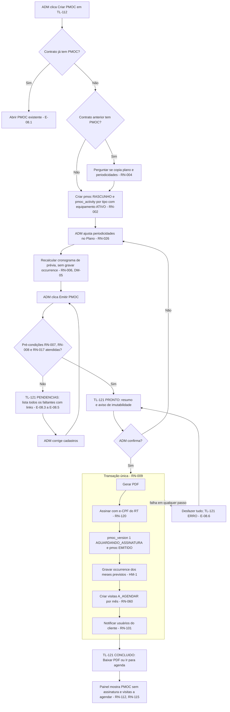
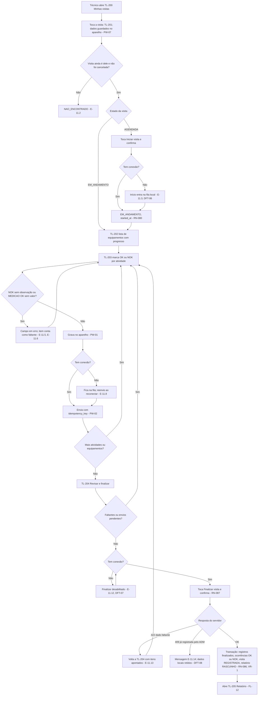
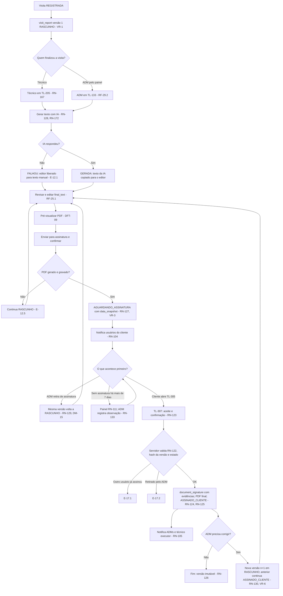

# 04 – Fluxos e telas do Sistema PMOC

> **Versão:** 1.1 – 27/10/2026 (decisões de 21/10/2026 e da auditoria final AF-01 a AF-20 incorporadas: `docs/auditoria-final.md` §5; telas da §4.5 detalhadas em AF-09)
> **Base:** `docs/00-escopo-prd.md` (RF-xx, RNF-xx, DEC-33 a DEC-42, P1–P7, Q1–Q9), `docs/02-regras-de-negocio.md` (RN-xxx, D-01 a D-08 com a opção **recomendada**) e `docs/03-modelo-de-dados.md` (tabelas, enums, DM-01 a DM-23 com o **padrão adotado**).
> **Leitor principal:** IA de código. Cada fluxo tem ID `FL-xx`, cada tela `TL-xxx`, cada erro `E-xx.y` (erro `y` do fluxo `FL-xx`), cada decisão em aberto deste documento `DFT-xx` (§7). Use os IDs em componentes, testes e commits.
> **Prioridade:** se este documento divergir dos docs 00, 02 ou 03, valem eles. Nada aqui altera uma `DEC`, `RN` ou `DM`.

## Convenções

| Item | Significado |
|---|---|
| **deve** / **pode** | Mesmo sentido do PRD. |
| **[A VALIDAR]** | Não veio dos arquivos nem do usuário. Implementar como descrito, isolado e fácil de mudar. |
| **(inferido)** | Dedução direta de uma regra citada. |
| **(UI)** | Proposta de interface sem fonte (texto de botão, disposição, componente). Toda proposta (UI) é **[A VALIDAR]** em bloco; não repito a marca em cada linha. Comportamento de negócio nunca é marcado só como (UI). |
| `ADM`, `TECNICO`, `CLIENTE` | Perfis (PRD §3.1). `SISTEMA` = processo automático (job ou transação do servidor). |
| Plataforma | DEC-33: telas `ADM` e `CLIENTE` = **web** (responsiva, RNF-01). Telas `TECNICO` = **PWA mobile**. |
| Nome de campo | Cada campo de tela cita a coluna do doc 03 (`tabela.coluna`). Campo sem coluna = só de tela. |
| Mensagens | Texto entre aspas é o texto exibido ao usuário (UI). Toda mensagem de bloqueio por regra cita o ID da regra no log do servidor (não na tela). |

### Decisões adotadas dos docs anteriores que afetam telas

| ID | Padrão adotado | Efeito nas telas |
|---|---|---|
| DM-09 | `contract.art_number` **obrigatório ao salvar** o contrato (decisão B8, 21/10/2026; RN-176). | TL-112 não salva sem ART (E-06.3). TL-121 continua listando a ART como pré-condição, como garantia redundante. |
| DM-13 | CNPJ `char(14)` aceitando `[0-9A-Z]{12}[0-9]{2}` (alfanumérico) [A VALIDAR]. | Campo CNPJ aceita letras maiúsculas nas 12 primeiras posições e dígitos nas 2 últimas; converte minúsculas para maiúsculas ao digitar; valida com `is_valid_cnpj`. |
| DM-11 | Certificado e-CPF guardado no banco, criptografado pela aplicação. | TL-103 só faz **upload** (arquivo + senha). Nenhuma tela mostra, baixa ou reexibe o arquivo ou a senha (RN-121). Mostra só titular, nº de série, emissor e validade. |
| D-01 a | OS = visita. | Não existe tela de "ordem de serviço"; tudo é "Visita". |
| D-04 a | Visitas geradas na emissão; assinatura do cliente no PMOC não bloqueia nada (RN-060, RN-134). | Agenda (TL-130) fica cheia logo após a emissão. |
| D-05 | Decidido em 21/10/2026 (F1): `NOK` = "não efetuado" (a atividade não foi executada). | Rótulo dos botões: "OK" e "NOK – não efetuado" (UI). Atividade executada com problema: botão "OK" + marca "Requer corretiva" (decisão R2 1.3 a; RN-193). |
| D-06 a | Ocorrência `PENDENTE` pode entrar em visita posterior (RN-064). | TL-131 tem a ação "Incluir pendências". |
| D-07 a | Nova versão do PMOC só quando o ADM decide (RN-015). | TL-120 mostra aviso "Plano alterado após a emissão" e o botão "Emitir nova versão". |
| D-08 a | Contrato pode ser cancelado (RN-144). | TL-112 tem a ação "Cancelar contrato". |

---

## 1. Padrões globais de interface

Valem para **todas** as telas. Cada tela da §4 só descreve o que é diferente.

### 1.1 Estrutura das áreas

| Área | Perfil | Plataforma | Navegação (UI) | Prefixo de rota [A VALIDAR] |
|---|---|---|---|---|
| Administração | `ADM` | Web desktop | Menu lateral fixo + cabeçalho com sino de notificações e nome do usuário | `/adm` |
| Portal do cliente | `CLIENTE` | Web responsiva (desktop e navegador do celular) | Menu superior (desktop) / menu inferior (celular) + sino + seletor de local | `/cliente` |
| App do técnico | `TECNICO` | PWA instalável | Barra inferior com 2 itens: "Visitas" e "Notificações"; telas empilhadas com botão voltar | `/tecnico` |
| Comum | todos | conforme perfil | — | `/login`, `/senha/*` |

Regras:
1. Após o login, o usuário vai para a tela inicial do perfil: `ADM` → TL-100; `CLIENTE` → TL-300; `TECNICO` → TL-200 (RF-01.4).
2. Rota de outra área → resposta do servidor 403 e tela de estado `SEM_ACESSO` (CA-01.3). O cliente web nunca decide permissão sozinho (PRD §3.1).
3. Toda tela com dados de um recurso específico (ex.: `/cliente/relatorios/{id}`) que não existe **ou** não é do usuário mostra o **mesmo** estado `NAO_ENCONTRADO` (RN-162: não revelar se existe).

### 1.2 Estados padrão de tela

Toda tela **deve** implementar os estados abaixo. As tabelas "Estados" da §4 só detalham o texto e os casos específicos.

| Estado | Quando | Comportamento obrigatório |
|---|---|---|
| `CARREGANDO` | Requisição inicial em andamento | Esqueleto (placeholder) no lugar do conteúdo (UI). Ações desabilitadas. Sem tela em branco. |
| `VAZIO` | Requisição ok e lista/resultado sem itens | Mensagem específica da tela + ação principal quando o perfil puder criar (ex.: "Cadastrar cliente"). Com filtro ativo: "Nenhum resultado para os filtros" + "Limpar filtros". |
| `ERRO` | Falha de rede, 5xx ou tempo esgotado no carregamento | Mensagem "Não foi possível carregar. Tente novamente." + botão "Tentar novamente". Mantém filtros. Não mostra detalhe técnico. |
| `SEM_ACESSO` | 403 | "Você não tem acesso a esta página." + botão para a tela inicial do perfil. |
| `NAO_ENCONTRADO` | 404, ou recurso de outro cliente (RN-162) | "Não encontrado ou sem acesso." + botão para a tela inicial. |
| `SESSAO_EXPIRADA` | 401 em qualquer chamada | Leva ao TL-001 com retorno para a rota atual após o login. No PWA, **antes** de sair, garante que o rascunho local está salvo (RNF-03 nível 1). Tempo de sessão [A VALIDAR] (RNF-04). |
| `OFFLINE` | Só PWA (TL-2xx), sem conexão | Faixa fixa "Sem conexão – seus dados ficam salvos no aparelho". Comportamento por tela na §4.3. |

### 1.3 Padrões de formulário

| ID | Regra | Origem |
|---|---|---|
| UF-01 | Validação de campo ao sair do campo e ao salvar; mensagem abaixo do campo. Salvar com erro: foco no 1º campo inválido. | (UI) |
| UF-02 | O servidor **revalida tudo**; erro de validação do servidor (422) é mostrado no campo correspondente. | PRD §3.1 |
| UF-03 | CNPJ, CEP e telefone: máscara na digitação e na exibição; envio ao servidor só com dígitos/caracteres válidos, sem máscara. | RF-05.5 |
| UF-04 | Endereço (bloco `[E]`): logradouro, nº **ou** marcar "s/n" (desabilita o nº), complemento opcional (DM-14), bairro (obrigatório só em empresa e RT), cidade, UF (lista das 27), CEP com 8 dígitos. | Doc 03 bloco `[E]`, CA-05.3, CA-05.4 |
| UF-05 | Datas `dd/mm/aaaa`; datas de negócio no fuso `America/Sao_Paulo`. | RNF-07, RNF-12 |
| UF-06 | Botão de salvar fica desabilitado durante o envio (evita duplo envio). | (UI) |
| UF-07 | **Conflito de edição:** o `UPDATE` usa `row_version`. Se o servidor responder 409, mostrar "Este registro foi alterado por outra pessoa. Recarregue para ver a versão atual." com botões "Recarregar" e "Copiar meus dados" (UI). Nada é sobrescrito sem recarregar. | Doc 03 bloco `[P]` (`row_version`) |
| UF-08 | Sair de formulário com alteração não salva (web) → confirmação "Descartar alterações?". No PWA não há essa confirmação porque tudo é salvo a cada alteração (RF-21.7). | (UI); RF-21.7 |
| UF-09 | Ação que não pode ser desfeita (emitir, enviar para assinatura, assinar, finalizar visita, cancelar visita/contrato, inativar) **deve** ter diálogo de confirmação que diz o efeito. | (UI); RNF-15 |
| UF-10 | Campo de motivo (`reason`) em remarcação, troca de técnico, cancelamento e correções do ADM; **opcional** em todos (decisão R2 2.5, que reverte C8 nesses pontos; RN-070). Entre agenda, correções e cancelamentos, o único motivo obrigatório é o do cancelamento de **contrato** (RN-144); a redefinição de segundo fator mantém o motivo (RN-194); o valor vai para `visit_schedule_change.reason` ou `audit_log.reason`. | RF-18.3; doc 03 §5.3 |

### 1.4 Padrões de lista

| ID | Regra |
|---|---|
| UL-01 | Paginação no servidor; 25 itens por página (decisão C2). |
| UL-02 | Filtros ficam na URL (recarregar mantém o filtro) (UI). |
| UL-03 | Registros com `deleted_at` preenchido nunca aparecem (EL-5). Registros `INATIVO` aparecem só com o filtro "Mostrar inativos" (UI). |
| UL-04 | Estado de entidade é mostrado como etiqueta com o texto da tabela 1.5. |

### 1.5 Rótulos de estado exibidos

Rótulos (UI). O valor gravado é sempre o do enum (doc 03 §4).

| Enum | Valor → rótulo |
|---|---|
| `occurrence_status` | `NAO_PREVISTA` → "Ø"; `PREVISTA` → "Prevista" (célula vazia na ficha, RN-150); `PENDENTE` → "Pendente"; `OK` → "OK"; `NOK` → "NOK" |
| `visit_status` | `A_AGENDAR` → "A agendar"; `AGENDADA` → "Agendada"; `EM_ANDAMENTO` → "Em andamento"; `REGISTRADA` → "Registrada"; `CANCELADA` → "Cancelada". Derivado: "Atrasada" quando RN-109 for verdadeira (não é estado). |
| `pmoc_status` | `RASCUNHO` → "Rascunho"; `EMITIDO` → "Aguardando assinatura do cliente"; `ASSINADO_CLIENTE` → "Assinado"; `HISTORICO` → "Histórico" |
| `report_status` | `RASCUNHO` → "Rascunho"; `AGUARDANDO_ASSINATURA` → "Aguardando assinatura"; `ASSINADO_CLIENTE` → "Assinado" |
| `contract_status` | `A_INICIAR` → "A iniciar"; `VIGENTE` → "Vigente"; `ENCERRADO` → "Encerrado"; `CANCELADO` → "Cancelado" |
| Certificado (derivado, RN-153) | `VALIDO` → "Válido"; `A_VENCER` → "Vence em {n} dias"; `VENCIDO` → "Vencido" |
| `notification_status` | `NAO_LIDA` → destaque visual; `LIDA` → normal |

### 1.6 Padrões do PWA (técnico)

| ID | Regra | Origem |
|---|---|---|
| PW-01 | Toda alteração de registro (marcação, valor, observação, foto) é gravada **primeiro no aparelho** e depois enviada ao servidor. | RF-21.7, RNF-03 nível 1 |
| PW-02 | Cada envio leva uma `idempotency_key` gerada no aparelho; reenvio com a mesma chave não duplica (doc 03 `idempotency_key`, DM-22). | RN-089 |
| PW-03 | Indicador de sincronização por visita e por equipamento (UI): "Salvo no aparelho" → "Enviando…" → "Enviado". Falha → "Não enviado – nova tentativa automática". O app tenta de novo ao reconectar e ao abrir. | RNF-03 nível 1, CA-22.1 |
| PW-04 | IDs (`uuid`) de `occurrence_record`, `photo` e `visit_equipment_note` são gerados no aparelho (DM-01). | DM-01 |
| PW-05 | Fotos são comprimidas no aparelho antes do envio; `captured_at` gravado. Resolução máxima e formatos [A VALIDAR]. | RNF-11 |
| PW-06 | Botões OK/NOK grandes, uso com uma mão. | RNF-14 [A VALIDAR] |
| PW-07 | Visita inteira offline (baixar antes **para executar** sem internet) é **Fase 2** (nível 2). No MVP (nível 1, decisão R2 1.1 b), o técnico pode baixar a agenda dos próximos dias **só para leitura** ("Baixar mais 7 dias") e acionar "Sincronizar agora"; para registrar, os dados da visita precisam ter sido abertos com conexão ao menos uma vez para ficarem no aparelho (inferido de RNF-03). A tela de "Baixar mais 7 dias" e "Sincronizar agora" ainda não existe neste doc: ver §4.5. | RNF-03, RF-22 |
| PW-08 | Dados locais de uma visita são apagados do aparelho só depois de **todos** os envios confirmados e de a visita sair da lista do técnico (UI). | RNF-03 nível 1 (inferido) |

---

## 2. Mapa de fluxos

| ID | Fluxo | Perfil principal | Tema pedido | RF | Diagrama |
|---|---|---|---|---|---|
| FL-01 | Login, recuperação de senha e senha inicial | todos | Acesso | RF-01, RF-02 | — |
| FL-02 | Configuração da empresa, RT e certificado | ADM | Cadastro | RF-04 | — |
| FL-03 | Biblioteca de tipos, grupos e atividades | ADM | Cadastro | RF-08 | — |
| FL-04 | Cliente, locais e usuários do cliente | ADM | Cadastro | RF-02, RF-05, RF-06 | — |
| FL-05 | Usuários ADM e técnicos (inclui inativação) | ADM | Cadastro | RF-02 | — |
| FL-06 | Contrato: criar, renovar, cancelar | ADM | Cadastro | RF-07, RF-15 | — |
| FL-07 | Equipamentos: criar, editar, inativar | ADM | Cadastro | RF-09 | — |
| FL-08 | Geração e emissão do PMOC | ADM, SISTEMA | Geração do PMOC | RF-10 a RF-13, RF-17 | **§5.1** |
| FL-09 | Mudança após a emissão e nova versão do PMOC | ADM | Geração do PMOC | RF-10.4, RF-15 | — |
| FL-10 | Agendamento: agendar, remarcar, trocar técnico, cancelar, dividir, avulsa, incluir pendências | ADM | Agendamento | RF-17, RF-18 | — |
| FL-11 | Agenda e execução da manutenção no app | TECNICO | Execução | RF-20 a RF-23 | **§5.2** |
| FL-12 | Relatório da visita: gerar com IA, revisar, enviar | TECNICO (ou ADM) | Emissão de relatório | RF-24, RF-25 | **§5.3** |
| FL-13 | Lançamento manual e correção pelo painel | ADM | Execução | RF-29 | — |
| FL-14 | Relatório pelo ADM: retirar, corrigir, nova versão, nota | ADM | Emissão de relatório | RF-29 | **§5.3** |
| FL-15 | Resolução de pendências | ADM | Alertas | RF-30 | — |
| FL-16 | Portal do cliente: consultar e baixar | CLIENTE | — | RF-27, RF-32, RF-16 | — |
| FL-17 | Assinatura do PMOC e do relatório pelo cliente | CLIENTE | Geração do PMOC / relatório | RF-14, RF-26 | **§5.3** (relatório) |
| FL-18 | Processamento diário e alertas | SISTEMA | Alertas | RF-11.4, RF-19, RF-28 | — |
| FL-19 | Central de notificações | todos | Alertas | RF-19 | — |
| FL-20 | Painel de pendências | ADM | Alertas | RF-28 | — |

### 2.1 Por que estes 3 diagramas

| Fluxo | Motivo |
|---|---|
| FL-08 Emissão do PMOC | Gera documento assinado pelo RT, imutável (RNF-15), e na mesma transação grava o cronograma e cria todas as visitas (RN-009). Erro aqui é irreversível ou deixa o contrato sem agenda. |
| FL-11 Execução | Ponto de maior risco de perda de dado (conexão de campo, RNF-03) e o único que muda ocorrências para OK/NOK. |
| FL-12 + FL-14 + FL-17 Relatório | Vai ao cliente sem aprovação do ADM (DEC-38) e termina em assinatura imutável; tem ciclo de retirada e nova versão. |

---

## 3. Fluxos passo a passo

Formato de cada fluxo:
- **Gatilho**, **Pré-condições**, **Passos** (numerados; `Ator:` ação → `Sistema:` resposta), **Resultado**, **Erros e alternativas** (tabela `E-xx.y`), **Telas**.
- "Sistema valida X" = validação no servidor; a tela também valida antes de enviar (UF-02).

### 3.1 Acesso

#### FL-01 – Login, recuperação de senha e senha inicial
- **Perfil:** todos · **RF:** RF-01, RF-02 · **Telas:** TL-001, TL-002, TL-003

Passos – login:
1. Usuário: informa e-mail e senha em TL-001 e confirma.
2. Sistema: valida credenciais e `app_user.status = 'ATIVO'` (RN-141); grava `security_event` `LOGIN_OK` (06 SEG-09; não há coluna `last_login_at`, AF-04).
2a. Se o usuário é `ADM`: o sistema pede o código TOTP (decisão R2 1.2 b; RN-194); sem segundo fator ativado, o ADM só acessa a tela de configurá-lo (§4.5, TL-004) e recebe 10 códigos de recuperação de uso único; quem perdeu o aplicativo usa um código ou pede a outro ADM que redefina (06 SEG-17). `TECNICO` e `CLIENTE` não passam por esta etapa no MVP.
3. Sistema: redireciona para a tela inicial do perfil (§1.1 regra 1) ou para a rota de retorno guardada.

Passos – recuperação:
1. Usuário: em TL-001 clica "Esqueci minha senha" → TL-002; informa e-mail.
2. Sistema: se o e-mail é de usuário `ATIVO`, cria o token de uso único em `auth_verification` (Better Auth; doc 03 §2.1, AF-04) e envia o link por e-mail (RF-01.2, decisão B4). **Sempre** mostra a mesma mensagem, exista ou não o e-mail (UI, não revelar cadastro).
3. Usuário: abre o link → TL-003; informa nova senha duas vezes.
4. Sistema: valida o token (existe, não usado, não expirado; Better Auth), grava o novo hash de senha em `auth_account`, invalida o token e leva ao TL-001 com "Senha alterada. Entre com a nova senha."

Passos – senha inicial (usuário criado pelo ADM em FL-04/FL-05):
1. Sistema: ao criar o usuário, gera o token de uso único e envia link "Definir senha" para o e-mail (mesmo mecanismo da recuperação) (DFT-01).
2. Usuário: segue os passos 3–4 da recuperação.

| Erro | Condição | Comportamento | Regra |
|---|---|---|---|
| E-01.1 | E-mail ou senha errados | "E-mail ou senha incorretos." Não diz qual dos dois. | (UI) |
| E-01.2 | Usuário `INATIVO` | Mesma mensagem de E-01.1 (não revela que existe) (UI). | RN-141, CA-01.2 |
| E-01.3 | Muitas tentativas seguidas | Bloqueio temporário [A VALIDAR: limite e tempo] (DFT-20). | RNF-04 (inferido) |
| E-01.4 | Token expirado, usado ou inválido | TL-003 em estado de erro: "Link inválido ou expirado." + botão "Pedir novo link". | Doc 03 §2.1 `auth_verification` (AF-04) |
| E-01.5 | Senhas digitadas diferentes ou fora da política | Erro no campo. Política: mínimo de 8 caracteres (decisão B6; DFT-21). | (UI) |
| E-01.7 | Código TOTP do `ADM` errado ou expirado | "Código incorreto." Conta no bloqueio de tentativas (E-01.3). | RN-194 |
| E-01.6 | Usuário logado acessa rota de outro perfil | Estado `SEM_ACESSO`. | CA-01.3 |

### 3.2 Cadastros (ADM)

#### FL-02 – Configuração da empresa executora, RT e certificado
- **Perfil:** ADM · **RF:** RF-04 · **Telas:** TL-102, TL-103
- **Pré-condição:** nenhuma. É o passo 1 do ciclo (PRD §5).

Passos:
1. ADM: abre TL-102. Sistema: se não existe `executor_company`, mostra o formulário vazio; se existe, mostra para edição (nunca "criar outra", CA-04.1).
2. ADM: preenche empresa (razão social, CNPJ, telefone, endereço com bairro, CREA, logo) e salva. Sistema: valida obrigatórios (RF-04.2) e grava.
3. ADM: preenche RT (nome, título, nº de registro, telefone, e-mail, endereço com bairro) e salva. Sistema: grava `technical_responsible` (DEC-29).
4. ADM: abre TL-103, envia o arquivo do certificado A1 e a senha.
5. Sistema: abre o certificado com a senha, lê titular, nº de série, emissor e validade; grava `rt_certificate` criptografado (DM-11) com `is_current = true` e passa o anterior para `is_current = false`.
6. Sistema: mostra titular, validade e o estado derivado (RN-153).

| Erro | Condição | Comportamento | Regra |
|---|---|---|---|
| E-02.1 | Campo obrigatório vazio ou CNPJ inválido | Erro no campo. | RF-04.2, RF-04.3, UF-01 |
| E-02.2 | Logo em formato ou tamanho não aceito | "Envie uma imagem PNG ou JPEG de até {n} MB." Formatos e limite [A VALIDAR]. | (UI) |
| E-02.3 | Senha do certificado errada | "Senha do certificado incorreta." Nada é gravado. A senha digitada nunca vai para log (RN-121). | RNF-09 |
| E-02.4 | Arquivo não é certificado legível (PKCS#12) | "Arquivo de certificado inválido." Nada é gravado. | RNF-09 |
| E-02.5 | Certificado já vencido no upload | Bloqueia: "Certificado vencido em {data}." [A VALIDAR] (DFT-02). | RN-153 (inferido) |
| E-02.6 | Certificado não é e-CPF ICP-Brasil ou o titular difere do RT cadastrado | Aviso (não bloqueia): "O titular do certificado ({nome}) é diferente do RT cadastrado." Verificação de cadeia ICP-Brasil [A VALIDAR]. | RF-04.4 (inferido) |
| E-02.7 | Edição de empresa/RT depois de PMOC emitido | Salva normalmente; aviso fixo: "Alterações não mudam PMOCs já emitidos; valem para novas emissões." | RF-04.5, VP-3 |

#### FL-03 – Biblioteca de tipos, grupos e atividades
- **Perfil:** ADM · **RF:** RF-08 · **Telas:** TL-104, TL-105

Passos:
1. ADM: em TL-104 clica "Novo tipo" → TL-105.
2. ADM: informa nome, plural (opcional), sigla e ao menos um grupo; salva. Sistema: valida RN-040 e grava `equipment_type` e `equipment_group`.
3. ADM: inclui atividades: título, periodicidade padrão, natureza, unidade (só se `MEDICAO`), ordem. Sistema: valida RN-042/RN-043 e grava `activity_template`.
4. ADM: para excluir tipo, grupo ou atividade, clica "Excluir". Sistema: se já usado em algum PMOC (tipo/atividade) ou equipamento (grupo), oferece só "Inativar" (RN-044, EL-4); senão exclui logicamente.

| Erro | Condição | Comportamento | Regra |
|---|---|---|---|
| E-03.1 | Sigla repetida, fora do formato `^[A-Z]{2,5}$` ou nome repetido | Erro no campo. Formato [A VALIDAR]. | RN-040, doc 03 `equipment_type.acronym` |
| E-03.2 | Tipo sem grupo `ATIVO` | Bloqueia salvar: "Inclua ao menos um grupo." | RN-040 |
| E-03.3 | Atividade `MEDICAO` sem unidade | Erro no campo unidade. | RN-042, CA-08.1 |
| E-03.4 | Mudar sigla de tipo que já tem equipamento | Campo sigla somente leitura com dica "A sigla compõe as TAGs e não pode mudar." | Doc 03 `acronym` imutável (inferido de RN-046) |
| E-03.5 | Mudar periodicidade padrão | Salva; aviso: "Não altera PMOCs já criados." | RN-003, CA-08.3 |
| E-03.6 | Título de atividade repetido no tipo | Erro no campo. | Doc 03 `activity_template` (inferido) |

#### FL-04 – Cliente, locais e usuários do cliente
- **Perfil:** ADM · **RF:** RF-02, RF-05, RF-06 · **Telas:** TL-108, TL-109, TL-110, TL-107

Passos:
1. ADM: em TL-108 clica "Novo cliente" → TL-109 (aba Dados).
2. ADM: preenche razão social, CNPJ, endereço; opcionais nome fantasia e até 2 telefones; salva. Sistema: valida RF-05 e grava `client`.
3. ADM: na aba Locais clica "Novo local" → TL-110; preenche nome, endereço, telefone opcional; salva. Sistema: gera `site.code` (DM-19) e mostra o código, somente leitura.
4. ADM: na aba Usuários (TL-109) clica "Novo usuário" → TL-107 com perfil `CLIENTE` e cliente já preenchidos e travados.
5. ADM: informa nome, e-mail, telefone opcional; salva. Sistema: grava `app_user` (`role = 'CLIENTE'`, `client_id`) e dispara a senha inicial (FL-01).

| Erro | Condição | Comportamento | Regra |
|---|---|---|---|
| E-04.1 | CNPJ com tamanho errado, CPF ou dígito verificador inválido | "CNPJ inválido." | RF-05.1, RF-05.2, CA-05.1, CA-05.2, DM-13 |
| E-04.2 | CNPJ já cadastrado | "Já existe cliente com este CNPJ: {razão social}." com link para ele. | RF-05.4 |
| E-04.3 | CEP com menos de 8 dígitos | Erro no campo. | CA-05.3 |
| E-04.4 | Telefone 2 igual ao 1, ou 2 sem 1 | Erro no campo. | RF-05.3 |
| E-04.5 | E-mail de usuário já existe | "Este e-mail já está em uso." | CA-02.2 |
| E-04.6 | Usuário `CLIENTE` sem cliente | Impossível pela tela (campo travado); servidor rejeita se vier sem. | RN-169, CA-02.3 |
| E-04.7 | Excluir cliente com local vivo, ou local com contrato/equipamento vivo | Botão "Excluir" desabilitado com dica do motivo. | Doc 03 `client`/`site` (inferido), EL-7 |
| E-04.8 | Envio do e-mail de senha inicial falha | Usuário é criado; aviso "Usuário criado, mas o e-mail não foi enviado." + botão "Reenviar link". | DFT-01 |

#### FL-05 – Usuários ADM e técnicos
- **Perfil:** ADM · **RF:** RF-02 · **Telas:** TL-106, TL-107

Passos – criar:
1. ADM: em TL-106 clica "Novo usuário" → TL-107; escolhe perfil `ADM` ou `TECNICO`, nome, e-mail, telefone opcional; salva. Sistema: grava e dispara senha inicial (FL-01).

Passos – inativar:
1. ADM: em TL-107 clica "Inativar".
2. Sistema: se o usuário é `TECNICO`, lista as visitas dele em `AGENDADA` e `EM_ANDAMENTO` (RN-074, CA-02.4) no diálogo de confirmação.
3. ADM: confirma. Sistema: `status = 'INATIVO'`, `inactivated_at`; o usuário perde o login e deixa de receber notificações (RN-141). As visitas **não** mudam de estado.
4. Sistema: mostra a lista de visitas a reatribuir com link para cada TL-131. Visitas `AGENDADA` → ADM troca o técnico (FL-10). Visitas `EM_ANDAMENTO` → não podem trocar técnico (RN-071); ADM conclui pelo lançamento manual (FL-13) (DFT-03).

Passos – reativar: ADM clica "Reativar" → `ATIVO` (RN-141, exceção inferida).

| Erro | Condição | Comportamento | Regra |
|---|---|---|---|
| E-05.1 | E-mail repetido | "Este e-mail já está em uso." | CA-02.2 |
| E-05.2 | ADM tenta inativar a si mesmo | Bloqueia: "Você não pode inativar o próprio usuário." [A VALIDAR] (DFT-22) | (inferido: evita ficar sem ADM) |
| E-05.3 | Inativar o último ADM ativo | Bloqueia [A VALIDAR] (DFT-22). | (inferido) |
| E-05.4 | Mudar perfil de usuário existente | Campo perfil somente leitura após criar [A VALIDAR] (DFT-04). | PRD §3.1 "exatamente um perfil" |

#### FL-06 – Contrato: criar, renovar, cancelar
- **Perfil:** ADM · **RF:** RF-07, RF-15 · **Telas:** TL-110 (aba Contratos), TL-112

Passos – criar:
1. ADM: em TL-110, aba Contratos, clica "Novo contrato" → TL-112.
2. ADM: informa início, fim e nº da ART (obrigatório, DM-09); opcionais código TH e revisão; salva.
3. Sistema: valida `end_date > start_date` e sobreposição (RN-143); calcula `month_count` (RN-022) e o estado (RN-142); mostra "{N} meses".
4. Sistema: mostra o botão "Criar PMOC" (vai para FL-08).

Passos – renovar:
1. ADM: em TL-112 de um contrato `VIGENTE` ou `ENCERRADO`, clica "Renovar".
2. Sistema: abre TL-112 novo com `previous_contract_id` preenchido e início sugerido = dia seguinte ao fim do anterior (UI).
3. ADM: confirma datas e salva. Sistema: grava. Na criação do PMOC (FL-08 passo 2) oferece "Copiar plano do PMOC anterior" (RN-004).
4. Salvar o contrato novo e emitir o PMOC novo **não** confirmam a renovação. ADM: em TL-112 do contrato novo, clica "Confirmar renovação" (decisão R2 2.1 c; RN-192). Sistema: grava `renewal_confirmed_at` e `renewal_confirmed_by_user_id`; o PMOC do contrato anterior vira `HISTORICO` imediatamente (decisão C10, RN-014); as visitas restantes do contrato anterior continuam válidas e registráveis, com o cronograma existente (decisão R2 2.1 x). Se o contrato anterior já está `ENCERRADO`, o PMOC dele já é histórico e a confirmação só registra a renovação.

Passos – cancelar:
1. ADM: em TL-112 clica "Cancelar contrato"; informa data de cancelamento (entre início e fim) e motivo (obrigatório).
2. Sistema: mostra no diálogo o impacto: nº de visitas que serão canceladas e nº de ocorrências que viram Ø (RN-144, RN-076).
3. ADM: confirma. Sistema: `CANCELADO`, PMOC → `HISTORICO`, visitas futuras → `CANCELADA` com notificação (RN-102), ocorrências futuras sem registro → `NAO_PREVISTA` (`CONTRATO_CANCELADO`).

| Erro | Condição | Comportamento | Regra |
|---|---|---|---|
| E-06.1 | Fim ≤ início | Erro no campo fim. | RF-07.2 |
| E-06.2 | Período sobrepõe outro contrato do local | "Período sobrepõe o contrato {início}–{fim}." | RN-143, CA-07.1 |
| E-06.3 | Salvar sem ART | Bloqueia: "Informe o nº da ART." | DM-09, RN-176 |
| E-06.4 | Mudar datas com PMOC emitido | Campos de data somente leitura com dica "Datas travadas após a emissão. Para encerrar antes, cancele o contrato." | RN-145 |
| E-06.5 | Cancelar com registro OK/NOK em mês posterior à data de cancelamento | Bloqueia: "Existem registros após {data}. Escolha uma data de cancelamento posterior." | RN-144 exceção |
| E-06.6 | Cancelar com visita `EM_ANDAMENTO` após a data | Bloqueia até a visita ser finalizada ou o ADM lançar (inferido de RN-076, que só cancela `A_AGENDAR`/`AGENDADA`) [A VALIDAR] (DFT-23). | RN-076 |
| E-06.7 | Contrato `CANCELADO` | Todos os campos e ações somente leitura (estado final). | Doc 03 §4.2 |

#### FL-07 – Equipamentos: criar, editar, inativar
- **Perfil:** ADM · **RF:** RF-09 · **Telas:** TL-110 (aba Equipamentos), TL-111

Passos – criar:
1. ADM: em TL-110, aba Equipamentos, clica "Novo equipamento" → TL-111.
2. ADM: escolhe tipo (só `ATIVO`), grupo (só os do tipo, `ATIVO`), ambiente; opcionais marca, modelo, série, capacidade + unidade (padrão `BTU/h`).
3. Sistema: mostra prévia da TAG "será gerada ao salvar: {código}-{sigla}-NNN" (UI); ao salvar, gera a TAG (RN-046) e mostra a TAG definitiva.
4. Sistema: se o local tem PMOC `EMITIDO`/`ASSINADO_CLIENTE`, antes de salvar mostra o impacto: "As ocorrências deste equipamento serão geradas a partir de {mês seguinte} e entram nas visitas não iniciadas." (RN-067). Depois de salvar, TL-120 mostra o aviso de plano alterado (FL-09).
5. Sistema: se o local tem PMOC `RASCUNHO`, recalcula o cronograma (RN-006). Se o tipo do equipamento não estava no plano, inclui no plano as atividades `ATIVO` desse tipo com a periodicidade padrão (inferido de RN-002) (DFT-05).

Passos – inativar:
1. ADM: clica "Inativar". Sistema: com PMOC emitido, mostra o impacto (ocorrências futuras sem registro viram Ø e saem das visitas não iniciadas; pendências continuam) (RN-068).
2. ADM: confirma. Sistema: `INATIVO`, `inactivated_at`, aplica RN-068 e RN-065.

| Erro | Condição | Comportamento | Regra |
|---|---|---|---|
| E-07.1 | Sem tipo, grupo ou ambiente | Erro no campo. | RN-045, CA-09.3 |
| E-07.2 | Grupo de outro tipo | Impossível pela tela (lista filtrada); servidor rejeita (FK composta). | RN-041 |
| E-07.3 | Capacidade ≤ 0, ou capacidade sem unidade | Erro no campo. | Doc 03 `equipment.capacity` |
| E-07.4 | Mudar tipo de equipamento com registro | Campo tipo somente leitura com dica "Inative e cadastre outro." | RN-049 |
| E-07.5 | Excluir equipamento com registro | Só "Inativar" disponível. | RN-048 |
| E-07.6 | Sequencial do tipo no local passou de 999 | "Limite de TAGs deste tipo no local atingido." [A VALIDAR] | RN-046 exceção |
| E-07.7 | Recalcular cancela visita `AGENDADA` que ficou vazia | Diálogo de impacto avisa antes: "A visita de {data} ficará sem itens e será cancelada." | RN-065 |

### 3.3 PMOC

#### FL-08 – Geração e emissão do PMOC
- **Perfil:** ADM, SISTEMA · **RF:** RF-10, RF-11, RF-12, RF-13, RF-17 · **Telas:** TL-112, TL-120, TL-121 · **Diagrama:** §5.1
- **Pré-condição:** contrato salvo sem PMOC (RN-001).

Passos:
1. ADM: em TL-112 clica "Criar PMOC".
2. Sistema: se o contrato tem `previous_contract_id` com PMOC, pergunta "Copiar plano e periodicidades do PMOC anterior?" (RN-004). A cópia nunca traz ocorrências, registros, visitas ou assinaturas.
3. Sistema: cria `pmoc` em `RASCUNHO` e `pmoc_activity` para cada tipo com equipamento `ATIVO` no local (RN-002) — ou a partir do anterior (passo 2). Abre TL-120.
4. ADM: na aba Plano, ajusta periodicidade por atividade (vale para todos os equipamentos do tipo, RN-026); pode remover ou incluir atividade [A VALIDAR] (RF-10.3).
5. Sistema: a cada mudança recalcula o cronograma de pré-visualização (RN-006, DM-05: nada é gravado em `occurrence`).
6. ADM: na aba Cronograma confere a grade meses × atividades (RN-023 a RN-025).
7. ADM: clica "Emitir PMOC". Sistema: verifica **todas** as pré-condições RN-007 e RN-008 e RN-017.
8. Sistema: se falta algo, abre TL-121 com a lista completa de itens faltantes, cada um com link para a tela que corrige (fim do fluxo).
9. Sistema: se está tudo ok, TL-121 mostra o resumo (cliente, local, vigência, nº de equipamentos, nº de atividades, nº de visitas que serão criadas) e o aviso "Após emitir, o PDF é assinado pelo RT e não pode ser alterado."
10. ADM: confirma.
11. Sistema: em **uma** transação (RN-009): gera o PDF → assina com o certificado do RT (RN-120) → `pmoc_version` 1 `AGUARDANDO_ASSINATURA` e `pmoc.status = 'EMITIDO'` → grava `occurrence` → cria visitas `A_AGENDAR` por mês (RN-060) → notifica usuários do cliente (RN-101).
12. Sistema: TL-121 mostra "PMOC emitido" com botões "Baixar PDF" e "Ir para agenda" (TL-130 filtrada pelo local).

Resultado: PMOC `EMITIDO`; visitas `A_AGENDAR` criadas; usuários do cliente notificados; TL-100 passa a listar o PMOC em "PMOC sem assinatura do cliente" (RN-112) e as visitas em "A agendar" (RN-115).

| Erro | Condição | Comportamento | Regra |
|---|---|---|---|
| E-08.1 | Contrato já tem PMOC | Botão "Criar PMOC" não aparece; mostra "Abrir PMOC". Servidor rejeita duplicado. | RN-001 |
| E-08.2 | Local sem equipamento `ATIVO` | Cria o rascunho com plano vazio e mostra "Cadastre equipamentos para montar o plano." | RN-002, RN-007 f |
| E-08.3 | Pré-condição faltante (a)–(g) | TL-121 lista **todos** os faltantes de uma vez, ex.: "Nº de ART do contrato", "Bairro do RT", "Ao menos 1 equipamento ativo". Nada é gravado. | RN-007, CA-12.1 |
| E-08.4 | Certificado `VENCIDO` ou inexistente | Item "certificado do RT vencido" na lista de E-08.3, link para TL-103. | RN-008, CA-04.2 |
| E-08.5 | Contrato `ENCERRADO` ou `CANCELADO` | Botão "Emitir" desabilitado com dica "Contrato encerrado não emite PMOC." | RN-017 |
| E-08.6 | Falha ao gerar PDF, ao assinar (senha do certificado não abre mais, erro de biblioteca) ou ao gravar | Transação desfeita. "A emissão não foi concluída e nada foi alterado. Tente novamente." Detalhe no log do servidor (sem dados do certificado, RN-121). | RN-009 exceção |
| E-08.7 | Emissão demora | TL-121 em estado `PROCESSANDO` com "Gerando e assinando o PDF…"; botão desabilitado; fechar a página não cancela. Emissão síncrona (decisão A2). Meta: 30 s com 30 equipamentos [A VALIDAR] e 15 min com 200 equipamentos (decisões C4 e R2 1.4 c; RNF-16; na prática dentro do limite de 800 s da função, medido no S-01: AF-11). Se passar do tempo do navegador, a tela consulta o estado do PMOC ao reabrir (UI). | RNF-16 |
| E-08.8 | Dois ADMs emitem ao mesmo tempo | Só uma emissão vence; a outra recebe 409 → UF-07. | `row_version`, `UNIQUE (pmoc_id, version_number)` |
| E-08.9 | Certificado `A_VENCER` | Emite normalmente; TL-121 mostra aviso "Certificado do RT vence em {n} dias." | RN-007 c, RN-114 |
| E-08.10 | Certificado do RT é A3 | Fora do MVP automático. Fluxo alternativo (baixar, assinar fora, enviar PDF) [A VALIDAR] (P4, RF-13.3). | RN-120 exceção |
| E-08.11 | Excluir rascunho | Permitido só em `RASCUNHO` (exclusão lógica). Confirmação UF-09. | Doc 03 `pmoc` `[L]` |

#### FL-09 – Mudança após a emissão e nova versão do PMOC
- **Perfil:** ADM · **RF:** RF-10.4, RF-15, RF-16 · **Telas:** TL-120, TL-121

Passos – alterar periodicidade com PMOC `EMITIDO` ou `ASSINADO_CLIENTE`:
1. ADM: em TL-120, aba Plano, muda a periodicidade de uma atividade; motivo opcional.
2. Sistema: mostra o impacto antes de salvar: "Recalcula só meses após {mês corrente}: {x} ocorrências entram, {y} saem. Registros OK/NOK e pendências não mudam." (RN-032).
3. ADM: confirma. Sistema: recalcula (RN-032), atualiza visitas não iniciadas (RN-065), grava auditoria (CA-10.2).
4. Sistema: TL-120 mostra a faixa "Plano alterado após a emissão da versão {n}. O PDF assinado não muda." com botão "Emitir nova versão" (D-07 a).

Passos – emitir nova versão:
1. ADM: clica "Emitir nova versão"; informa motivo (`issue_reason`, opcional).
2. Sistema: mesmas verificações e passos 7–11 do FL-08, **sem** recriar `occurrence` nem visitas (VP-7); cria versão `n+1`; versão anterior fica `is_current = false` (e `SUBSTITUIDA` se não assinada) (VP-2); `pmoc.status = 'EMITIDO'`; notifica o cliente (RN-101).

Passos – ficha atualizada:
1. ADM ou CLIENTE: clica "Baixar ficha atualizada". Sistema: gera PDF sem assinatura com "gerado em {data}" e grava `pmoc_ficha_export` (RN-131, DM-16).

| Erro | Condição | Comportamento | Regra |
|---|---|---|---|
| E-09.1 | PMOC `HISTORICO` | Plano e "Emitir nova versão" somente leitura; só downloads. | RN-146, RN-017 |
| E-09.2 | Visita do mês já `EM_ANDAMENTO`/`REGISTRADA` | Diálogo de impacto lista "não alteradas: visita de {data} (em andamento)". | RN-066 |
| E-09.3 | Nova versão com pré-condição faltante | Igual a E-08.3. | RN-007 |
| E-09.4 | Geração da ficha atualizada falha | "Não foi possível gerar a ficha. Tente novamente." Nada é gravado. | (UI) |

### 3.4 Agendamento (ADM)

#### FL-10 – Agendar, remarcar, trocar técnico, cancelar, dividir, avulsa, incluir pendências
- **Perfil:** ADM · **RF:** RF-17, RF-18, RF-19 · **Telas:** TL-130, TL-131
- **Pré-condição:** PMOC emitido (visitas `A_AGENDAR` existem, RN-060).

Passos – agendar:
1. ADM: em TL-130, filtro "A agendar", abre uma visita → TL-131.
2. ADM: clica "Agendar"; escolhe data (obrigatória), horário (opcional) e técnico (só `TECNICO` `ATIVO`, RN-073); motivo opcional; salva.
3. Sistema: se a data está fora do mês de referência, mostra o aviso imediato "Data fora do mês de referência ({mês}). A visita continua cobrindo {mês}." e pede confirmação (RN-072, RN-116).
4. Sistema: `AGENDADA` (RN-069); grava `visit_schedule_change` (campos `DATA`, `HORARIO`, `TECNICO`, `ESTADO`); notifica técnico e usuários do cliente (RN-102).

Passos – remarcar / trocar técnico (estado `A_AGENDAR` ou `AGENDADA`):
1. ADM: em TL-131 clica "Remarcar" ou "Trocar técnico"; altera; motivo opcional; salva.
2. Sistema: grava histórico (RN-070); notifica com data antiga e nova (RN-102, CA-19.1) ou técnico anterior, novo e cliente (RN-103). O técnico anterior deixa de ver a visita (CA-18.1).

Passos – cancelar:
1. ADM: clica "Cancelar visita"; motivo opcional; confirma (UF-09).
2. Sistema: `CANCELADA`; vínculos `visit_occurrence` encerrados (`VISITA_CANCELADA`); ocorrências seguem o fluxo normal e podem ir a outra visita (RN-075); notifica (RN-102).

Passos – dividir (estado `A_AGENDAR` ou `AGENDADA`) [A VALIDAR] (RF-17.2):
1. ADM: clica "Dividir visita"; marca, por equipamento, quais ocorrências vão para a nova visita.
2. Sistema: valida que cada ocorrência fica em exatamente uma visita (RN-062, CA-17.2); cria visita nova `A_AGENDAR`, `origin = 'DIVISAO'`, mesmo mês de referência (DM-21).

Passos – visita avulsa [A VALIDAR] (RF-17.3):
1. ADM: em TL-130 clica "Nova visita avulsa"; escolhe local, mês de referência e ocorrências do mês que não estão em outra visita ativa (RN-063).
2. Sistema: cria `A_AGENDAR`, `origin = 'AVULSA'`.

Passos – incluir pendências (visita `A_AGENDAR` ou `AGENDADA`) (D-06 a):
1. ADM: em TL-131 clica "Incluir pendências"; o sistema lista ocorrências `PENDENTE` do mesmo PMOC.
2. ADM: marca e confirma. Sistema: tira de visita anterior não iniciada, se houver, e inclui nesta; a ocorrência continua no mês previsto original (RN-064, RN-031).

| Erro | Condição | Comportamento | Regra |
|---|---|---|---|
| E-10.1 | Agendar sem data ou sem técnico | Erro no campo. | RN-069 |
| E-10.2 | Técnico ficou `INATIVO` entre abrir e salvar | "O técnico selecionado não está mais ativo." Lista recarrega. | RN-073 |
| E-10.3 | Remarcar/trocar técnico com visita `EM_ANDAMENTO` | Botões desabilitados com dica "Visita em andamento." | RN-071, CA-18.2 |
| E-10.4 | Cancelar visita `EM_ANDAMENTO` ou `REGISTRADA` | Botão não aparece. | Doc 02 §7.5 |
| E-10.5 | Técnico iniciou a visita enquanto o ADM editava | Servidor responde 409 → UF-07; ao recarregar, ações de agenda bloqueadas (E-10.3). | `row_version` |
| E-10.6 | Divisão deixa uma das visitas vazia | "Cada visita precisa de ao menos uma ocorrência." | RN-062 (inferido) |
| E-10.7 | Ocorrência escolhida já está em outra visita ativa | Ela não aparece na lista; servidor rejeita (UNIQUE parcial). | RN-061 |
| E-10.8 | Data no passado | Permitida com aviso "Data no passado." (UI) [A VALIDAR]; a visita entra em "Atrasada" se não iniciada (RN-109). | RN-109 |
| E-10.9 | Mesmo técnico com outra visita na mesma data/horário | Aviso, não bloqueia (UI) [A VALIDAR]. | (UI) |

### 3.5 Execução da manutenção (técnico)

#### FL-11 – Agenda e execução no app
- **Perfil:** TECNICO · **RF:** RF-20, RF-21, RF-22, RF-23 · **Telas:** TL-200, TL-201, TL-202, TL-203, TL-204 · **Diagrama:** §5.2
- **Pré-condição:** visita `AGENDADA` atribuída ao técnico.

Passos:
1. Técnico: abre o app → TL-200 "Próximas": visitas `AGENDADA` e `EM_ANDAMENTO` dele, ordenadas por data (RF-20.1).
2. Técnico: toca a visita → TL-201 com endereço, equipamentos (TAG, tipo, grupo, ambiente, marca, modelo) e atividades previstas por equipamento (RF-20.2). Ao abrir com conexão, o app guarda os dados da visita no aparelho (PW-07).
3. Técnico: toca "Iniciar visita" e confirma. Sistema: `EM_ANDAMENTO`, grava `started_at` e `started_by_user_id` (RN-080). Iniciar antes da data agendada é permitido (RN-080 exceção).
4. App: abre TL-202 com a lista de equipamentos e o progresso de cada um ("3 de 14 atividades").
5. Técnico: toca um equipamento → TL-203. Para cada atividade: toca "OK" ou "NOK – não efetuado".
   - `MEDICAO` + OK: campo numérico obrigatório com a unidade exibida (RN-082).
   - `MEDICAO` + NOK: valor opcional.
   - NOK: observação obrigatória (RN-083).
6. Técnico: opcionalmente adiciona fotos (câmera ou galeria) com legenda opcional e observação geral do equipamento (RF-21.5).
7. App: grava cada alteração no aparelho e envia em seguida (PW-01 a PW-03). Os dados são rascunho (`finalized_at = NULL`) e **não** mudam o estado da ocorrência (RN-084).
8. Técnico: repete 5–7 para todos os equipamentos e toca "Revisar e finalizar" → TL-204.
9. App: TL-204 lista o que falta por equipamento/atividade (RN-085). Botão "Finalizar visita" só habilita quando nada falta **e** todos os envios foram confirmados.
10. Técnico: toca "Finalizar visita" e confirma ("Depois de finalizar você não altera mais os registros.", RN-087).
11. Sistema: em uma transação: valida todos os registros; grava `finished_at`, `execution_date`, `executed_by_user_id`, `finalization_channel = 'APP_TECNICO'`; `finalized_at` em todos os registros; ocorrências → `OK`/`NOK` (inclusive as `PENDENTE`, RN-086); visita → `REGISTRADA`; cria `visit_report` versão 1 `RASCUNHO` (VR-1).
12. App: abre TL-205 (FL-12).

Resultado: visita `REGISTRADA`, ocorrências OK/NOK na ficha (CA-23.2), relatório em rascunho.

| Erro | Condição | Comportamento | Regra |
|---|---|---|---|
| E-11.1 | Sem visitas | TL-200 estado `VAZIO`: "Nenhuma visita agendada para você." | RF-20 |
| E-11.2 | Visita reatribuída a outro técnico ou cancelada enquanto estava na lista | Ao abrir: estado `NAO_ENCONTRADO` com "Esta visita não está mais com você." O app apaga os dados locais dela se não houver envio pendente (PW-08). | CA-03.2, CA-18.1, RN-165 |
| E-11.3 | Iniciar sem conexão | Ação entra na fila local com `started_at` do aparelho e é enviada ao reconectar [A VALIDAR] (DFT-06). | RNF-03 nível 1 |
| E-11.4 | Iniciar e o servidor responde que a visita mudou (data/técnico) | Mostra o estado atual; se não é mais do técnico, E-11.2. | RNF-03 (agenda do ADM prevalece) [A VALIDAR] |
| E-11.5 | OK em medição sem valor | Campo em erro "Informe o valor em {unidade}."; atividade conta como faltante em TL-204. | RN-082, CA-21.1 |
| E-11.6 | NOK sem observação | Campo em erro "Descreva por que a atividade não foi efetuada."; faltante em TL-204. | RN-083, CA-21.2 |
| E-11.7 | Valor não numérico | Teclado numérico; aceita vírgula decimal; rejeita texto. | Doc 03 `measured_value numeric` |
| E-11.8 | Conexão cai durante o registro | Faixa `OFFLINE`; tudo continua sendo gravado no aparelho; reenvio automático ao reconectar. Nada se perde. | RN-089, CA-22.1 |
| E-11.9 | App fechado ou celular reiniciado no meio | Ao reabrir, TL-202/TL-203 mostram os dados do aparelho e reenviam o que falta. | CA-21.3 |
| E-11.10 | Foto falha no envio | Miniatura com ícone "não enviada" e reenvio automático; finalizar fica bloqueado até enviar (passo 9). | PW-03 |
| E-11.11 | Limite de fotos por equipamento atingido | "Limite de 10 fotos por equipamento." (decisão D4) | RF-21.5, RN-185 |
| E-11.12 | Finalizar sem conexão | Botão desabilitado com "Conecte-se para finalizar. Seus dados estão salvos." [A VALIDAR] (DFT-07). | RNF-03 nível 1 |
| E-11.13 | Servidor rejeita a finalização por dado faltante (ex.: ADM retirou/alterou algo) | Volta para TL-204 com os itens apontados pelo servidor. | RN-085 |
| E-11.14 | ADM já finalizou a visita pelo painel enquanto o técnico registrava | Finalização recebe 409: "Esta visita já foi registrada pelo escritório." Dados locais não enviados ficam guardados e o app mostra "Envie ao escritório" (UI) [A VALIDAR] (DFT-08). | RN-090, RN-151 |
| E-11.15 | Equipamento em campo não está na lista | Técnico registra na observação geral; não há botão de cadastrar. | RN-054, Q9 |
| E-11.16 | Atividade fora do plano | Não há botão de incluir; usar observação. | RN-088 |
| E-11.17 | Sessão expira durante o registro | Rascunho fica no aparelho; após novo login os envios continuam. | §1.2 `SESSAO_EXPIRADA` |
| E-11.18 | Técnico inativado durante o registro | Login negado; dados não enviados ficam no aparelho e não são enviados. O ADM conclui pelo painel (FL-13). | RN-141, DFT-03 |

### 3.6 Relatório da visita

#### FL-12 – Gerar com IA, revisar e enviar
- **Perfil:** TECNICO (visitas que ele finalizou, RN-167) ou ADM (FL-14) · **RF:** RF-24, RF-25 · **Telas:** TL-205 (técnico), TL-133 (ADM) · **Diagrama:** §5.3
- **Pré-condição:** visita `REGISTRADA`; relatório em `RASCUNHO`.

Passos:
1. Técnico: em TL-205 toca "Gerar texto com IA".
2. Sistema: envia à IA **só** os dados da visita e os cadastrais do local, sem e-mail, telefone ou IP (RN-128, RN-172). Estado de tela `GERANDO`.
3. Sistema: grava `ai_generated_text`, `ai_model`, `ai_prompt_version`, `ai_generated_at`, `ai_generation_status = 'GERADA'`; copia o texto para o editor (`final_text`).
4. Técnico: lê e edita o texto (RF-25.1). O app salva o texto a cada alteração (PW-01).
5. Técnico: toca "Pré-visualizar PDF" (DFT-09) e confere dados, tabela por equipamento, fotos e texto (RF-25.4).
6. Técnico: toca "Enviar para assinatura do cliente" e confirma ("O cliente receberá o relatório para assinar. Você não poderá editar depois.").
7. Sistema: grava `data_snapshot`, gera o PDF, `pdf_sha256`, `sent_at`, `sent_by_user_id`; versão → `AGUARDANDO_ASSINATURA` (RN-127, VR-3); notifica usuários do cliente (RN-104). **Sem** aprovação do ADM (CA-25.1).
8. App: TL-205 passa a somente leitura com "Enviado em {data}" e "Baixar PDF".

| Erro | Condição | Comportamento | Regra |
|---|---|---|---|
| E-12.1 | IA falha, indisponível ou passa do tempo | `ai_generation_status = 'FALHOU'`, `ai_error_message` gravado. Tela: "Não foi possível gerar o texto. Tente de novo ou escreva o texto." Editor liberado vazio. Tempo máximo [A VALIDAR] (RNF-10.5). | RN-128 exceção, RNF-10.4 |
| E-12.2 | Gerar de novo depois de editar | Confirmação "Gerar de novo substitui o texto atual." (DFT-10). O texto da IA anterior fica no `audit_log` (VR-2). | VR-2 |
| E-12.3 | Enviar com texto vazio | Botão desabilitado: "Escreva ou gere o texto do relatório." | Doc 03 `final_text` obrigatório ao enviar |
| E-12.4 | Sem conexão | Gerar, pré-visualizar e enviar ficam desabilitados com "Conecte-se para continuar."; edição do texto continua salva no aparelho. | RNF-03 nível 1 (inferido: IA e PDF são do servidor) |
| E-12.5 | Falha ao gerar o PDF no envio | Versão continua `RASCUNHO`. "Não foi possível enviar. Tente novamente." | RNF-15 (nada meio enviado) (inferido) |
| E-12.6 | Técnico fecha o app sem enviar | Relatório fica `RASCUNHO`. TL-200 mostra a visita na aba "Finalizadas" com etiqueta "Relatório não enviado"; TL-100 lista em "Registradas sem relatório" (RN-110). | RN-110 |
| E-12.7 | ADM retirou ou mudou o relatório enquanto o técnico editava | 409 → UF-07. | `row_version` |
| E-12.8 | Técnico tenta gerar relatório da visita finalizada pelo ADM | Sem botão; somente leitura. | RN-167 |
| E-12.9 | IA cita valor que não está no registro | Não detectável pela tela. O técnico é o responsável pela revisão (DEC-38); o prompt proíbe (RNF-10.2). Validação automática de números do texto contra o registro [A VALIDAR] (DFT-11). | RN-128, CA-24.2 |

#### FL-13 – Lançamento manual e correção pelo painel (ADM)
- **Perfil:** ADM · **RF:** RF-29 · **Telas:** TL-131, TL-132
- **Gatilho:** técnico não lançou (DEC-42), visita atrasada (RN-109) ou correção de visita registrada.

Passos – lançar visita não registrada (`A_AGENDAR`, `AGENDADA` ou `EM_ANDAMENTO`):
1. ADM: em TL-131 clica "Lançar manualmente" → TL-132.
2. ADM: informa data de execução (obrigatória) e técnico executor (obrigatório, DFT-12).
3. ADM: para cada equipamento/atividade, marca OK/NOK, valor, observação; anexa fotos; observação geral (mesmas validações de FL-11 passos 5–6, RN-090).
4. ADM: clica "Finalizar visita" e confirma.
5. Sistema: mesma transação de FL-11 passo 11 com `source = 'PAINEL_ADM'`, `finalization_channel = 'PAINEL_ADM'`, `finalized_by_user_id` = ADM; relatório `RASCUNHO` com `author_user_id` = ADM (VR-1).
6. Sistema: TL-132 oferece "Ir para o relatório" → TL-133 (FL-14).

Passos – corrigir visita `REGISTRADA`:
1. ADM: em TL-131 clica "Corrigir registros" → TL-132 em modo correção.
2. ADM: altera marcações, valores, observações, fotos; motivo opcional (UF-10); salva.
3. Sistema: atualiza `occurrence_record` e `occurrence.status` (OK ↔ NOK), grava auditoria com valor anterior e novo (RN-092, CA-29.2).
4. Sistema: se o relatório já foi enviado ou assinado, mostra "O relatório enviado não muda. Para refletir a correção, abra o relatório e retire de assinatura ou crie nova versão." (HM-6).

| Erro | Condição | Comportamento | Regra |
|---|---|---|---|
| E-13.1 | Visita `CANCELADA` | Botões não aparecem. | RN-090 |
| E-13.2 | Mesmas validações de registro | Iguais a E-11.5 a E-11.7. | RN-082, RN-083, RN-085 |
| E-13.3 | Visita `EM_ANDAMENTO` com registros do técnico ainda chegando | Aviso no topo: "O técnico {nome} está com esta visita em andamento. No mesmo item, o envio do técnico prevalece sobre o seu rascunho." (RNF-03 [A VALIDAR], DFT-08). | RNF-03 [A VALIDAR] |
| E-13.4 | Data de execução no futuro | Erro "Data de execução não pode ser futura." (inferido) | RN-031 (data real) |
| E-13.5 | Alterar visita de PMOC `HISTORICO` | Permitido; só aparece na ficha atualizada. | RN-146 exceção |

#### FL-14 – Relatório pelo ADM: gerar, retirar, corrigir, nova versão, nota
- **Perfil:** ADM · **RF:** RF-24, RF-29 · **Telas:** TL-133 · **Diagrama:** §5.3

Passos por estado da versão atual:

| Estado | Ações do ADM | Resultado | Regra |
|---|---|---|---|
| `RASCUNHO` | Gerar com IA, editar, pré-visualizar, enviar | Igual a FL-12 passos 1–7, com `sent_by_user_id` = ADM | RF-29.2, RN-127 |
| `AGUARDANDO_ASSINATURA` | "Retirar de assinatura" (motivo opcional) | Mesma versão → `RASCUNHO`, `withdrawn_at`; cliente deixa de ver o botão assinar (RN-129, DM-15). Reenvio gera PDF novo | RN-129 |
| `AGUARDANDO_ASSINATURA` | "Registrar observação" | Grava `document_follow_up_note` (RN-133). Não muda estado | RN-133, Q4 |
| `ASSINADO_CLIENTE` | "Criar nova versão para correção" | Versão `n+1` em `RASCUNHO`, texto inicial = texto final anterior (UI); anterior continua `ASSINADO_CLIENTE` e disponível (RN-130, VR-6) | RN-130 [A VALIDAR] |
| qualquer | "Baixar PDF" (versão atual e anteriores) | Download por URL assinada (RN-171) | RN-126 |

| Erro | Condição | Comportamento | Regra |
|---|---|---|---|
| E-14.1 | Cliente assinou enquanto o ADM retirava | Retirada recebe 409: "O relatório acabou de ser assinado por {nome}." Opção "Criar nova versão". | RN-124, `row_version` |
| E-14.2 | ADM tenta assinar | Não existe botão; servidor rejeita (trigger). | RN-133 |
| E-14.3 | Mesmos erros de IA e PDF | E-12.1, E-12.5. | RN-128 |

### 3.7 Cliente

#### FL-16 – Portal do cliente: consultar e baixar
- **Perfil:** CLIENTE · **RF:** RF-16, RF-27, RF-32 · **Telas:** TL-300 a TL-306

Passos:
1. Usuário do cliente: faz login → TL-300 com: itens aguardando assinatura (PMOC e relatórios) em destaque (RF-32.4), próximas visitas e últimos relatórios.
2. Usuário: escolhe o local no seletor do cabeçalho ("Todos os locais" é o padrão, Q2).
3. Usuário: navega para Cronograma (TL-301), PMOCs (TL-302 → TL-303), Relatórios (TL-304 → TL-305) ou Equipamentos (TL-306).
4. Usuário: baixa PDFs (PMOC de qualquer versão, relatórios, ficha atualizada).

| Erro | Condição | Comportamento | Regra |
|---|---|---|---|
| E-16.1 | Usuário abre por URL um documento de outro cliente | `NAO_ENCONTRADO`. | RN-162, CA-03.1 |
| E-16.2 | Link de download expirou | "O link expirou." e o botão gera um novo link (UI). | RN-171 |
| E-16.3 | PMOC em `RASCUNHO` | Nunca aparece. | RN-147 |
| E-16.4 | Cliente tenta editar algo | Não há ação de edição em nenhuma tela; servidor rejeita qualquer escrita exceto assinatura e marcação de notificação. | CA-32.2 |

#### FL-17 – Assinatura do PMOC e do relatório
- **Perfil:** CLIENTE · **RF:** RF-14, RF-26 · **Telas:** TL-303 (PMOC), TL-305 (relatório), TL-307 (diálogo de assinatura) · **Diagrama:** §5.3 (relatório)
- **Pré-condição:** documento aguardando assinatura (`EMITIDO` / `AGUARDANDO_ASSINATURA`); usuário `CLIENTE` `ATIVO` do cliente dono (RN-122).

Passos:
1. Usuário: abre o documento pela notificação, pelo destaque de TL-300 ou pela lista.
2. Sistema: mostra o PDF da versão atual dentro da página (visualizador) e o botão "Assinar".
3. Usuário: clica "Assinar" → TL-307 com o texto do aceite (P5 [A VALIDAR]) e caixa "Li e concordo".
4. Usuário: marca e clica "Confirmar assinatura".
5. Sistema: confere RN-122 e que o `document_sha256` enviado pela tela é o `pdf_sha256` da versão atual; grava `document_signature` com evidências (RN-125); gera o PDF final com bloco de evidências; versão → `ASSINADO_CLIENTE` (PMOC) / `ASSINADO_CLIENTE` (relatório); `pmoc.status = 'ASSINADO_CLIENTE'` quando for PMOC.
6. Sistema: notifica ADMs e técnico executor quando for relatório (RN-105).
7. Tela: "Assinado por {nome} em {data/hora}" e botão "Baixar PDF assinado". Outros usuários do cliente veem o mesmo, sem botão assinar (CA-14.2).

| Erro | Condição | Comportamento | Regra |
|---|---|---|---|
| E-17.1 | Outro usuário do cliente assinou antes | "Este documento já foi assinado por {nome} em {data}." Tela recarrega sem botão. | RN-124, UNIQUE parcial |
| E-17.2 | ADM retirou o relatório de assinatura | "Este relatório foi retirado para correção e não está mais disponível para assinatura." | RN-129 |
| E-17.3 | Nova versão do PMOC emitida enquanto o usuário lia | Hash não confere: "O documento foi atualizado. Leia a nova versão antes de assinar." Recarrega na versão atual. | Doc 03 `document_signature.document_sha256` (trigger) |
| E-17.4 | PMOC virou `HISTORICO` | Sem botão assinar; "Este PMOC não está mais vigente." (RN-122 só permite assinar PMOC `EMITIDO`) (inferido). | RN-014, RN-122 |
| E-17.5 | Caixa de aceite não marcada | Botão confirmar desabilitado. | RN-123 |
| E-17.6 | Falha ao gravar ou gerar o PDF final | Nada gravado. "A assinatura não foi registrada. Tente novamente." | RN-126 (inferido) |
| E-17.7 | Assinar no celular do técnico | Não existe no MVP. | RN-135, Q1 |

### 3.8 Alertas

#### FL-18 – Processamento diário e alertas
- **Perfil:** SISTEMA · **RF:** RF-11.4, RF-19, RF-28 · **Telas afetadas:** TL-100, TL-010

Passos (job diário às 00:05 `America/Sao_Paulo`, decisão C1):
1. `PREVISTA` com `due_date < hoje` → `PENDENTE`, `pending_since = hoje` (RN-029).
2. Uma notificação `OCORRENCIAS_PENDENTES` por local e mês para cada ADM `ATIVO`, com a quantidade (RN-106, `dedupe_key`).
3. Recalcula `contract.status` (RN-142); contrato que passou de `VIGENTE` para `ENCERRADO` → PMOC `HISTORICO` (RN-014).
4. Painel (TL-100) passa a refletir: pendências (RN-108), visitas atrasadas (RN-109), registradas sem relatório (RN-110), relatórios aguardando > 7 dias (RN-111), PMOC sem assinatura (RN-112), contratos a vencer ≤ 30 dias (RN-113), certificado a vencer/vencido (RN-114), visitas a agendar (RN-115).

| Erro | Condição | Comportamento | Regra |
|---|---|---|---|
| E-18.1 | Job falha ou não roda | Reexecução idempotente processa todos os dias atrasados (usa `due_date < hoje`, não "ontem"). Falha registrada no log; alerta técnico ao operador [A VALIDAR]. | RN-029 (inferido) |
| E-18.2 | Notificação repetida no reprocessamento | Bloqueada por `UNIQUE (recipient_user_id, event_type, dedupe_key)`. | RN-106 |

#### FL-19 – Central de notificações
- **Perfil:** todos · **RF:** RF-19 · **Telas:** TL-010

Passos:
1. Sistema: cria `notification` para os destinatários `ATIVO` de cada evento (tabela RF-19; RN-101 a RN-106).
2. Usuário: vê o contador de não lidas no sino (web) ou no item "Notificações" (PWA). Atualização do contador [A VALIDAR] (DFT-14).
3. Usuário: abre TL-010 e toca uma notificação. Sistema: `LIDA` + `read_at` (RN-107) e navega para a tela do recurso (`entity_type` + `entity_id`).

| Erro | Condição | Comportamento | Regra |
|---|---|---|---|
| E-19.1 | Recurso não está mais acessível (visita reatribuída, relatório retirado) | Notificação marcada como lida; tela de destino em `NAO_ENCONTRADO` com texto da E-11.2 ou E-17.2 conforme o caso. | RN-165, RN-129 |
| E-19.2 | Nenhum canal externo | Nunca enviar e-mail, SMS ou WhatsApp por notificação. | RN-100, CA-19.2 |

#### FL-20 – Painel de pendências
- **Perfil:** ADM · **RF:** RF-28 · **Telas:** TL-100, TL-134

Passos:
1. ADM: abre TL-100 (tela inicial). Sistema: mostra os grupos da tabela de FL-18 passo 4 com a contagem e a lista de cada grupo.
2. ADM: filtra por cliente, local, técnico e período (RN-117).
3. ADM: clica um item e é levado à ação que resolve:

| Grupo | Ação levada |
|---|---|
| Ocorrências pendentes | TL-134 (FL-15) ou TL-131 "Incluir pendências" (FL-10) |
| Visitas atrasadas | TL-131 (remarcar, trocar técnico, ou lançar manualmente) |
| Registradas sem relatório | TL-133 |
| Relatórios aguardando > 7 dias | TL-133 (registrar observação, retirar) |
| PMOC sem assinatura | TL-120 (registrar observação) |
| Contratos a vencer | TL-112 (renovar) |
| Certificado a vencer / vencido | TL-103 |
| Visitas a agendar | TL-131 (agendar); destaque mês corrente ou anterior (RN-115) |

#### FL-15 – Resolução de pendências
- **Perfil:** ADM · **RF:** RF-30 · **Telas:** TL-134

Passos:
1. ADM: em TL-100, grupo "Ocorrências pendentes", seleciona uma ou várias ocorrências da **mesma visita/mês** (lote [A VALIDAR]) → TL-134.
2. ADM: escolhe resultado:
   - `OK`: data de execução obrigatória; valor obrigatório se a atividade é `MEDICAO` (CHECK do doc 03 §2.7).
   - `NOK` ou **Dispensar**: observação obrigatória (dispensar = `NOK`, decisão R2 2.2 a).
   - **Cancelar pendência**: a ocorrência vira `NAO_PREVISTA` com `unscheduled_reason = PENDENCIA_CANCELADA`; não cria `occurrence_record`; o ADM pode registrar observação no `audit_log`.
3. ADM: confirma. Sistema (exceto em "cancelar pendência"): cria `occurrence_record` com `source = 'RESOLUCAO_PENDENCIA'`, `visit_id = NULL`, finalizado; ocorrência → `OK`/`NOK`; `pending_since` mantido (HM-7); auditoria (RN-092).

| Erro | Condição | Comportamento | Regra |
|---|---|---|---|
| E-15.1 | NOK ou Dispensar sem observação | Erro no campo. | CA-30.1 |
| E-15.2 | OK de medição sem valor | Erro no campo. No lote, ocorrências de medição exigem valor individual (UI). | RN-082 |
| E-15.3 | Seleção de ocorrências de meses ou visitas diferentes | Botão "Resolver em lote" desabilitado com dica. | RN-091 |
| E-15.4 | Ocorrência já resolvida por outro ADM | 409 → UF-07. | `row_version` |
| E-15.5 | Ocorrência está numa visita `EM_ANDAMENTO` | Aviso: "Esta pendência está na visita em andamento de {técnico}." Resolver pelo painel ou aguardar [A VALIDAR] (DFT-08). | RN-064 |
| E-15.6 | Resolver não gera relatório | Sem visita, não há relatório. Aviso fixo em TL-134: "A resolução de pendência não gera relatório para o cliente." (inferido de `visit_report` ligado a `visit`) | Doc 03 `visit_report.visit_id` |

---

## 4. Telas

### 4.0 Catálogo

IDs: `TL-0xx` comuns, `TL-1xx` ADM (web), `TL-2xx` técnico (PWA), `TL-3xx` cliente (web). IDs pulados estão reservados. Rotas são proposta [A VALIDAR] (DFT-17).

| ID | Tela | Perfil | Plataforma | Rota | Fluxos | Objetivo |
|---|---|---|---|---|---|---|
| TL-001 | Login | todos | web/PWA | `/login` | FL-01 | Entrar no sistema |
| TL-002 | Esqueci minha senha | todos | web/PWA | `/senha/esqueci` | FL-01 | Pedir link de redefinição |
| TL-003 | Definir nova senha | todos | web/PWA | `/senha/definir?token=` | FL-01 | Definir senha inicial ou nova |
| TL-010 | Notificações | todos | web/PWA | `/{área}/notificacoes` | FL-19 | Ler avisos do app |
| TL-100 | Painel de pendências | ADM | web | `/adm` | FL-18, FL-20 | Ver e tratar tudo que precisa de ação |
| TL-102 | Empresa executora e RT | ADM | web | `/adm/empresa` | FL-02 | Manter os dados únicos de empresa e RT |
| TL-103 | Certificado do RT | ADM | web | `/adm/empresa/certificado` | FL-02 | Enviar e acompanhar o e-CPF |
| TL-104 | Tipos de equipamento | ADM | web | `/adm/tipos` | FL-03 | Listar a biblioteca |
| TL-105 | Tipo de equipamento | ADM | web | `/adm/tipos/{id}` | FL-03 | Manter tipo, grupos e atividades padrão |
| TL-106 | Usuários | ADM | web | `/adm/usuarios` | FL-05 | Listar usuários |
| TL-107 | Usuário | ADM | web | `/adm/usuarios/{id}` | FL-04, FL-05 | Criar, editar, inativar usuário |
| TL-108 | Clientes | ADM | web | `/adm/clientes` | FL-04 | Listar clientes |
| TL-109 | Cliente | ADM | web | `/adm/clientes/{id}` | FL-04 | Dados do cliente, locais e usuários |
| TL-110 | Local | ADM | web | `/adm/locais/{id}` | FL-04, FL-06, FL-07 | Dados do local, equipamentos e contratos |
| TL-111 | Equipamento | ADM | web | `/adm/equipamentos/{id}` | FL-07 | Criar, editar, inativar equipamento |
| TL-112 | Contrato | ADM | web | `/adm/contratos/{id}` | FL-06, FL-08 | Manter contrato; criar PMOC; renovar; cancelar |
| TL-120 | PMOC | ADM | web | `/adm/pmocs/{id}` | FL-08, FL-09 | Plano, cronograma, versões, emissão |
| TL-121 | Emissão do PMOC (diálogo) | ADM | web | sobre TL-120 | FL-08, FL-09 | Conferir pré-condições e emitir |
| TL-130 | Agenda | ADM | web | `/adm/agenda` | FL-10 | Ver e filtrar visitas em lista e calendário |
| TL-131 | Visita | ADM | web | `/adm/visitas/{id}` | FL-10, FL-13 | Agendar, remarcar, dividir, cancelar, ver histórico |
| TL-132 | Lançamento manual da visita | ADM | web | `/adm/visitas/{id}/lancamento` | FL-13 | Preencher ou corrigir registros |
| TL-133 | Relatório da visita | ADM | web | `/adm/visitas/{id}/relatorio` | FL-12, FL-14 | Gerar, enviar, retirar, nova versão |
| TL-134 | Resolver pendências (diálogo) | ADM | web | sobre TL-100 | FL-15 | Lançar OK/NOK em ocorrências pendentes |
| TL-200 | Minhas visitas | TECNICO | PWA | `/tecnico` | FL-11 | Ver visitas atribuídas |
| TL-201 | Detalhe da visita | TECNICO | PWA | `/tecnico/visitas/{id}` | FL-11 | Conferir local e itens; iniciar |
| TL-202 | Execução – equipamentos | TECNICO | PWA | `/tecnico/visitas/{id}/execucao` | FL-11 | Escolher equipamento e ver progresso |
| TL-203 | Execução – registro do equipamento | TECNICO | PWA | `/tecnico/visitas/{id}/equipamentos/{eqId}` | FL-11 | Marcar OK/NOK, medir, fotografar |
| TL-204 | Revisar e finalizar | TECNICO | PWA | `/tecnico/visitas/{id}/finalizar` | FL-11 | Ver faltantes e finalizar |
| TL-205 | Relatório da visita | TECNICO | PWA | `/tecnico/visitas/{id}/relatorio` | FL-12 | Gerar, revisar e enviar relatório |
| TL-300 | Início do cliente | CLIENTE | web | `/cliente` | FL-16, FL-17 | Ver pendências de assinatura e próximas visitas |
| TL-301 | Cronograma de visitas | CLIENTE | web | `/cliente/visitas` | FL-16 | Ver visitas próximas e realizadas |
| TL-302 | PMOCs | CLIENTE | web | `/cliente/pmocs` | FL-16 | Listar PMOCs vigentes e históricos |
| TL-303 | PMOC | CLIENTE | web | `/cliente/pmocs/{id}` | FL-16, FL-17 | Ler, baixar e assinar PMOC |
| TL-304 | Relatórios | CLIENTE | web | `/cliente/relatorios` | FL-16 | Listar relatórios |
| TL-305 | Relatório | CLIENTE | web | `/cliente/relatorios/{id}` | FL-16, FL-17 | Ler, baixar e assinar relatório |
| TL-306 | Equipamentos | CLIENTE | web | `/cliente/equipamentos` | FL-16 | Ver equipamentos com TAG |
| TL-307 | Assinar documento (diálogo) | CLIENTE | web | sobre TL-303/TL-305 | FL-17 | Aceite e confirmação da assinatura |
| TL-004 | Configurar segundo fator | ADM | web | `/conta/segundo-fator` | FL-01 | Ativar o TOTP obrigatório (§4.5) |
| TL-005 | Minha conta | todos | web/PWA | `/conta` | FL-01 | Dados, senha, sessões, LGPD (§4.5) |
| TL-007 | Verificar documento | pública | web | `/verificar/{codigo}` | — | Conferir PDF pelo código (§4.5) |
| TL-140 | Pedidos de titular | ADM | web | `/adm/lgpd` | — | Registrar pedidos LGPD (§4.5) |
| TL-206 | Comprovante de visita | TECNICO | PWA | `/tecnico/visitas/{id}/comprovante` | FL-11 | Assinatura do responsável no local (§4.5) |
| TL-207 | Envios pendentes | TECNICO | PWA | `/tecnico/envios` | FL-11 | Ver fila e sincronizar (§4.5) |

Fora do MVP (sem tela agora): consulta da auditoria com filtros (Fase 2, PRD §6); indicadores; push do PWA.

### 4.0.1 Matriz tela × perfil

`✅` acessa e age · `👁` só lê · `—` sem acesso (estado `SEM_ACESSO`). Toda checagem no servidor.

| Tela | ADM | TECNICO | CLIENTE |
|---|---|---|---|
| TL-001 a TL-003, TL-010 | ✅ | ✅ | ✅ |
| TL-100 a TL-134 | ✅ | — | — |
| TL-200 a TL-205 | — | ✅ só visitas próprias (RN-164, RN-165) | — |
| TL-004 (segundo fator) | ✅ | — | — |
| TL-005 (meu perfil) | ✅ | ✅ | ✅ |
| TL-206 (comprovante), TL-207 (envios) | — | ✅ só visitas próprias | — |
| TL-140 (pedidos de titular) | ✅ | — | — |
| TL-007 (verificar documento) | pública (sem login) | pública | pública |
| TL-300 a TL-307 | — | — | ✅ só dados do seu cliente (RN-161); TL-307 só assinante válido (RN-122) |

---

### 4.1 Telas comuns

#### TL-001 – Login
- **Objetivo:** autenticar. **Permissão:** pública.

| Campo | Controle | Obrig. | Validação | Coluna |
|---|---|---|---|---|
| E-mail | texto e-mail | sim | formato de e-mail | `app_user.email` |
| Senha | senha com "mostrar" | sim | — | tabelas do Better Auth (comparação; `app_user` não tem `password_hash`, 03 §2.1) |
| Código do aplicativo autenticador | texto de 6 dígitos | cond. | só para `ADM` com segundo fator ativo (RN-194); aparece após e-mail e senha corretos | tabelas do Better Auth (segundo fator) |

| Ação | Habilitada quando | Resultado |
|---|---|---|
| Entrar | campos preenchidos | FL-01 login; erros E-01.1 a E-01.3 |
| Esqueci minha senha | sempre | TL-002 |

| Estado | Comportamento |
|---|---|
| Vazio | Não se aplica (formulário). |
| Carregando | Botão "Entrando…" desabilitado. |
| Erro | Mensagem acima do formulário (E-01.1, E-01.3); falha de rede: "Sem conexão. Tente novamente." |
| `SESSAO_EXPIRADA` | Faixa "Sua sessão expirou. Entre de novo." |

#### TL-002 – Esqueci minha senha
| Campo | Controle | Obrig. | Validação | Coluna |
|---|---|---|---|---|
| E-mail | texto e-mail | sim | formato | `app_user.email` |

| Ação | Resultado |
|---|---|
| Enviar link | Sempre "Se o e-mail estiver cadastrado, você receberá um link." (FL-01) |

Estados: Carregando = botão desabilitado. Erro = falha de rede, "Tente novamente". Vazio = não se aplica.

#### TL-003 – Definir nova senha
| Campo | Controle | Obrig. | Validação | Coluna |
|---|---|---|---|---|
| Nova senha | senha | sim | mínimo de 8 caracteres (decisão B6) | tabelas do Better Auth (`app_user` não tem `password_hash`) |
| Repetir senha | senha | sim | igual à nova | — |

| Ação | Resultado |
|---|---|
| Salvar senha | FL-01 passo 4; erro E-01.4, E-01.5 |

| Estado | Comportamento |
|---|---|
| Carregando | Validando o token ao abrir: esqueleto do formulário. |
| Erro | Token inválido/expirado (E-01.4): sem formulário, só "Pedir novo link". |
| Vazio | Não se aplica. |

#### TL-010 – Notificações
- **Objetivo:** ler avisos do app (RF-19). **Permissão:** cada usuário vê só as próprias (`recipient_user_id`).

| Campo exibido | Origem |
|---|---|
| Título, texto, data/hora, lida/não lida | `notification.title`, `body`, `created_at`, `status` |

| Ação | Habilitada quando | Resultado | Regra |
|---|---|---|---|
| Abrir notificação | sempre | Marca `LIDA` e navega ao recurso (FL-19) | RN-107 |
| Marcar todas como lidas | há não lidas | Todas → `LIDA` (DFT-13) | RN-107 |
| Filtro "Não lidas" | sempre | Lista só `NAO_LIDA` (UI) | — |

| Estado | Comportamento |
|---|---|
| Vazio | "Você não tem notificações." |
| Carregando | Esqueleto de 5 linhas. |
| Erro | Padrão §1.2. |
| `OFFLINE` (PWA) | Mostra a última lista guardada com "Atualizado em {hora}" (UI). |

---

### 4.2 Telas do ADM (web)

#### TL-100 – Painel de pendências
- **Objetivo:** tela inicial do ADM com tudo que precisa de ação (RF-28). **Fluxos:** FL-18, FL-20.

Filtros (RN-117):

| Filtro | Controle | Coluna |
|---|---|---|
| Cliente | busca por razão social/nome fantasia/CNPJ | `client.id` |
| Local | lista dependente do cliente | `visit.site_id`, `site.id` |
| Técnico | lista de `TECNICO` | `visit.technician_user_id` |
| Período | data inicial e final | `visit.scheduled_date`, `occurrence.reference_month`, `visit_report_version.sent_at` conforme o grupo |

Grupos (cada um com contagem e lista; clicar leva à ação da tabela de FL-20):

| Grupo | Regra | Colunas mostradas |
|---|---|---|
| Ocorrências pendentes | RN-108 | Cliente, local, TAG, atividade, mês previsto, pendente desde |
| Visitas atrasadas | RN-109 | Local, data agendada, técnico, estado |
| Registradas sem relatório enviado | RN-110 | Local, data de execução, técnico executor |
| Relatórios aguardando assinatura há mais de 7 dias | RN-111 | Local, data de envio, dias aguardando |
| PMOCs sem assinatura do cliente | RN-112 | Cliente, local, versão, emitido em |
| Contratos a vencer em até 30 dias | RN-113 | Cliente, local, fim do contrato |
| Certificado do RT | RN-114 | Estado e validade (só aparece se `A_VENCER` ou `VENCIDO`) |
| Visitas a agendar | RN-115 | Local, mês de referência, nº de equipamentos; destaque se mês corrente ou anterior |

| Ação | Habilitada quando | Resultado |
|---|---|---|
| Resolver selecionadas | ≥ 1 ocorrência pendente marcada, mesma visita/mês | TL-134 |
| Abrir item | sempre | Tela da ação (FL-20) |

| Estado | Comportamento |
|---|---|
| Vazio (tudo zerado) | "Nenhuma pendência. Tudo em dia." |
| Vazio (um grupo) | Grupo recolhido com contagem 0. |
| Carregando | Esqueleto por grupo; grupos carregam independentes (UI). |
| Erro | Erro por grupo, com "Tentar novamente" só naquele grupo. |
| Primeiro uso | Se não existe `executor_company` ou certificado: faixa "Configure a empresa, o RT e o certificado" com link para TL-102 (PRD §5 passo 1). |

#### TL-102 – Empresa executora e RT
- **Objetivo:** manter os registros únicos (RF-04). **Fluxo:** FL-02. Duas seções na mesma página: Empresa e Responsável técnico.

Campos – Empresa:

| Campo | Controle | Obrig. | Validação | Coluna |
|---|---|---|---|---|
| Razão social | texto | sim | não vazio | `executor_company.legal_name` |
| CNPJ | texto com máscara | sim | DM-13 + `is_valid_cnpj` | `executor_company.cnpj` |
| Telefone | texto com máscara | sim | 10 ou 11 dígitos | `executor_company.phone` |
| Endereço | bloco UF-04 (bairro obrigatório) | sim | bloco `[E]` | `executor_company.address_*` |
| Registro CREA | texto | sim | não vazio | `executor_company.crea_registration` |
| Logo | upload de imagem com prévia | sim | formato/tamanho [A VALIDAR] (E-02.2) | `executor_company.logo_file_id` |

Campos – RT:

| Campo | Controle | Obrig. | Validação | Coluna |
|---|---|---|---|---|
| Nome | texto | sim | não vazio | `technical_responsible.full_name` |
| Título | texto | sim | não vazio | `technical_responsible.professional_title` |
| Nº de registro | texto | sim | não vazio | `technical_responsible.registration_number` |
| Telefone | texto com máscara | sim | 10 ou 11 dígitos | `technical_responsible.phone` |
| E-mail | texto e-mail | sim | formato | `technical_responsible.email` |
| Endereço | bloco UF-04 (bairro obrigatório) | sim | bloco `[E]` | `technical_responsible.address_*` |
| Certificado | resumo (estado, validade) + link | — | — | TL-103 |

| Ação | Habilitada quando | Resultado | Regra |
|---|---|---|---|
| Salvar empresa | formulário válido | Grava; aviso E-02.7 se já houve emissão | RF-04 |
| Salvar RT | formulário válido | Idem | RF-04 |
| Gerenciar certificado | sempre | TL-103 | — |

Não existe ação "Nova empresa" nem "Excluir" (CA-04.1).

| Estado | Comportamento |
|---|---|
| Vazio | Primeiro acesso: formulários vazios com título "Configure a empresa executora". |
| Carregando | Esqueleto dos dois formulários. |
| Erro | Padrão §1.2; erro ao salvar: mensagem no topo da seção, dados digitados mantidos. |

#### TL-103 – Certificado do RT
- **Objetivo:** enviar e acompanhar o e-CPF A1 (RF-04.4, RF-13). **Fluxo:** FL-02.

| Campo | Controle | Obrig. | Validação | Coluna |
|---|---|---|---|---|
| Arquivo do certificado | upload (`.pfx`, `.p12`) | sim | PKCS#12 legível (E-02.4) | `rt_certificate.encrypted_pkcs12` (gravado cifrado) |
| Senha do certificado | senha | sim | abre o arquivo (E-02.3) | `rt_certificate.encrypted_password` (gravada cifrada) |

Exibido (somente leitura) do certificado atual e do histórico: titular, nº de série, emissor, válido de/até, estado derivado (RN-153), enviado em, enviado por (`rt_certificate.holder_name`, `serial_number`, `issuer_name`, `valid_from`, `valid_until`, `created_at`, `created_by_user_id`).

| Ação | Habilitada quando | Resultado | Regra |
|---|---|---|---|
| Enviar certificado | arquivo + senha preenchidos | FL-02 passos 4–6; novo vira atual | RF-04.4, DM-11 |

Proibido em qualquer tela: baixar o certificado, mostrar a senha, reexibir a senha mascarada (RN-121).

| Estado | Comportamento |
|---|---|
| Vazio | "Nenhum certificado enviado. Sem certificado o PMOC não pode ser emitido." |
| Carregando | Esqueleto; ao enviar: "Validando certificado…". |
| Erro | E-02.3 a E-02.6 no formulário; carregamento padrão §1.2. |
| `A_VENCER` / `VENCIDO` | Faixa amarela/vermelha com a data (RN-114) (UI). |

#### TL-104 – Tipos de equipamento
| Coluna exibida | Origem |
|---|---|
| Nome, sigla, nº de grupos, nº de atividades ativas, estado | `equipment_type.*`, contagens |

| Ação | Resultado |
|---|---|
| Novo tipo | TL-105 vazio |
| Abrir | TL-105 |
| Filtro "Mostrar inativos" | UL-03 |

| Estado | Comportamento |
|---|---|
| Vazio | "Nenhum tipo cadastrado." + "Novo tipo". Carga inicial da análise §4 como semente [A VALIDAR] (RF-08.6). |
| Carregando / Erro | Padrão §1.2. |

#### TL-105 – Tipo de equipamento
- **Objetivo:** manter tipo, grupos e atividades padrão (RF-08). **Fluxo:** FL-03.

Campos – tipo:

| Campo | Controle | Obrig. | Validação | Coluna |
|---|---|---|---|---|
| Nome | texto | sim | único (sem caixa) | `equipment_type.name` |
| Plural | texto | não | — | `equipment_type.plural_name` |
| Sigla | texto maiúsculo | sim | `^[A-Z]{2,5}$`, única; somente leitura se há equipamento (E-03.4) | `equipment_type.acronym` |

Lista editável – grupos:

| Campo | Controle | Obrig. | Validação | Coluna |
|---|---|---|---|---|
| Nome do grupo | texto | sim | único no tipo | `equipment_group.name` |
| Estado | ativo/inativo | sim | ≥ 1 ativo (E-03.2) | `equipment_group.status` |

Lista editável – atividades padrão (ordenadas por periodicidade e ordem, RN-051):

| Campo | Controle | Obrig. | Validação | Coluna |
|---|---|---|---|---|
| Título | texto | sim | único no tipo | `activity_template.title` |
| Periodicidade padrão | seleção `MM/MB/MT/MS/MA` com nome por extenso (UI) | sim | enum | `activity_template.default_periodicity` |
| Natureza | seleção Verificação / Medição | sim | enum | `activity_template.nature` |
| Unidade | texto | cond. | obrigatória se Medição; desabilitada se Verificação | `activity_template.unit` |
| Exige foto | caixa de seleção | sim (padrão: não) | RN-185; decisão R2 2.7 a | `activity_template.requires_photo` |
| Ordem | número / arrastar (UI) | sim | inteiro | `activity_template.display_order` |
| Estado | ativo/inativo | sim | — | `activity_template.status` |

| Ação | Habilitada quando | Resultado | Regra |
|---|---|---|---|
| Salvar | válido | Grava; aviso E-03.5 se mudou periodicidade padrão | RN-003 |
| Excluir tipo / grupo / atividade | sem uso | Exclusão lógica | EL-4 |
| Inativar tipo / grupo / atividade | com uso | `INATIVO` | RN-044 |
| Reativar | `INATIVO` | `ATIVO` | (inferido) |

| Estado | Comportamento |
|---|---|
| Vazio | Tipo novo: listas com "Inclua o primeiro grupo" / "Inclua a primeira atividade". |
| Carregando / Erro | Padrão §1.2. |

#### TL-106 – Usuários
| Coluna exibida | Origem |
|---|---|
| Nome, e-mail, perfil, cliente (se CLIENTE), estado, último login | `app_user.*`, `client.legal_name` |

Filtros: perfil, estado, cliente, busca por nome/e-mail.

| Ação | Resultado |
|---|---|
| Novo usuário | TL-107 |
| Abrir | TL-107 |

Estados: Vazio "Nenhum usuário encontrado." (sempre existe ao menos o ADM logado, então vazio só ocorre com filtro). Carregando/Erro padrão.

#### TL-107 – Usuário
| Campo | Controle | Obrig. | Validação | Coluna |
|---|---|---|---|---|
| Nome | texto | sim | não vazio | `app_user.name` |
| E-mail | texto e-mail | sim | único (E-04.5) | `app_user.email` |
| Perfil | seleção `ADM/TECNICO/CLIENTE` | sim | somente leitura após criar (DFT-04) | `app_user.role` |
| Cliente | busca de cliente | cond. | obrigatório e só visível se `CLIENTE` (RN-169); travado quando aberto de TL-109 | `app_user.client_id` |
| Telefone | texto com máscara | não | 10 ou 11 dígitos [A VALIDAR] | `app_user.phone` |
| Estado | somente leitura | — | — | `app_user.status`, `inactivated_at` |

| Ação | Habilitada quando | Resultado | Regra |
|---|---|---|---|
| Salvar | válido | Cria/edita; na criação dispara senha inicial (DFT-01) | RF-02 |
| Reenviar link de senha | usuário `ATIVO` | Novo token de uso único | FL-01 |
| Inativar | `ATIVO`; não é o próprio usuário (E-05.2) | FL-05 inativar; técnico com visitas: lista para reatribuir | RN-141, RN-074 |
| Reativar | `INATIVO` | `ATIVO` | RN-141 |

Não existe "Excluir" (RN-141).

**Implementação (Etapa 2):** na edição, o e-mail fica somente leitura até existir a troca com reautenticação (06 SEG-12; pendente). A lista "Visitas para reatribuir" ao inativar técnico (RN-074, CA-02.4) entra na Etapa 5, junto com as visitas. "Cliente" vem do módulo `clientes` (lista de seleção; o cadastro é da Etapa 3).

| Estado | Comportamento |
|---|---|
| Vazio | Novo usuário: formulário vazio. |
| Carregando / Erro | Padrão §1.2. |
| Após inativar técnico | Painel "Visitas para reatribuir" com links (CA-02.4); vazio: "Nenhuma visita futura." |

#### TL-108 – Clientes
| Coluna exibida | Origem |
|---|---|
| Razão social, nome fantasia, CNPJ (com máscara), cidade/UF, nº de locais | `client.*` |

Filtro: busca por razão social, nome fantasia ou CNPJ.

| Ação | Resultado |
|---|---|
| Novo cliente | TL-109 vazio |
| Abrir | TL-109 |

| Estado | Comportamento |
|---|---|
| Vazio | "Nenhum cliente cadastrado." + "Novo cliente". |
| Carregando / Erro | Padrão §1.2. |

#### TL-109 – Cliente
- **Objetivo:** dados do cliente, seus locais e usuários (RF-05, RF-06, RF-02). Abas: **Dados**, **Locais**, **Usuários**.

Aba Dados:

| Campo | Controle | Obrig. | Validação | Coluna |
|---|---|---|---|---|
| Razão social | texto | sim | não vazio | `client.legal_name` |
| Nome fantasia | texto | não | — | `client.trade_name` |
| CNPJ | texto com máscara, maiúsculas | sim | DM-13, `is_valid_cnpj`, único (E-04.1, E-04.2) | `client.cnpj` |
| Telefone 1 | texto com máscara | não | 10 ou 11 dígitos | `client.phone_1` |
| Telefone 2 | texto com máscara | não | exige telefone 1; diferente dele (E-04.4) | `client.phone_2` |
| Endereço | bloco UF-04 (bairro opcional) | sim | bloco `[E]` | `client.address_*` |

Aba Locais: lista (código, nome, cidade, contrato vigente até, estado do PMOC) + "Novo local" → TL-110.
Aba Usuários: lista (nome, e-mail, estado) + "Novo usuário" → TL-107 com perfil `CLIENTE` e cliente travados.

| Ação | Habilitada quando | Resultado | Regra |
|---|---|---|---|
| Salvar | válido | Grava | RF-05 |
| Excluir cliente | sem local vivo | Exclusão lógica com motivo | E-04.7, EL-7 |

| Estado | Comportamento |
|---|---|
| Vazio | Aba Locais: "Nenhum local. Cadastre o primeiro local deste cliente." Aba Usuários: "Nenhum usuário. O cliente não terá acesso ao portal até ter um usuário." |
| Carregando / Erro | Por aba, padrão §1.2. |

#### TL-110 – Local
- **Objetivo:** dados do local, equipamentos e contratos (RF-06, RF-07, RF-09). Abas: **Dados**, **Equipamentos**, **Contratos e PMOC**.

Aba Dados:

| Campo | Controle | Obrig. | Validação | Coluna |
|---|---|---|---|---|
| Cliente | somente leitura (link) | sim | — | `site.client_id` |
| Código | somente leitura; vazio até salvar | — | gerado (DM-19), imutável (RN-047) | `site.code` |
| Nome | texto | sim | não vazio | `site.name` |
| Telefone | texto com máscara | não | 10 ou 11 dígitos | `site.phone` |
| Endereço | bloco UF-04 (bairro opcional) | sim | bloco `[E]` | `site.address_*` |

Aba Equipamentos: lista (TAG, tipo, grupo, ambiente, marca, modelo, estado), filtro por tipo e "Mostrar inativos"; "Novo equipamento" → TL-111.
Aba Contratos e PMOC: lista de contratos (início, fim, meses, ART, TH-revisão, estado do contrato, estado do PMOC) com links para TL-112 e TL-120; "Novo contrato" → TL-112.

| Ação | Habilitada quando | Resultado | Regra |
|---|---|---|---|
| Salvar | válido | Grava; na criação gera o código | RF-06 |
| Excluir local | sem contrato e sem equipamento vivos | Exclusão lógica | E-04.7 |
| Ver agenda do local | existe PMOC emitido | TL-130 filtrada pelo local | — |

| Estado | Comportamento |
|---|---|
| Vazio | Equipamentos: "Nenhum equipamento." Contratos: "Nenhum contrato. Cadastre o contrato para criar o PMOC." |
| Carregando / Erro | Por aba, padrão §1.2. |

#### TL-111 – Equipamento
| Campo | Controle | Obrig. | Validação | Coluna |
|---|---|---|---|---|
| Local | somente leitura | sim | imutável | `equipment.site_id` |
| TAG | somente leitura; prévia antes de salvar | — | gerada (RN-046) | `equipment.tag` |
| Tipo | seleção (só `ATIVO`) | sim | somente leitura com registro (E-07.4) | `equipment.equipment_type_id` |
| Grupo | seleção filtrada pelo tipo (só `ATIVO`) | sim | RN-041 | `equipment.equipment_group_id` |
| Ambiente / localização interna | texto | sim | não vazio (CA-09.3) | `equipment.location_description` |
| Marca | texto | não | — | `equipment.brand` |
| Modelo | texto | não | — | `equipment.model` |
| Nº de série | texto | não | — | `equipment.serial_number` |
| Capacidade | número decimal | não | > 0 | `equipment.capacity` |
| Unidade da capacidade | texto, padrão `BTU/h` | cond. | obrigatória com capacidade | `equipment.capacity_unit` |
| Estado | somente leitura | — | — | `equipment.status`, `inactivated_at` |

| Ação | Habilitada quando | Resultado | Regra |
|---|---|---|---|
| Salvar | válido | Grava; diálogo de impacto se PMOC emitido (FL-07 passo 4) | RN-067, RN-006 |
| Inativar | `ATIVO` | Diálogo de impacto; `INATIVO` | RN-068 |
| Excluir | sem `occurrence_record` | Exclusão lógica | RN-048 |
| Reativar | `INATIVO` [A VALIDAR] (sem fonte; efeito no cronograma igual à inclusão RN-067) | `ATIVO` | (inferido) |

| Estado | Comportamento |
|---|---|
| Vazio | Novo equipamento: formulário vazio; se não existe tipo `ATIVO`: "Cadastre um tipo de equipamento antes." com link TL-104. |
| Carregando / Erro | Padrão §1.2. |

#### TL-112 – Contrato
| Campo | Controle | Obrig. | Validação | Coluna |
|---|---|---|---|---|
| Local | somente leitura | sim | — | `contract.site_id` |
| Contrato anterior | somente leitura (link), quando renovação | não | — | `contract.previous_contract_id` |
| Renovação confirmada em / por | somente leitura | — | preenchido por "Confirmar renovação" (RN-192) | `contract.renewal_confirmed_at`, `renewal_confirmed_by_user_id` |
| Data de início | data | sim | somente leitura após emissão (RN-145) | `contract.start_date` |
| Data de fim | data | sim | > início; sem sobreposição (E-06.1, E-06.2) | `contract.end_date` |
| Nº de meses | somente leitura | — | calculado | `contract.month_count` |
| Nº da ART | texto | sim (DM-09, decisão B8) | bloqueio E-06.3 se vazio | `contract.art_number` |
| Código TH | texto | não | até 30 caracteres | `contract.th_code` |
| Revisão | texto | não | até 10 caracteres; nunca incrementada pelo sistema | `contract.revision` |
| Estado | somente leitura | — | RN-142 | `contract.status` |
| Data de cancelamento / motivo | somente leitura, quando cancelado | — | — | `contract.cancelled_on`, `cancellation_reason` |

| Ação | Habilitada quando | Resultado | Regra |
|---|---|---|---|
| Salvar | não `CANCELADO`; válido | Grava | RF-07 |
| Criar PMOC | contrato salvo sem PMOC; não `ENCERRADO`/`CANCELADO` | FL-08 | RN-001, RN-017 |
| Abrir PMOC | PMOC existe | TL-120 | — |
| Renovar | `VIGENTE` ou `ENCERRADO`; local sem outro contrato posterior | FL-06 renovar | RF-15 |
| Confirmar renovação | contrato com `previous_contract_id`, não `CANCELADO` e ainda sem `renewal_confirmed_at` | FL-06 passo 4 de renovar | RN-192 |
| Cancelar contrato | `A_INICIAR` ou `VIGENTE` (nunca `ENCERRADO` ou `CANCELADO`; decisão R2 2.6) | FL-06 cancelar (data, motivo obrigatório, impacto) | RN-144 |
| Excluir | PMOC inexistente ou `RASCUNHO` | Exclusão lógica | Doc 03 `contract` |

| Estado | Comportamento |
|---|---|
| Vazio | Novo contrato: formulário vazio. |
| Carregando / Erro | Padrão §1.2. |
| `CANCELADO` | Tudo somente leitura; faixa "Contrato cancelado em {data}: {motivo}". |

#### TL-120 – PMOC
- **Objetivo:** montar o plano, conferir o cronograma, emitir, acompanhar versões e assinaturas (RF-10 a RF-16). **Fluxos:** FL-08, FL-09.
- Cabeçalho fixo: cliente, local, vigência (início–fim, RN-005), TH-revisão (RN-010), estado do PMOC, versão atual.
- Abas: **Plano**, **Cronograma**, **Versões e assinaturas**, **Ficha histórico**.

Aba Plano (uma tabela por tipo presente; atividades ordenadas por RN-051):

| Campo | Controle | Obrig. | Validação | Coluna |
|---|---|---|---|---|
| Tipo | título do bloco (nome e nº de equipamentos ativos) | — | — | `pmoc_activity.equipment_type_id` |
| Atividade | somente leitura | — | — | `pmoc_activity.title` |
| Natureza / unidade | somente leitura | — | — | `pmoc_activity.nature`, `unit` |
| Periodicidade | seleção `MM/MB/MT/MS/MA` | sim | só ADM; em PMOC `HISTORICO` somente leitura | `pmoc_activity.periodicity` |
| Remover / incluir atividade | botão | — | [A VALIDAR] (RF-10.3). "Remover" fica **bloqueado** com a mensagem "Há visita em andamento com esta atividade: {técnico}, {data}" enquanto existir visita `EM_ANDAMENTO` com ocorrência dela (RN-183; decisão R2 2.3 b) | `pmoc_activity.removed_at`, `activity_template_id = NULL` |

Aba Cronograma: grade por tipo, linhas = atividades, colunas = meses 1..N com mês/ano; célula com "•" quando prevista, "Ø" quando não (UI). Em `RASCUNHO` é cálculo de pré-visualização (DM-05).

Aba Versões e assinaturas: lista de `pmoc_version` (nº, emitida em, por, motivo, estado `AGUARDANDO_ASSINATURA`/`ASSINADO_CLIENTE`/`SUBSTITUIDA`, assinada por/em, atual) com "Baixar PDF" e "Baixar PDF assinado"; notas de acompanhamento (`document_follow_up_note`).

Aba Ficha histórico: grade por equipamento com os estados da ocorrência (rótulos §1.5) e botão "Baixar ficha atualizada" (RN-131).

| Ação | Habilitada quando | Resultado | Regra |
|---|---|---|---|
| Alterar periodicidade | `RASCUNHO`, `EMITIDO`, `ASSINADO_CLIENTE` | `RASCUNHO`: recálculo imediato (RN-006). Emitido: diálogo de impacto (FL-09) | RN-026, RN-032 |
| Emitir PMOC | `RASCUNHO` | TL-121 | RN-007 |
| Emitir nova versão | `EMITIDO` ou `ASSINADO_CLIENTE`; contrato não encerrado | TL-121 em modo nova versão | RN-016, RN-017 |
| Baixar PDF (versão) | versão existe | Download | RN-126 |
| Baixar ficha atualizada | PMOC emitido (inclui `HISTORICO`) | FL-09 ficha | RN-131 |
| Registrar observação | versão atual `AGUARDANDO_ASSINATURA` | `document_follow_up_note` | RN-133 |
| Excluir rascunho | `RASCUNHO` | Exclusão lógica | E-08.11 |

| Estado | Comportamento |
|---|---|
| Vazio | Plano sem atividades: "Cadastre equipamentos no local para montar o plano." (E-08.2). Versões: "Ainda não emitido." Ficha: "A ficha aparece após a emissão." |
| Carregando | Esqueleto do cabeçalho e da aba; recálculo de cronograma mostra "Recalculando…" na grade. |
| Erro | Padrão §1.2 por aba. |
| Plano alterado após emissão | Faixa de FL-09 passo 4 com "Emitir nova versão". |
| `HISTORICO` | Faixa "PMOC histórico: somente leitura." Só downloads ativos (RN-146). |

#### TL-121 – Emissão do PMOC (diálogo)
- **Objetivo:** conferir e emitir (FL-08 passos 7–12; FL-09 nova versão).

Campos:

| Campo | Controle | Obrig. | Coluna |
|---|---|---|---|
| Motivo da nova versão | texto | não; só em nova versão | `pmoc_version.issue_reason` |

Conteúdo por estado do diálogo:

| Estado | Conteúdo | Ações |
|---|---|---|
| `VERIFICANDO` | "Verificando dados…" | — |
| `PENDENCIAS` | Lista de **todos** os faltantes de RN-007 (a)–(g), RN-008, RN-017, cada um com link para corrigir (E-08.3 a E-08.5) | "Fechar" |
| `PRONTO` | Resumo (cliente, local, vigência, nº de equipamentos, atividades, visitas a criar; em nova versão: o que mudou desde a versão anterior (UI)); aviso de imutabilidade; aviso E-08.9 se certificado `A_VENCER` | "Emitir" (UF-09), "Cancelar" |
| `PROCESSANDO` | "Gerando e assinando o PDF…" (E-08.7) | nenhuma |
| `CONCLUIDO` | "PMOC emitido – versão {n}." | "Baixar PDF", "Ir para agenda" |
| `ERRO` | E-08.6 ou E-08.8 | "Tentar novamente", "Fechar" |

Estados padrão "vazio" não se aplica (diálogo sempre tem conteúdo).

#### TL-130 – Agenda
- **Objetivo:** ver e filtrar visitas (RF-18.7). Visões: **Lista** (padrão) e **Calendário mensal por técnico** (formato [A VALIDAR], DFT-18).

Filtros: estado (múltiplo), técnico, cliente, local, período de data agendada, mês de referência, "Só atrasadas" (RN-109).

| Coluna exibida | Origem |
|---|---|
| Data e horário agendados, local (código e nome), cliente, mês de referência, técnico, nº de equipamentos, estado, etiqueta "Atrasada", ícone "fora do mês de referência" | `visit.*`, `site.*`, contagem `visit_occurrence` ativa |

| Ação | Habilitada quando | Resultado | Regra |
|---|---|---|---|
| Abrir visita | sempre | TL-131 | — |
| Agendar (atalho na linha) | `A_AGENDAR` | Diálogo de agendar de TL-131 | RN-069 |
| Nova visita avulsa | existe PMOC emitido | FL-10 avulsa | RN-063 [A VALIDAR] |

| Estado | Comportamento |
|---|---|
| Vazio | Sem nenhum PMOC emitido: "As visitas aparecem depois que um PMOC é emitido." Com filtro: padrão. |
| Carregando / Erro | Padrão §1.2. |

#### TL-131 – Visita (ADM)
- **Objetivo:** tudo sobre uma visita (RF-17, RF-18, RF-29).
- Cabeçalho: local, cliente, endereço, mês de referência, estado, data/horário, técnico atribuído, origem (`visit.origin`), visita de origem (se divisão).
- Seções: **Itens** (equipamentos e ocorrências da visita, com estado de cada ocorrência), **Execução** (início, fim, executor, canal, data de execução), **Comprovante** (se houver: nome do responsável, hora do aparelho e de recebimento, download do PDF; `visit_receipt`, AF-10), **Relatório** (estado + link TL-133), **Histórico de agendamento** (`visit_schedule_change`: data/hora, usuário, campo, de → para, motivo).

Diálogo Agendar / Remarcar / Trocar técnico:

| Campo | Controle | Obrig. | Validação | Coluna |
|---|---|---|---|---|
| Data | data | sim | aviso fora do mês (RN-072) e data passada (E-10.8) | `visit.scheduled_date` |
| Horário | hora | não | — | `visit.scheduled_time` |
| Técnico | seleção (só `TECNICO` `ATIVO`) | sim | RN-073 | `visit.technician_user_id` |
| Motivo | texto | não | — | `visit_schedule_change.reason` |

Ações por estado:

| Ação | `A_AGENDAR` | `AGENDADA` | `EM_ANDAMENTO` | `REGISTRADA` | `CANCELADA` | Regra |
|---|---|---|---|---|---|---|
| Agendar | ✅ | — | — | — | — | RN-069 |
| Remarcar / trocar técnico | ✅ | ✅ | ❌ (dica E-10.3) | — | — | RN-070, RN-071 |
| Cancelar visita | ✅ | ✅ | — | — | — | RN-070, RN-075 |
| Dividir visita | ✅ | ✅ | — | — | — | RN-062 [A VALIDAR] |
| Incluir pendências | ✅ | ✅ | — | — | — | RN-064 |
| Lançar manualmente | ✅ | ✅ | ✅ (aviso E-13.3) | — | — | RN-090 |
| Corrigir registros | — | — | — | ✅ | — | RN-090 |
| Abrir relatório | — | — | — | ✅ | — | — |

| Estado | Comportamento |
|---|---|
| Vazio | Itens vazios só em visita inconsistente: "Esta visita não tem itens." (não deveria ocorrer, RN-065 exclui/cancela visita vazia). Histórico vazio: "Sem alterações de agenda." |
| Carregando / Erro | Padrão §1.2. |
| `CANCELADA` | Tudo somente leitura; faixa com data, autor (ou "automático") e motivo. |
| Atrasada | Faixa "Visita atrasada" com atalhos "Remarcar" e "Lançar manualmente" (RN-109). |

#### TL-132 – Lançamento manual da visita (ADM)
- **Objetivo:** preencher (DEC-42) ou corrigir registros (RF-29). **Fluxo:** FL-13.

Cabeçalho – campos:

| Campo | Controle | Obrig. | Validação | Coluna |
|---|---|---|---|---|
| Data de execução | data | sim | não futura (E-13.4) | `visit.execution_date`, `occurrence_record.executed_on` |
| Técnico executor | seleção de `TECNICO` | sim | DFT-12 | `visit.executed_by_user_id`, `occurrence_record.executed_by_user_id` |
| Motivo (correção) | texto | não | — | `audit_log.reason` |

Por equipamento (blocos recolhíveis) – mesmos campos de TL-203:

| Campo | Controle | Obrig. | Validação | Coluna |
|---|---|---|---|---|
| Resultado por atividade | OK / NOK | sim para finalizar | RN-081 | `occurrence_record.result` |
| Valor medido | número + unidade fixa | cond. | RN-082 | `occurrence_record.measured_value`, `measurement_unit` |
| Requer corretiva | caixa de seleção; só aparece com "OK" | não | RN-193 | `occurrence_record.requires_corrective` |
| Observação da atividade | texto | cond. | obrigatória se NOK (RN-083) ou se "Requer corretiva" (RN-193) | `occurrence_record.observation` |
| Fotos | upload múltiplo com legenda | cond. | obrigatória (≥ 1 do equipamento) se a atividade exige foto; máximo de 10 por equipamento na visita (RN-185) | `photo.file_id`, `caption` |
| Observação geral do equipamento | texto | não | — | `visit_equipment_note.observation` |

| Ação | Habilitada quando | Resultado | Regra |
|---|---|---|---|
| Salvar rascunho | sempre | Grava registros sem `finalized_at` | RN-084 |
| Finalizar visita | visita não registrada; nada faltando | FL-13 passo 5 | RN-085, RN-090 |
| Salvar correção | visita `REGISTRADA` | FL-13 corrigir; aviso HM-6 | RN-092 |
| Marcar todas como OK (por equipamento) | atividades de verificação sem marcação | Preenche OK só onde vazio (DFT-13) | — |

| Estado | Comportamento |
|---|---|
| Vazio | Não se aplica (sempre há itens). |
| Carregando / Erro | Padrão §1.2. |
| Faltantes | Contador "Faltam {n} itens" com link para o primeiro (RN-085). |
| Técnico em andamento | Aviso E-13.3. |

#### TL-133 – Relatório da visita (ADM)
- **Objetivo:** gerar, enviar, retirar, corrigir (RF-24, RF-29). **Fluxos:** FL-12, FL-14.
- Cabeçalho: visita (local, data de execução, técnico executor), estado do relatório, versão atual, elaborador (`author_user_id`).

| Campo | Controle | Obrig. | Validação | Coluna |
|---|---|---|---|---|
| Texto do relatório | editor de texto | sim para enviar | não vazio (E-12.3); editável só em `RASCUNHO` | `visit_report_version.final_text` |
| Texto gerado pela IA | somente leitura, recolhível | — | — | `visit_report_version.ai_generated_text`, `ai_model`, `ai_prompt_version`, `ai_generated_at` |
| Observação de acompanhamento | texto | sim ao registrar | não vazio | `document_follow_up_note.note` |

Lista de versões: nº, estado, enviada em/por, retirada em/por, assinada por/em, botões de download.

Ações: tabela de FL-14.

| Estado | Comportamento |
|---|---|
| Vazio | Texto vazio em rascunho: "Gere o texto com IA ou escreva o relatório." |
| Carregando | Esqueleto; gerando IA: `GERANDO` "Gerando texto…" com editor bloqueado. |
| Erro | E-12.1 (IA), E-12.5 (PDF), E-14.1 (conflito); carregamento padrão §1.2. |
| Visita não registrada | "O relatório fica disponível depois que a visita é registrada." com link "Lançar manualmente". |

#### TL-134 – Resolver pendências (diálogo)
- **Objetivo:** lançar OK/NOK, dispensar ou cancelar ocorrências `PENDENTE` (RF-30). **Fluxo:** FL-15.

Lista das ocorrências selecionadas (TAG, atividade, mês previsto, natureza) e, para cada uma ou para o lote:

| Campo | Controle | Obrig. | Validação | Coluna |
|---|---|---|---|---|
| Resultado | OK / NOK / Dispensar / Cancelar pendência | sim | "Dispensar" grava `NOK` (observação obrigatória); "Cancelar pendência" não grava registro: a ocorrência vira `NAO_PREVISTA` (RN-091) | `occurrence_record.result`; `occurrence.status`, `unscheduled_reason` |
| Data de execução | data | cond. | obrigatória se OK (RN-091); não futura | `occurrence_record.executed_on` |
| Valor medido | número | cond. | obrigatório se OK e `MEDICAO` (E-15.2) | `occurrence_record.measured_value` |
| Observação | texto | cond. | obrigatória se NOK ou Dispensar (CA-30.1); opcional em Cancelar | `occurrence_record.observation` |

| Ação | Resultado |
|---|---|
| Confirmar | FL-15 passo 3 |
| Cancelar | Fecha sem gravar |

Estados: Carregando = botão "Gravando…". Erro = E-15.4 e erros de campo. Vazio = não abre sem seleção. Aviso fixo E-15.6.

---

### 4.3 Telas do técnico (PWA)

Todas seguem PW-01 a PW-08. Coluna "Offline" = comportamento sem conexão no MVP (nível 1).

#### TL-200 – Minhas visitas
- **Objetivo:** agenda do técnico (RF-20). Abas: **Próximas** (`AGENDADA`, `EM_ANDAMENTO`, ordenadas por data e horário) e **Finalizadas** (`REGISTRADA` que ele finalizou; sem limite de tempo, decisão B12, DFT-19).

| Campo exibido | Origem |
|---|---|
| Data, horário, local (nome e código), endereço resumido, nº de equipamentos, estado, etiqueta "Atrasada" (RN-109), etiqueta "Relatório não enviado" (aba Finalizadas), indicador de envio pendente (PW-03) | `visit.*`, `site.*`, `visit_report.status` |

| Ação | Resultado |
|---|---|
| Tocar visita | TL-201 (próximas) ou TL-205 / leitura (finalizadas) |
| Puxar para atualizar | Recarrega a lista (UI) |

| Estado | Comportamento |
|---|---|
| Vazio | Próximas: "Nenhuma visita agendada para você." Finalizadas: "Nenhuma visita finalizada." |
| Carregando | Esqueleto de 3 cartões. |
| Erro | Padrão §1.2; se há lista guardada, mostra-a com "Não foi possível atualizar". |
| Offline | Mostra a última lista guardada com "Atualizado em {hora}". |

#### TL-201 – Detalhe da visita
| Campo exibido | Origem |
|---|---|
| Local, endereço completo, telefone do local, data, horário, mês de referência | `site.*`, `visit.*` |
| Por equipamento: TAG, tipo, grupo, ambiente, marca, modelo, atividades previstas | `equipment.*`, `pmoc_activity.title` via `visit_occurrence` (RF-20.2) |

| Ação | Habilitada quando | Resultado | Regra |
|---|---|---|---|
| Iniciar visita | `AGENDADA` | Confirmação; `EM_ANDAMENTO`; TL-202 | RN-080 |
| Continuar | `EM_ANDAMENTO` | TL-202 | — |
| Abrir endereço no mapa | endereço preenchido | Abre o app de mapas do celular (UI) [A VALIDAR] | — |

| Estado | Comportamento |
|---|---|
| Vazio | Não se aplica. |
| Carregando / Erro | Padrão §1.2. |
| `NAO_ENCONTRADO` | E-11.2. |
| Offline | Mostra dados guardados; "Iniciar" conforme DFT-06. |

#### TL-202 – Execução – equipamentos
| Campo exibido | Origem |
|---|---|
| Lista de equipamentos: TAG, tipo, ambiente, progresso "{feitas} de {total}", ícone de NOK, indicador de envio (PW-03) | registros locais + `occurrence_record` |

| Ação | Resultado |
|---|---|
| Tocar equipamento | TL-203 |
| Revisar e finalizar | TL-204 |

| Estado | Comportamento |
|---|---|
| Vazio | Não se aplica (visita sempre tem itens). |
| Carregando | Esqueleto; dados vêm primeiro do aparelho. |
| Erro | Falha ao enviar: indicador por equipamento; a tela continua usável. |
| Offline | Faixa `OFFLINE`; uso normal. |

#### TL-203 – Execução – registro do equipamento
- **Objetivo:** registrar cada atividade (RF-21).
- Cabeçalho: TAG, tipo, grupo, ambiente, marca, modelo.

| Campo | Controle | Obrig. | Validação | Coluna |
|---|---|---|---|---|
| Resultado da atividade | dois botões grandes "OK" / "NOK – não efetuado" (PW-06) | sim para finalizar | RN-081 | `occurrence_record.result` |
| Valor medido | campo numérico com unidade ao lado (ex.: "V") | cond. | obrigatório se `MEDICAO` + OK (E-11.5); aceita vírgula | `occurrence_record.measured_value`, `measurement_unit` |
| Requer corretiva | caixa de seleção; só aparece com "OK" | não | RN-193; decisão R2 1.3 a | `occurrence_record.requires_corrective` |
| Observação da atividade | texto; aparece ao marcar NOK, ao marcar "Requer corretiva" ou ao tocar "Observação" | cond. | obrigatória se NOK (E-11.6) ou se "Requer corretiva" | `occurrence_record.observation` |
| Fotos | botões "Câmera" e "Galeria"; miniaturas com legenda opcional e vínculo opcional à atividade | cond. | obrigatória (≥ 1 foto do equipamento) se a atividade exige foto (RN-185); máximo de 10 por equipamento na visita (E-11.11) | `photo.file_id`, `caption`, `occurrence_id`, `captured_at` |
| Observação geral do equipamento | texto | não | — | `visit_equipment_note.observation` |

Atividades em ordem RN-051. Atividade de ocorrência `PENDENTE` incluída de outro mês (RN-064) mostra etiqueta "Pendente de {mês}".

| Ação | Habilitada quando | Resultado |
|---|---|---|
| Marcar OK/NOK | visita `EM_ANDAMENTO` | Salva no aparelho e envia (PW-01) |
| Limpar marcação | marcação existe | Volta a sem marcação (UI) |
| Excluir foto | foto existe | Exclusão lógica da foto (`photo` `[L]`) |
| Próximo equipamento | sempre | TL-203 do próximo (UI) |

| Estado | Comportamento |
|---|---|
| Vazio | Não se aplica. |
| Carregando | Dados do aparelho aparecem de imediato. |
| Erro | Envio falhou: indicador "Não enviado" por atividade/foto (E-11.10); validação: E-11.5 a E-11.7. |
| Offline | Uso normal (E-11.8). |
| Somente leitura | Visita `REGISTRADA` ou que não é mais dele: sem ações. |

#### TL-204 – Revisar e finalizar
| Campo exibido | Origem |
|---|---|
| Resumo: nº de OK, nº de NOK, nº de fotos, faltantes agrupados por equipamento com o motivo ("sem marcação", "sem valor", "NOK sem observação", "requer corretiva sem observação", "sem foto"), envios pendentes | registros locais |

| Ação | Habilitada quando | Resultado | Regra |
|---|---|---|---|
| Ir ao item faltante | há faltante | TL-203 na atividade | RN-085 |
| Coletar comprovante | zero faltantes; com ou sem conexão | TL-206 (opcional) | RN-189, AF-10 |
| Finalizar visita | zero faltantes, zero envios pendentes, com conexão (DFT-07) | Confirmação; FL-11 passo 11 | RN-086, RN-087 |

| Estado | Comportamento |
|---|---|
| Vazio | Não se aplica. |
| Carregando | "Finalizando visita…" com botão desabilitado. |
| Erro | E-11.12 a E-11.14. |
| Offline | Botão desabilitado com texto E-11.12. |
| Concluído | Vai para TL-205. |

#### TL-205 – Relatório da visita (técnico)
- **Objetivo:** gerar, revisar e enviar (RF-24, RF-25). **Fluxo:** FL-12. Permissão: só visitas que ele finalizou (RN-167); visita finalizada pelo ADM = somente leitura.

| Campo | Controle | Obrig. | Validação | Coluna |
|---|---|---|---|---|
| Texto do relatório | editor de texto | sim para enviar | não vazio | `visit_report_version.final_text` |

| Ação | Habilitada quando | Resultado | Regra |
|---|---|---|---|
| Gerar texto com IA | `RASCUNHO`; com conexão | FL-12 passos 2–3; confirmação E-12.2 se já há texto | RN-128 |
| Pré-visualizar PDF | `RASCUNHO`; texto não vazio; com conexão | Abre PDF de prévia (DFT-09) | RF-25.4 |
| Enviar para assinatura | `RASCUNHO`; texto não vazio; com conexão | Confirmação; FL-12 passo 7 | RN-127 |
| Baixar PDF | enviado ou assinado | Download | RF-27 |

| Estado | Comportamento |
|---|---|
| Vazio | "Gere o texto com IA ou escreva o relatório." |
| Carregando | `GERANDO`: "Gerando texto…" (editor bloqueado). Envio: "Enviando…". |
| Erro | E-12.1, E-12.5, E-12.7. |
| Offline | E-12.4. |
| Enviado / Assinado | Somente leitura com estado, data e "Baixar PDF". |

---

### 4.4 Telas do cliente (web)

Cabeçalho comum: nome do cliente, seletor de local ("Todos os locais" + cada local do cliente, Q2), sino de notificações, menu do usuário. O seletor filtra TL-301 a TL-306 e fica na URL (UL-02).

#### TL-300 – Início do cliente
- **Objetivo:** mostrar o que precisa de ação e o que vem a seguir (RF-32.4).

| Bloco | Conteúdo | Origem |
|---|---|---|
| Aguardando sua assinatura | PMOCs `EMITIDO` (versão atual `AGUARDANDO_ASSINATURA`) e relatórios `AGUARDANDO_ASSINATURA`, com botão "Ler e assinar" | `pmoc_version`, `visit_report_version` |
| Próximas visitas | 5 próximas `AGENDADA`/`EM_ANDAMENTO`: data, horário, local, técnico | `visit.*`, `app_user.name` |
| Últimos relatórios | 5 últimos enviados: data da visita, local, estado | `visit_report_version` |

| Ação | Resultado |
|---|---|
| Ler e assinar | TL-303 ou TL-305 |
| Ver todos | TL-301 / TL-304 |

| Estado | Comportamento |
|---|---|
| Vazio | Por bloco: "Nada aguardando sua assinatura." / "Nenhuma visita agendada." / "Nenhum relatório ainda." |
| Carregando / Erro | Por bloco, padrão §1.2. |

#### TL-301 – Cronograma de visitas
- **Objetivo:** ver visitas próximas e realizadas, sem edição (RF-32.1, DEC-36).

| Coluna exibida | Origem |
|---|---|
| Data, horário, local, técnico, mês de referência, estado (rótulos §1.5), link do relatório quando houver, link do comprovante de visita quando houver (aba Realizadas; AF-10) | `visit.*`, `visit_receipt.pdf_file_id` |

Abas: **Próximas** (`AGENDADA`, `EM_ANDAMENTO`) e **Realizadas** (`REGISTRADA`). Visitas `A_AGENDAR` e `CANCELADA`: DFT-15.

Ações: abrir relatório (TL-305) quando existir versão enviada. Nenhuma ação de edição (CA-32.2).

| Estado | Comportamento |
|---|---|
| Vazio | Próximas: "Nenhuma visita agendada." Realizadas: "Nenhuma visita realizada." |
| Carregando / Erro | Padrão §1.2. |
| Atualização | Remarcação aparece "logo após a alteração" (CA-32.1): ver DFT-14. |

#### TL-302 – PMOCs
| Coluna exibida | Origem |
|---|---|
| Local, vigência, estado (rótulos §1.5), versão atual, assinado por/em | `pmoc.*`, `contract.*`, `pmoc_version.*`, `document_signature.*` |

`RASCUNHO` nunca aparece, nem o `HISTORICO` que nunca foi emitido (RN-147; decisão R2 2.4). `HISTORICO` emitido aparece com etiqueta "Histórico" (CA-15.1).

| Ação | Resultado |
|---|---|
| Abrir | TL-303 |

| Estado | Comportamento |
|---|---|
| Vazio | "Nenhum PMOC emitido." |
| Carregando / Erro | Padrão §1.2. |

#### TL-303 – PMOC (cliente)
- Cabeçalho: local, vigência, estado, versão atual.
- Conteúdo: visualizador do PDF da versão atual; lista de versões anteriores com download (RN-163).

| Ação | Habilitada quando | Resultado | Regra |
|---|---|---|---|
| Assinar | versão atual `AGUARDANDO_ASSINATURA`; usuário `ATIVO` | TL-307 | RN-122 |
| Baixar PDF | sempre | PDF assinado pelo cliente se houver, senão o assinado pelo RT (CA-27.2 aplicado ao PMOC, inferido) | RN-171 |
| Baixar ficha atualizada | PMOC emitido | FL-09 ficha | RN-131 |

| Estado | Comportamento |
|---|---|
| Vazio | Não se aplica. |
| Carregando | Esqueleto do cabeçalho; visualizador com "Carregando documento…". |
| Erro | Padrão §1.2; PDF não abre: "Não foi possível exibir. Baixe o arquivo." |
| Assinado | Faixa "Assinado por {nome} em {data/hora}"; sem botão assinar (CA-14.2). |
| `HISTORICO` | Faixa "PMOC histórico"; sem botão assinar (E-17.4). |

#### TL-304 – Relatórios
- Filtros: local (seletor do cabeçalho), período, estado (aguardando / assinado) (CA-27.1).

| Coluna exibida | Origem |
|---|---|
| Data da visita, local, técnico, estado, assinado por/em | `visit.*`, `visit_report_version.*`, `document_signature.*` |

Só aparecem versões já enviadas (`AGUARDANDO_ASSINATURA` ou `ASSINADO_CLIENTE`). Relatório retirado: DFT-16.

| Estado | Comportamento |
|---|---|
| Vazio | "Nenhum relatório." / com filtro: padrão. |
| Carregando / Erro | Padrão §1.2. |

#### TL-305 – Relatório (cliente)
- Cabeçalho: local, data e horário da visita, técnico, estado.
- Conteúdo: visualizador do PDF da versão atual; versões anteriores assinadas com download.

| Ação | Habilitada quando | Resultado | Regra |
|---|---|---|---|
| Assinar | versão atual `AGUARDANDO_ASSINATURA`; usuário `ATIVO` | TL-307 | RN-122 |
| Baixar PDF | versão enviada | Última versão (assinada se houver) | CA-27.2 |

| Estado | Comportamento |
|---|---|
| Vazio | Não se aplica. |
| Carregando / Erro | Como TL-303. |
| Assinado | Faixa "Assinado por {nome} em {data/hora}". |
| Retirado | E-17.2 (DFT-16). |

#### TL-306 – Equipamentos
| Coluna exibida | Origem |
|---|---|
| TAG, tipo, grupo, ambiente, marca, modelo, capacidade, local | `equipment.*` (só `ATIVO`) |

Somente leitura (RF-32.5). Filtro por tipo.

| Estado | Comportamento |
|---|---|
| Vazio | "Nenhum equipamento cadastrado." |
| Carregando / Erro | Padrão §1.2. |

#### TL-307 – Assinar documento (diálogo)
- **Objetivo:** assinatura eletrônica simples (RN-123, RNF-08). **Fluxo:** FL-17.

| Campo | Controle | Obrig. | Validação | Coluna |
|---|---|---|---|---|
| Identificação do documento | somente leitura: tipo, local, versão | — | — | `document_signature.document_type`, versão |
| Assinante | somente leitura: nome e e-mail do usuário logado | — | — | `signer_name`, `signer_email` |
| Texto do aceite | somente leitura (P5 [A VALIDAR]) | — | versão do texto gravada | `acceptance_text`, `acceptance_text_version` |
| "Li o documento e concordo" | caixa de seleção | sim | E-17.5 | — |

Evidências gravadas pelo servidor, sem campo na tela: data/hora com fuso, IP, user-agent [A VALIDAR], hash do PDF (RN-125).

| Ação | Resultado |
|---|---|
| Confirmar assinatura | FL-17 passo 5 |
| Cancelar | Fecha sem gravar |

| Estado | Comportamento |
|---|---|
| Vazio | Não se aplica. |
| Carregando | "Registrando assinatura…" com botões desabilitados. |
| Erro | E-17.1 a E-17.3, E-17.6. |
| Concluído | Fecha e a tela de origem mostra o estado "Assinado". |

---

### 4.5 Telas decididas em 21/10/2026 (rodada 2), detalhadas em 27/10/2026 (AF-09)

Estas telas foram decididas pelo usuário na rodada 2 e desenhadas na auditoria final (AF-09). Valem como as demais telas deste documento: rotas são proposta (DFT-17); textos marcados (UI) podem ser ajustados sem decisão nova.

#### TL-004 – Configurar segundo fator (ADM)
- **Objetivo:** ativar o TOTP obrigatório do ADM (RN-194; 06 SEG-05, SEG-06). **Rota:** `/conta/segundo-fator`. **Permissão:** `ADM` logado. Enquanto o ADM não ativar, qualquer outra rota redireciona para cá (exceto "Sair"). **Dados:** `auth_two_factor` (03 §2.1); evento `security_event` `MFA_ATIVADO`.

Passo 0 – confirmar a senha (implementação, Etapa 2): o plugin `twoFactor` exige a senha para ativar e para gerar novos códigos; vale como a reautenticação da SEG-12.

Passo 1 – ler o QR code (gerado no navegador com `qrcode` 1.5.4, aprovado pelo usuário em 10/11/2026; o segredo não sai do aparelho):

| Campo | Controle | Obrig. | Validação | Coluna |
|---|---|---|---|---|
| QR code | imagem (URI `otpauth://` gerada pelo plugin `twoFactor`) | — | — | `auth_two_factor` |
| Chave para digitar | texto somente leitura com "Copiar" | — | — | `auth_two_factor` |
| Código do aplicativo | texto de 6 dígitos | sim | 6 dígitos; código válido na janela do TOTP | — |

Passo 2 – códigos de recuperação (mostrados **uma vez**):

| Campo | Controle | Obrig. | Validação | Coluna |
|---|---|---|---|---|
| 10 códigos de uso único | lista somente leitura com "Copiar" e "Baixar .txt" | — | — | `auth_two_factor` (só o hash) |
| Guardei os códigos em local seguro | caixa de seleção | sim | marcada para concluir | — |

| Ação | Habilitada quando | Resultado | Regra |
|---|---|---|---|
| Confirmar código | 6 dígitos preenchidos | Ativa o segundo fator e vai para o passo 2 | RN-194 |
| Concluir | caixa marcada | TL-100 | — |
| Gerar novos códigos de recuperação | segundo fator já ativo; pede a senha (SEG-12) | Invalida os 10 anteriores e mostra o passo 2 de novo | SEG-06 |
| Sair | sempre | Encerra a sessão | — |

Não existe "Desativar segundo fator" para o ADM (é obrigatório). Quem perdeu o aplicativo usa um código de recuperação no login ou pede a outro ADM que redefina (06 SEG-17).

| Estado | Comportamento |
|---|---|
| Vazio | Não se aplica. |
| Carregando | Esqueleto do QR code. |
| Erro | Código errado: E-01.7; 5 erros seguidos: bloqueio de 15 min (06 SEG-62). |
| Já ativo | Mostra "Segundo fator ativo desde {data}" e só a ação "Gerar novos códigos de recuperação". |

#### TL-005 – Minha conta (todos os perfis)
- **Objetivo:** dados do próprio usuário, senha, sessões e direitos do titular (decisões D7.3, D7.4 e R2 2.10 a; 06 SEG-04, SEG-12, SEG-13, LG-21, LG-25). **Rota:** `/conta` (web e PWA). **Permissão:** usuário logado, só os próprios dados.

| Campo | Controle | Obrig. | Validação | Coluna |
|---|---|---|---|---|
| Nome | texto | sim | não vazio | `app_user.name` |
| Telefone | texto com máscara | não | 10 ou 11 dígitos | `app_user.phone` |
| E-mail | somente leitura | — | — | `app_user.email`. Texto: "Para trocar o e-mail, fale com o administrador." (troca só pelo ADM, com reautenticação, SEG-12) |
| Perfil e cliente | somente leitura | — | — | `app_user.role`; nome do cliente (`client`) quando `CLIENTE` |

Seção **Senha** – "Trocar senha": senha atual, nova senha (mínimo 8, SEG-01) e repetir. Ao salvar, revoga as outras sessões (SEG-04), grava `security_event` `SENHA_ALTERADA` e envia o e-mail de segurança (SEG-19).

Seção **Sessões ativas** – só as do próprio usuário (SEG-13): navegador e sistema (do `User-Agent`), criada em, último uso, etiqueta "Esta sessão". Ações "Encerrar" (por sessão) e "Encerrar todas as outras".

Seção **Segundo fator** – só para `ADM`: "Ativo desde {data}" e link "Gerar novos códigos de recuperação" (TL-004).

Seção **Seus dados (LGPD)** – texto com o canal de contato (LG-25) e o que o titular pode pedir (06 §2.5). Sem formulário no MVP: o pedido chega pelo canal e o ADM registra em TL-140 (decisão R2 2.10 a).

| Ação | Habilitada quando | Resultado | Regra |
|---|---|---|---|
| Salvar dados | nome válido | Grava; auditado | LG-21 |
| Trocar senha | três campos válidos | Troca e revoga as outras sessões | SEG-04 |
| Encerrar sessão | sessão que não é a atual | Revoga; `security_event` `SESSAO_REVOGADA` | SEG-13 |

| Estado | Comportamento |
|---|---|
| Vazio | Não se aplica. |
| Carregando / Erro | Padrão §1.2. Senha atual errada: "Senha atual incorreta." |
| Offline (PWA) | Só leitura dos dados guardados; ações desabilitadas com "Conecte-se para alterar." |

#### TL-206 – Comprovante de visita (técnico)
- **Objetivo:** coletar, no local, o nome e a assinatura do responsável presente (RN-189; decisões A3 a e R2 2.9 a; AF-10). **Rota:** `/tecnico/visitas/{id}/comprovante`. **Permissão:** técnico da visita, visita `EM_ANDAMENTO`. **Acesso:** botão "Coletar comprovante" em TL-204, habilitado com zero faltantes. **Funciona sem conexão.** Não é obrigatório para finalizar.

| Campo exibido | Origem |
|---|---|
| Data, horário de início, técnico, local e endereço, equipamentos atendidos com OK/NOK por atividade, quantidade de fotos | registros locais da visita (vira `visit_receipt.content_snapshot`) |
| Termo exibido | `standard_text` código `TERMO_COMPROVANTE`, versão vigente, baixada com a agenda |

| Campo | Controle | Obrig. | Validação | Coluna |
|---|---|---|---|---|
| Nome do responsável | texto | sim | 3 a 120 caracteres | `visit_receipt.signer_name` |
| Assinatura | área de desenho com "Limpar" | sim | pelo menos um traço | `visit_receipt.signature_image_file_id` (PNG) |

| Ação | Habilitada quando | Resultado |
|---|---|---|
| Confirmar | dois campos preenchidos | Calcula o `sha256` do conteúdo, grava no aparelho (`receipts`), põe na fila e volta a TL-204 com "Comprovante salvo." |
| Refazer | comprovante salvo e ainda não enviado | Substitui o comprovante local |
| Cancelar | sempre | Volta a TL-204 sem gravar |

| Estado | Comportamento |
|---|---|
| Vazio | Não se aplica. |
| Offline | Uso normal; o envio acontece na sincronização. |
| Pendente de envio | Etiqueta "Comprovante não enviado" em TL-204 e em TL-207; TL-204 não finaliza com envio pendente (DFT-07). |
| Enviado | Somente leitura: "Comprovante enviado em {data}". |
| Erro | Hash diferente no servidor (422): "Não foi possível enviar o comprovante. Colete de novo." |

Onde aparece depois de enviado: ADM em TL-131 (seção **Comprovante**: nome, data/hora do aparelho e de recebimento, download do PDF); cliente em TL-301, aba Realizadas (coluna "Comprovante" com download do PDF).

#### TL-007 – Verificar documento (pública)
- **Objetivo:** conferir se um PDF do sistema é autêntico pelo código impresso no rodapé (RN-187; 06 INT-14; decisões B7 a e R2 2.8 b). **Rota:** `/verificar` e `/verificar/{codigo}` (o link do rodapé abre direto o resultado). **Permissão:** pública, sem login.

| Campo | Controle | Obrig. | Validação | Coluna |
|---|---|---|---|---|
| Código de verificação | texto | sim | não vazio | `pmoc_version.verification_code` ou `visit_report_version.verification_code` |

| Campo exibido no resultado | Origem |
|---|---|
| Tipo de documento, versão, data de emissão ou envio, data da assinatura do cliente (se houver), hash SHA-256 do PDF, situação (vigente, substituído, assinado) | versão encontrada |

Sem nome de pessoa nem dado do cliente (INT-14). Upload do PDF para conferir: depois do MVP.

| Estado | Comportamento |
|---|---|
| Vazio | Só o campo e o botão "Verificar". |
| Não encontrado | "Código não encontrado. Confira o código impresso no rodapé do documento." (mesma mensagem para código mal formado). |
| Limite | Mais de 30 consultas por hora do mesmo IP: "Muitas consultas. Tente de novo mais tarde." (429; `rate_limit_counter`). |
| Erro | Padrão §1.2. |

#### TL-207 – Envios pendentes (técnico)
- **Objetivo:** mostrar o que ainda não chegou ao servidor e permitir sincronizar (OF-06, PW-03; decisão R2 1.1 b). **Rota:** `/tecnico/envios`. **Acesso:** contador global de pendências no cabeçalho do PWA. **Permissão:** técnico.

| Campo exibido | Origem |
|---|---|
| Última sincronização bem-sucedida | `meta` local |
| Itens pendentes por visita: tipo (início, registro, observação, foto, comprovante), estado ("Salvo no aparelho", "Enviando…", "Não enviado – nova tentativa automática") e último erro | `outbox` local |
| Aviso quando o item mais antigo tem mais de 24 h | `outbox` local (decisão C3) |

| Ação | Habilitada quando | Resultado |
|---|---|---|
| Sincronizar agora | com conexão | Envia a fila e baixa as mudanças (05 §6.4) |
| Baixar mais 7 dias | com conexão | Amplia em 7 dias a agenda baixada **só para leitura** (PW-07; 05 §6.7) |

O mesmo botão "Baixar mais 7 dias" aparece no fim da aba Próximas de TL-200.

| Estado | Comportamento |
|---|---|
| Vazio | "Tudo enviado." com a hora da última sincronização. |
| Offline | Lista visível; ações desabilitadas com "Sem conexão. Os dados estão salvos no aparelho." |
| Erro definitivo | Item com 409 ou 422 mostra a mensagem do servidor (ex.: E-11.14) e "O escritório vai conferir este registro." (vira `sync_review_item`). |

#### TL-100 – blocos de sincronização (complemento)
Dois grupos novos no painel de pendências (decisão D7.9; RF-28 item 8; AF-03), na mesma forma dos grupos de TL-100:

| Grupo | Regra | Colunas mostradas | Ação |
|---|---|---|---|
| Sincronização para revisar | `sync_review_item.status = 'ABERTO'` (02 §11.2) | Técnico, local, visita, motivo, "Aplicado: sim/não", recebido em | Abrir a visita (TL-131) ou o lançamento (TL-132); "Marcar como resolvido" com observação (`resolution_note`) |
| Técnicos com envio pendente há mais de 24 h | `device.oldest_pending_at < now() - 24 h` (decisão C3) | Técnico, aparelho, itens pendentes, pendente desde, última sincronização | Contato com o técnico (fora do sistema) |

#### TL-140 – Pedidos de titular (ADM)
- **Objetivo:** registrar e acompanhar pedidos de titular recebidos pelo canal de contato (06 §2.5; decisão R2 2.10 a; AF-16). **Rota:** `/adm/lgpd`. **Permissão:** `ADM`.

| Campo | Controle | Obrig. | Validação | Coluna |
|---|---|---|---|---|
| Nome do titular | texto | sim | não vazio | `data_subject_request.requester_name` |
| E-mail | texto e-mail | sim | formato | `requester_email` |
| Usuário do sistema | busca de usuário | não | — | `user_id` |
| Tipo | seleção | sim | enum | `request_type` |
| Recebido em | data | sim | não futura | `received_on` (prazo `due_on` calculado) |
| Resposta | texto | cond. | obrigatória para concluir ou recusar | `response_summary` |

| Ação | Habilitada quando | Resultado |
|---|---|---|
| Registrar pedido | campos obrigatórios | Cria em `ABERTO` |
| Exportar dados do usuário | `user_id` preenchido; pede a senha (SEG-12) | Gera o arquivo de LG-20; `security_event` `EXPORT_TITULAR` |
| Concluir / Recusar | resposta preenchida | `CONCLUIDO` / `RECUSADO` com `answered_on` = hoje |

| Estado | Comportamento |
|---|---|
| Vazio | "Nenhum pedido registrado." |
| Prazo | Pedido `ABERTO` a 3 dias ou menos de `due_on` aparece destacado. |
| Carregando / Erro | Padrão §1.2. |

---

## 5. Diagramas dos fluxos críticos

Convenção: retângulo = passo; losango = decisão; nó com `E-xx.y` = erro da tabela do fluxo. Nomes de estado em maiúsculas = valor do enum (doc 03 §4).

### 5.1 FL-08 – Geração e emissão do PMOC

### 5.2 FL-11 – Execução da manutenção no app

### 5.3 FL-12 + FL-14 + FL-17 – Relatório: geração, envio e assinatura

---

## 6. Rastreabilidade

| Pedido | Onde está |
|---|---|
| Fluxos por perfil: cadastro | FL-02 a FL-07 (ADM) |
| Fluxos por perfil: geração do PMOC | FL-08, FL-09 (ADM, SISTEMA); FL-17 assinatura (CLIENTE) |
| Fluxos por perfil: agendamento | FL-10 (ADM); efeitos em FL-11 (TECNICO) e TL-301 (CLIENTE) |
| Fluxos por perfil: execução da manutenção | FL-11 (TECNICO), FL-13 (ADM) |
| Fluxos por perfil: emissão de relatório | FL-12 (TECNICO/ADM), FL-14 (ADM), FL-17 (CLIENTE) |
| Fluxos por perfil: alertas | FL-18 (SISTEMA), FL-19 (todos), FL-20 e FL-15 (ADM) |
| Fluxos de erro | Tabela "Erros e alternativas" de cada fluxo (`E-xx.y`) + §1.2 |
| Lista de telas com objetivo, campos, ações e permissões | §4.0 (catálogo), §4.0.1 (permissões), §4.1 a §4.4 |
| Diagramas Mermaid dos 3 fluxos críticos | §5.1 a §5.3 (justificativa em §2.1) |
| Estados de cada tela (vazio, carregando, erro) | §1.2 (padrão) + tabela "Estado" de cada tela |

Cobertura de RF por fluxo/tela:

| RF | Fluxo | Telas |
|---|---|---|
| RF-01 | FL-01 | TL-001 a TL-003 |
| RF-02 | FL-04, FL-05 | TL-106, TL-107, TL-109 |
| RF-03 | §1.1, §4.0.1 | todas |
| RF-04 | FL-02 | TL-102, TL-103 |
| RF-05, RF-06 | FL-04 | TL-108 a TL-110 |
| RF-07 | FL-06 | TL-112 |
| RF-08 | FL-03 | TL-104, TL-105 |
| RF-09 | FL-07 | TL-110, TL-111 |
| RF-10 a RF-13 | FL-08, FL-09 | TL-120, TL-121 |
| RF-14 | FL-17 | TL-303, TL-307 |
| RF-15 | FL-06, FL-08 | TL-112, TL-120, TL-302 |
| RF-16 | FL-09 | TL-120, TL-303 |
| RF-17, RF-18 | FL-10 | TL-130, TL-131 |
| RF-19 | FL-19 | TL-010 |
| RF-20 a RF-23 | FL-11 | TL-200 a TL-204 |
| RF-24, RF-25 | FL-12 | TL-205, TL-133 |
| RF-26 | FL-17 | TL-305, TL-307 |
| RF-27 | FL-16 | TL-304, TL-305, TL-205 |
| RF-28 | FL-20 | TL-100 |
| RF-29 | FL-13, FL-14 | TL-132, TL-133 |
| RF-30 | FL-15 | TL-134 |
| RF-31 | todos (auditoria por trigger, doc 03 §5.3) | sem tela no MVP |
| RF-32 | FL-16 | TL-300 a TL-306 |

---

## 7. Decisões em aberto sobre fluxos e telas

### 7.1 Novas (DFT)

Cada item já está aplicado acima com o **padrão adotado**. Responda com o ID e "ok" ou a alternativa.

| ID | Pergunta | Padrão adotado | Alternativa | Afeta |
|---|---|---|---|---|
| DFT-01 | Como o usuário criado pelo ADM define a primeira senha? | Link "Definir senha" por e-mail, mesmo mecanismo da recuperação (não é alerta, não conflita com DEC-40). | ADM digita senha provisória e o usuário troca no 1º login. | FL-01, FL-04, FL-05, TL-107 |
| DFT-02 | Upload de certificado já vencido | Bloquear. | Aceitar com aviso (emissão continuaria bloqueada por RN-008). | FL-02, TL-103 |
| DFT-03 | Visita `EM_ANDAMENTO` de técnico que foi inativado (RN-074 manda reatribuir, RN-071 proíbe trocar técnico em andamento) | ADM conclui pelo lançamento manual (FL-13), informando o técnico executor. | Exceção a RN-071: permitir trocar o técnico só nesse caso. | FL-05, E-11.18 |
| DFT-04 | Perfil do usuário pode mudar depois de criado? | Não; criar outro usuário. | Permitir mudar enquanto o usuário não tiver registros. | TL-107 |
| DFT-05 | Equipamento de tipo novo entra no local com PMOC existente | Sistema inclui no plano as atividades `ATIVO` do tipo com a periodicidade padrão (inferido de RN-002). | ADM inclui as atividades manualmente no plano. | FL-07, FL-09, TL-120 |
| DFT-06 | Técnico pode iniciar visita sem conexão? | Sim; o início vai para a fila com a hora do aparelho. | Exigir conexão para iniciar. | FL-11, TL-201 |
| DFT-07 | Técnico pode finalizar visita sem conexão? | Não no MVP; os dados ficam salvos e ele finaliza ao reconectar. | Finalização na fila (é parte do nível 2, Fase 2). | FL-11, TL-204 |
| DFT-08 | ADM e técnico lançando na mesma visita `EM_ANDAMENTO` | Lançamento do ADM permitido com aviso; no mesmo item, o envio do técnico prevalece sobre o rascunho do ADM (RNF-03). Se o ADM finalizar antes, a visita fica `REGISTRADA` e envios posteriores do técnico são recusados (E-11.14); os dados ficam retidos no aparelho. | Bloquear o lançamento manual enquanto a visita estiver `EM_ANDAMENTO`. | FL-11, FL-13, FL-15 |
| DFT-09 | Pré-visualização do PDF antes de enviar o relatório | Sim, botão "Pré-visualizar PDF" (não obrigatório). | Sem prévia; o PDF só existe após o envio. | FL-12, TL-205, TL-133 |
| DFT-10 | Gerar texto com IA de novo depois de editar | Substitui o texto atual após confirmação. | Mostrar o novo texto ao lado para o técnico escolher. | FL-12, TL-205 |
| DFT-11 | Conferir automaticamente se os números do texto da IA existem no registro (CA-24.2) | Não no MVP; responsabilidade da revisão do técnico (DEC-38) e do prompt (RNF-10.2). | Destacar no editor números que não estão no registro. | FL-12 |
| DFT-12 | Quem pode ser o "técnico executor" no lançamento manual | Qualquer usuário `TECNICO`, ativo ou inativo (a execução pode ter ocorrido antes da inativação). | Só técnicos ativos; ou permitir o próprio ADM. | FL-13, TL-132 |
| DFT-13 | Atalhos em lote: "Marcar todas como OK" (TL-132) e "Marcar todas como lidas" (TL-010) | Existem, só preenchem itens vazios. | Não existir no MVP. | TL-132, TL-010 |
| DFT-14 | Como listas e contador de notificações se atualizam (CA-32.1 "logo após a alteração") | Consulta ao servidor a cada 60 s e ao voltar para a aba. | Tempo real (WebSocket ou SSE). | FL-19, TL-010, TL-301 |
| DFT-15 | Quais visitas o cliente vê no cronograma | **Confirmado D5 (21/10/2026)**, só dos contratos e locais do próprio cliente: `AGENDADA`, `EM_ANDAMENTO` (Próximas) e `REGISTRADA` (Realizadas). `A_AGENDAR` não aparece (sem data). `CANCELADA` aparece só no filtro "Canceladas". | Mostrar também `A_AGENDAR` como "a definir"; ou esconder `CANCELADA`. | TL-301 |
| DFT-16 | Relatório retirado de assinatura: o que o cliente vê | A versão some da lista do cliente até ser reenviada; versões assinadas anteriores continuam visíveis. Notificação antiga leva a E-17.2. | Mostrar "Em correção" no lugar. | FL-14, TL-304, TL-305 |
| DFT-17 | Rotas, menus e textos de tela | Os da §1.1 e §4.0 e todos os itens marcados (UI). | Definidos por um protótipo visual. | todas |
| DFT-18 | Formato da agenda do ADM (RF-18.7) | Lista (padrão) + calendário mensal filtrável por técnico. | Calendário semanal por técnico em colunas. | TL-130 |
| DFT-19 | Até quando o técnico vê visitas finalizadas | **Decidido B12 (21/10/2026): sem limite de tempo**; todas as visitas que ele finalizou continuam visíveis, com busca (UI). | Últimos 90 dias na aba Finalizadas. | TL-200 |
| DFT-20 | Bloqueio de login por tentativas | 5 tentativas erradas → bloqueio de 15 min. | Sem bloqueio no MVP. | FL-01 (E-01.3) |
| DFT-21 | Política de senha | Mínimo de 8 caracteres. | Exigir letras e números ou outra regra. | FL-01, TL-003 |
| DFT-22 | ADM pode inativar a si mesmo ou o último ADM ativo? | Não (E-05.2, E-05.3). | Permitir. | FL-05 |
| DFT-23 | Cancelar contrato com visita `EM_ANDAMENTO` após a data | Bloquear até a visita ser registrada. | Cancelar e deixar a visita seguir. | FL-06 (E-06.6) |

### 7.2 Pendências herdadas que mudam telas se a resposta for diferente

| Origem | Tema | Padrão aplicado nas telas | Se mudar |
|---|---|---|---|
| P4 (PRD) | Certificado A1 ou A3 (resolvida em 21/10/2026: A1, decisão A7) | Emissão automática (TL-121). | Se mudar para A3: TL-120 ganha "Baixar para assinar" e "Enviar PDF assinado"; TL-121 sem `PROCESSANDO` de assinatura. |
| P5 (PRD) | Texto do aceite | Texto provisório em TL-307. | Só troca o texto e a versão. |
| P6 (PRD) | Prompt e estrutura do relatório | Editor de texto livre em TL-205/TL-133. | Estrutura em seções fixas pode virar campos separados no editor. |
| Q1 (PRD) | Assinatura presencial no celular do técnico | O relatório não é assinado no local (RN-135); o **comprovante de visita** é (decisão A3, RN-189). | Tela desenhada: TL-206 (§4.5, AF-09); dados em `visit_receipt` (AF-10). |
| Q2 (PRD) | Usuário do cliente restrito a locais | Seletor mostra todos os locais. | TL-107 ganha lista de locais permitidos; seletor de TL-3xx filtra por ela. |
| Q3 (PRD) | Só alguns usuários assinam | Qualquer usuário `ATIVO` assina. | TL-107 ganha "Pode assinar"; TL-303/TL-305 escondem "Assinar" para quem não pode. |
| Q4 (PRD) | Documento que o cliente não assina | Só observação (TL-133, TL-120). | Ação "Encerrar sem assinatura" com motivo. |
| RF-10.3 | Incluir/remover atividade no plano do PMOC | Botões em TL-120. | Remover os botões. |
| RF-17.2, RF-17.3 | Dividir visita, visita avulsa | Ações em TL-130/TL-131. | Remover as ações. |
| RF-21.5 | Limite de fotos | 10 por equipamento na visita (decisão D4, RN-185). | Trocar o número em E-11.11. |
| RF-29.3 | PDF indicar que o relatório foi lançado pelo ADM | Campo elaborador exibido em TL-133; PDF [A VALIDAR]. | Ajustar só o PDF. |
| PRD §3.2 | Técnico ver e baixar PMOC | Não vê (RN-166). | Nova aba "PMOC" em TL-201 somente leitura. |
| RNF-03 nível 2 | Visita inteira offline | Fase 2. | TL-200 ganha "Baixar para trabalhar offline"; DFT-07 muda para fila. |
